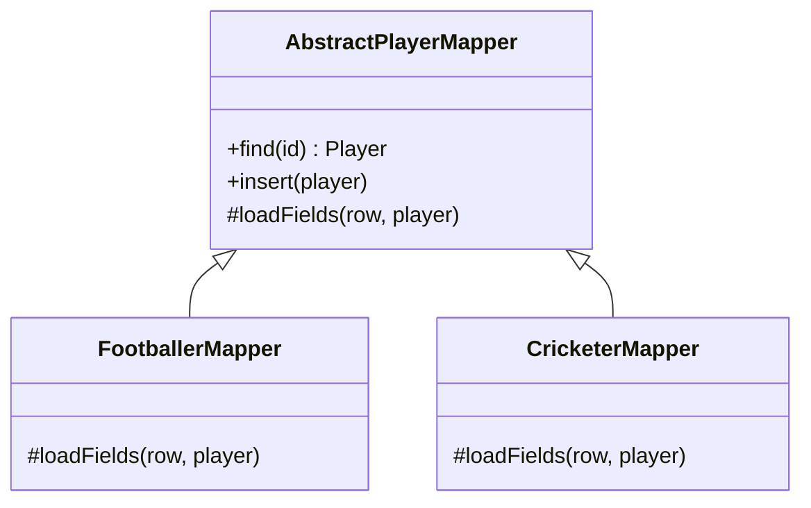

# Inheritance Mappers

## Descrição

O Inheritance Mappers organiza os mapeadores de uma hierarquia de herança para que a lógica de mapeamento comum fique em um lugar e a específica de cada classe em outro. Ele é uma estrutura de apoio aos padrões de mapeamento de herança, que definem como o esquema das tabelas é desenhado.

Normalmente há uma classe abstrata de mapeador na raiz, com a lógica comum de carga, inserção e atualização, e um mapeador concreto por classe da hierarquia. Cada concreto trata dos campos próprios e delega à superclasse os campos herdados. Um mapeador de superclasse também pode delegar para os das subclasses ao carregar um objeto cujo tipo concreto ainda não se conhece.

Tanto faz o esquema escolhido (Single Table, Class Table ou Concrete Table): a estrutura de mapeadores segue a hierarquia de classes.

## Problemas que resolve

- Duplicação do código de mapeamento dos campos herdados em cada subclasse.
- Carregar uma superclasse sem saber o tipo concreto da linha.
- Adicionar nova subclasse sem alterar a lógica das outras.

## Quando usar

- Quando o domínio tem hierarquia de herança mapeada por Data Mapper.
- Quando os três esquemas de herança precisam compartilhar uma estrutura de código consistente.

### Quando evitar

- Quando se usa um framework ORM que já resolve herança por metadados.
- Quando a hierarquia é rasa e o mapeamento direto é suficiente.

## Trade-offs

| Ganho | Custo / Risco |
| --- | --- |
| Reuso da lógica comum de mapeamento | Mais classes de mapeador para manter |
| Nova subclasse exige só um novo mapeador | Mapeador de superclasse precisa conhecer as subclasses ou um registro delas |
| Independente do esquema de tabelas escolhido | Código escrito à mão cresce com a hierarquia |

- **Extensibilidade:** adicionar subtipos é local.
- **Complexidade:** o carregamento polimórfico exige uma estratégia de descoberta do tipo.

## Diagrama



O mapeador abstrato guarda o fluxo comum; cada mapeador concreto trata dos campos de sua classe e chama o da superclasse para os campos herdados.

## Exemplo

Uma hierarquia `Player`, `Footballer` e `Cricketer` usa mapeadores em cadeia.

```python
class PlayerMapper:
    def load(self, row):
        player = self.create()
        player.id = row["id"]
        player.name = row["name"]
        return player

class FootballerMapper(PlayerMapper):
    def create(self):
        return Footballer()

    def load(self, row):
        player = super().load(row)
        player.club = row["club"]
        return player
```

## Padrões relacionados

- [Single Table Inheritance](./single-table-inheritance.md) — um dos esquemas que o mapeador de herança implementa.
- [Class Table Inheritance](./class-table-inheritance.md) — outro esquema suportado pela mesma estrutura.
- [Concrete Table Inheritance](./concrete-table-inheritance.md) — terceiro esquema suportado.
- [Data Mapper](../data-source-architectural/data-mapper.md) — padrão cujos mapeadores são organizados em hierarquia.
- [Layer Supertype](../base/layer-supertype.md) — mesma ideia de reunir comportamento comum na raiz da hierarquia.
- [Template Method](../../../coding/gof/behavioral/template-method.md) — o fluxo comum com passos que as subclasses especializam.

## Referência

- [Página do padrão no catálogo do Fowler](https://martinfowler.com/eaaCatalog/inheritanceMappers.html)
- *Patterns of Enterprise Application Architecture*, Martin Fowler (Addison-Wesley, 2002)
