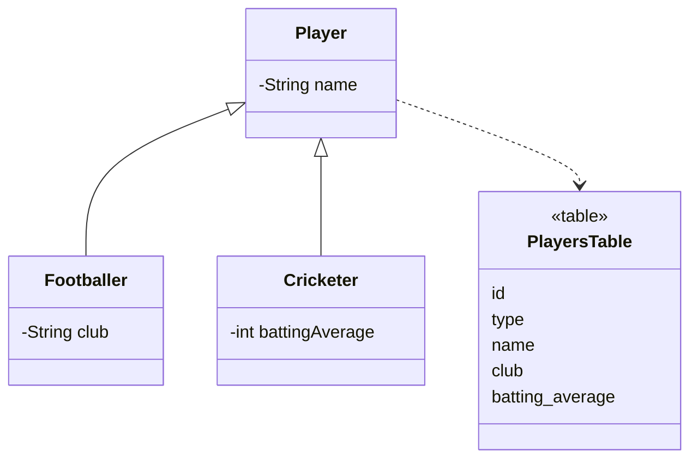

# Single Table Inheritance

## Descrição

O Single Table Inheritance representa uma hierarquia de classes como uma única tabela, com colunas para todos os campos de todas as classes. Cada linha guarda um objeto, e uma coluna discriminadora indica a qual classe concreta ela pertence.

Os campos que não se aplicam a uma subclasse ficam nulos. Ao carregar, o mapeador lê o discriminador para decidir qual classe instanciar.

É o esquema mais simples dos três de herança, e tem a vantagem de não exigir joins nem de a tabela ser alterada quando um campo sobe ou desce na hierarquia.

## Problemas que resolve

- Mapear herança com um esquema simples e sem joins.
- Consultar polimorficamente toda a hierarquia em uma única tabela.

## Quando usar

- Quando a hierarquia é pequena e as subclasses diferem em poucos campos.
- Quando o desempenho de leitura polimórfica importa.
- Quando refatorações movem campos pela hierarquia com frequência.

### Quando evitar

- Quando as subclasses têm muitos campos exclusivos, gerando uma tabela larga e esparsa.
- Quando é necessário `NOT NULL` nas colunas das subclasses.

## Trade-offs

| Ganho | Custo / Risco |
| --- | --- |
| Uma única tabela, sem joins | Colunas nulas desperdiçam espaço |
| Mover campos na hierarquia não muda o esquema | Sem `NOT NULL` nas colunas específicas |
| Consulta polimórfica simples | Tabela cresce e pode virar gargalo; nomes de coluna podem colidir |

- **Integridade:** restrições por subclasse só com `CHECK` condicionais.
- **Legibilidade:** a tabela mistura conceitos diferentes.

## Diagrama



Toda a hierarquia fica em `PlayersTable`; a coluna `type` identifica a subclasse e as colunas específicas ficam nulas nas demais.

## Exemplo

Uma hierarquia de jogadores é mapeada em uma só tabela com discriminador.

```java
@Entity
@Inheritance(strategy = InheritanceType.SINGLE_TABLE)
@DiscriminatorColumn(name = "type")
public abstract class Player {
    @Id @GeneratedValue
    private Long id;
    private String name;
}

@Entity
@DiscriminatorValue("FOOTBALLER")
public class Footballer extends Player {
    private String club;
}
```

No EF Core, é o padrão Table-per-Hierarchy (TPH).

## Padrões relacionados

- [Class Table Inheritance](/application/poeaa/object-relational-structural/class-table-inheritance) — uma tabela por classe, com joins.
- [Concrete Table Inheritance](/application/poeaa/object-relational-structural/concrete-table-inheritance) — uma tabela por classe concreta, sem joins entre tipos.
- [Inheritance Mappers](/application/poeaa/object-relational-structural/inheritance-mappers) — estrutura de mapeadores usada com qualquer um dos três esquemas.
- [Embedded Value](/application/poeaa/object-relational-structural/embedded-value) — outro caso de colunas agrupadas na tabela do dono.

## Referência

- [Página do padrão no catálogo do Fowler](https://martinfowler.com/eaaCatalog/singleTableInheritance.html)
- *Patterns of Enterprise Application Architecture*, Martin Fowler (Addison-Wesley, 2002)
- [Single Table Inheritance na Wikipedia](https://en.wikipedia.org/wiki/Single_Table_Inheritance)
