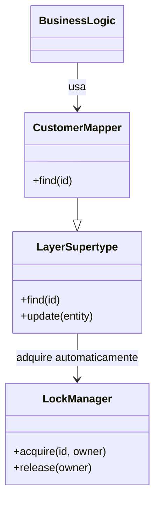

# Implicit Lock

## Descrição

O Implicit Lock permite que código de framework ou de um supertipo de camada adquira bloqueios offline automaticamente, em vez de depender de o desenvolvedor lembrar de fazê-lo em cada ponto de uso. A ideia central de Fowler é que esquecer de adquirir um bloqueio é um bug que pode causar corrupção de dados sutil, difícil de detectar em testes, e portanto o mecanismo não deve ser deixado nas mãos do código de negócio.

Na prática, a aquisição é embutida em um ponto que todo acesso a dados atravessa: os mappers de dados, o Unit of Work ou um Layer Supertype. Ao carregar ou gravar um objeto, essa infraestrutura aplica o bloqueio escolhido (otimista ou pessimista), de forma transparente para o código de aplicação.

O padrão não é um tipo de bloqueio, e sim uma forma de aplicar os demais padrões de lock de modo confiável e centralizado.

## Problemas que resolve

- Desenvolvedores esquecem de adquirir o bloqueio e abrem brechas de concorrência.
- Lógica de bloqueio duplicada e espalhada pela camada de negócio.
- Dificuldade de mudar a estratégia de bloqueio (por exemplo, de otimista para pessimista) sem tocar em todo o código.

## Quando usar

- Em qualquer sistema que adote Optimistic ou Pessimistic Offline Lock em escala.
- Quando há uma camada de acesso a dados única, como mappers ou repositórios.
- Quando se quer que o controle de concorrência seja uma propriedade da infraestrutura, não do caso de uso.

### Quando evitar

- Quando o sistema é pequeno e o bloqueio é necessário em poucos pontos, sendo mais claro fazê-lo explicitamente.
- Quando o acesso aos dados é disperso e não há um ponto central para embutir a lógica.
- Quando o comportamento mágico dificultaria entender ou depurar por que um bloqueio foi (ou não foi) adquirido.

## Trade-offs

| Ganho | Custo / Risco |
| --- | --- |
| Elimina o risco de esquecer o bloqueio | Comportamento menos visível, "mágico" |
| Lógica de concorrência centralizada | Depende de uma infraestrutura bem projetada (mappers, supertypes) |
| Troca de estratégia sem tocar nos casos de uso | Pode adquirir bloqueios desnecessários, reduzindo concorrência |
| Código de negócio mais limpo | Mais difícil depurar problemas de bloqueio |

- **Acoplamento:** o código de negócio fica desacoplado do mecanismo de bloqueio.
- **Testabilidade:** a infraestrutura de lock pode ser testada isoladamente.
- **Consistência:** a garantia vale apenas se todo acesso passar pelo ponto central.

## Diagrama



O código de negócio usa apenas o `CustomerMapper`. O `LayerSupertype`, do qual o mapper herda, adquire o bloqueio no `LockManager` sempre que um objeto é carregado ou alterado.

## Exemplo

Todos os mappers herdam de um supertipo que adquire o bloqueio pessimista ao carregar uma entidade para edição, sem que o caso de uso precise chamar o lock manager.

```typescript
abstract class LockingMapper<T extends { id: string }> {
  constructor(private locks: LockManager, private session: Session) {}

  async findForUpdate(id: string): Promise<T> {
    // bloqueio adquirido de forma implicita
    await this.locks.acquire(this.resourceKey(id), this.session.id);
    return this.load(id);
  }

  protected abstract resourceKey(id: string): string;
  protected abstract load(id: string): Promise<T>;
}

class CustomerMapper extends LockingMapper<Customer> {
  protected resourceKey(id: string) { return `customer:${id}`; }
  protected async load(id: string) { /* SELECT ... */ return {} as Customer; }
}

// Caso de uso: nao menciona locks
const customer = await customerMapper.findForUpdate("42");
```

Frameworks como o Hibernate aplicam a verificação de `@Version` implicitamente em todo `flush`, sem código extra no domínio.

## Padrões relacionados

- [Optimistic Offline Lock](/application/poeaa/offline-concurrency/optimistic-offline-lock) — estratégia cuja aplicação pode ser tornada implícita.
- [Pessimistic Offline Lock](/application/poeaa/offline-concurrency/pessimistic-offline-lock) — idem, com aquisição automática ao carregar objetos.
- [Coarse-Grained Lock](/application/poeaa/offline-concurrency/coarse-grained-lock) — a aquisição implícita deve respeitar o bloqueio do grupo.
- [Layer Supertype](/application/poeaa/base/layer-supertype) — local clássico para embutir a lógica de bloqueio.
- [Unit of Work](/application/poeaa/object-relational-behavioral/unit-of-work) — outro ponto central em que o bloqueio pode ser aplicado automaticamente.

## Referência

- [Página do padrão no catálogo do Fowler](https://martinfowler.com/eaaCatalog/implicitLock.html)
- *Patterns of Enterprise Application Architecture*, Martin Fowler (Addison-Wesley, 2002)
