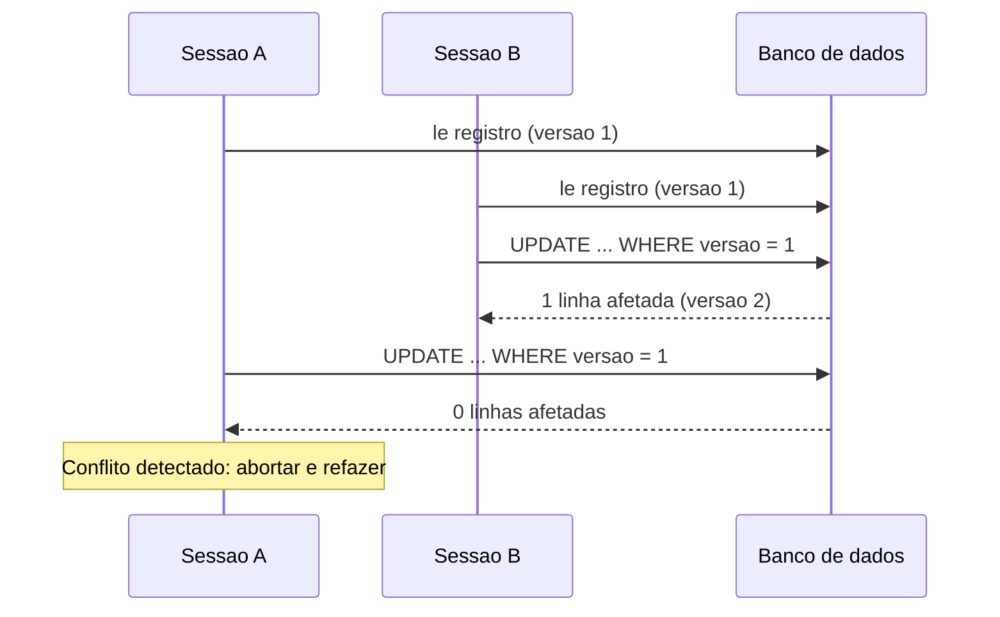

# Optimistic Offline Lock

## Descrição

O Optimistic Offline Lock evita conflitos entre transações de negócio concorrentes validando, no momento do commit, que ninguém alterou os dados que a sessão leu. Ele parte da premissa de que conflitos são raros: não bloqueia nada durante a leitura nem durante a edição, e só detecta o problema na hora de gravar.

A implementação típica associa a cada registro um número de versão (ou timestamp). Ao carregar o dado, a sessão guarda a versão lida; ao gravar, o `UPDATE` inclui a condição `WHERE id = ? AND version = ?` e incrementa a versão. Se nenhuma linha for afetada, outra transação de negócio já modificou o registro e a gravação falha, normalmente forçando a sessão a abortar, recarregar e refazer o trabalho.

Como a transação de negócio se estende por várias requisições (e, portanto, várias transações de banco), as transações de banco sozinhas não protegem contra a perda de atualizações. Este padrão leva a verificação de consistência para a camada de aplicação.

## Problemas que resolve

- Lost update: duas sessões leem o mesmo registro, editam e a última gravação sobrescreve silenciosamente a primeira.
- Leituras inconsistentes quando uma transação de negócio depende de dados que mudaram no meio do caminho.
- Necessidade de concorrência alta sem manter bloqueios durante o tempo de reflexão do usuário.

## Quando usar

- Quando a probabilidade de conflito é baixa e o custo de refazer o trabalho é aceitável.
- Quando a maioria das sessões é de leitura ou toca registros diferentes.
- Em APIs HTTP e UIs web, em que não se pode manter bloqueios entre requisições.

### Quando evitar

- Quando conflitos são frequentes ou o custo de perder o trabalho do usuário é alto; o Pessimistic Offline Lock é mais adequado.
- Quando o sistema não consegue lidar com falhas de commit de forma amigável (sem fluxo de retry ou de resolução de conflito).
- Quando a atualização é feita por processos que não respeitam a coluna de versão.

## Trade-offs

| Ganho | Custo / Risco |
| --- | --- |
| Alta concorrência, sem bloqueios longos | Conflito só é descoberto no commit, depois do trabalho feito |
| Implementação simples (uma coluna de versão) | Exige tratar falhas e definir política de retry ou merge |
| Sem risco de deadlock ou de bloqueios órfãos | Todas as escritas precisam passar pela verificação de versão |
| Escala bem em ambientes web e distribuídos | Em cenários de alta contenção, gera muito retrabalho |

- **Consistência:** garante que nenhuma atualização perdida passe despercebida, mas não impede leituras sujas durante a sessão.
- **Desempenho:** sem custo de bloqueio; o único custo é a condição extra no `UPDATE`.
- **Usabilidade:** o usuário pode perder minutos de edição se o conflito ocorrer no final.

## Diagrama



A sessão B grava primeiro e incrementa a versão. A sessão A tenta gravar com a versão antiga, não afeta nenhuma linha e detecta o conflito.

## Exemplo

Dois atendentes abrem o mesmo cadastro de cliente. O primeiro salva; o segundo, ao salvar, recebe um erro de conflito em vez de sobrescrever a alteração. Em JPA, basta anotar um campo com `@Version`; em HTTP, o mesmo efeito vem com `ETag` e `If-Match`.

```java
@Entity
class Customer {
    @Id Long id;
    String name;

    @Version
    long version; // o Hibernate adiciona "AND version = ?" ao UPDATE
}

try {
    customer.setName("Novo nome");
    entityManager.flush();
} catch (OptimisticLockException e) {
    // outro usuario alterou o registro: recarregar e pedir nova decisao
}
```

```sql
UPDATE customer
   SET name = 'Novo nome', version = version + 1
 WHERE id = 42 AND version = 7;  -- 0 linhas => conflito
```

## Padrões relacionados

- [Pessimistic Offline Lock](./pessimistic-offline-lock.md) — alternativa para alta contenção: bloqueia antes de editar em vez de validar depois.
- [Coarse-Grained Lock](./coarse-grained-lock.md) — faz um único número de versão proteger um grupo de objetos relacionados.
- [Implicit Lock](./implicit-lock.md) — garante que a verificação de versão não seja esquecida pelo código de aplicação.
- [Unit of Work](../object-relational-behavioral/unit-of-work.md) — normalmente é quem aplica a verificação de versão ao gravar as mudanças.
- [Layer Supertype](../base/layer-supertype.md) — local comum para o campo de versão compartilhado pelas entidades.

## Referência

- [Página do padrão no catálogo do Fowler](https://martinfowler.com/eaaCatalog/optimisticOfflineLock.html)
- *Patterns of Enterprise Application Architecture*, Martin Fowler (Addison-Wesley, 2002)
- [Optimistic concurrency control na Wikipedia](https://en.wikipedia.org/wiki/Optimistic_concurrency_control)
