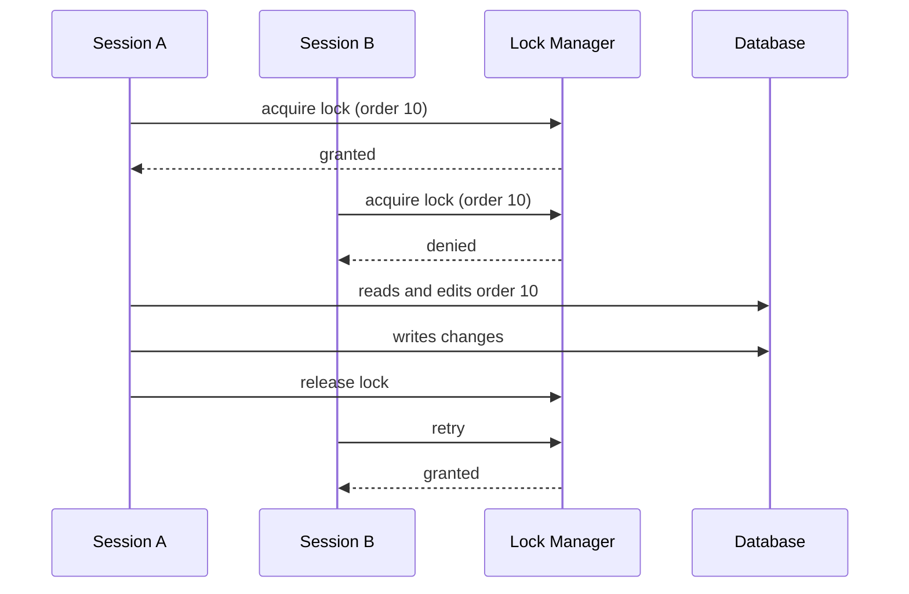

# Pessimistic Offline Lock

## Descrição

O Pessimistic Offline Lock previne conflitos entre transações de negócio concorrentes permitindo que apenas uma sessão por vez edite um dado. A sessão precisa adquirir o bloqueio antes de começar a trabalhar com o registro e só o libera ao concluir a transação de negócio. Assim, o conflito é evitado desde o início, em vez de detectado no fim.

Como a transação de negócio abrange várias transações de banco, os bloqueios do próprio banco não servem: é preciso um gerenciador de bloqueios próprio (lock manager), geralmente uma tabela com o identificador do recurso e o dono do bloqueio, com restrição de unicidade. O Fowler descreve tipos de bloqueio (exclusivo de escrita, exclusivo de leitura e leitura/escrita) e a necessidade de definir o que ocorre quando o bloqueio não é obtido, além de tratar bloqueios órfãos com timeout.

O padrão é a opção mais segura quando perder o trabalho do usuário é inaceitável, ao custo de reduzir a concorrência.

## Problemas que resolve

- Conflitos frequentes ou caros, em que o retrabalho do Optimistic Offline Lock seria inaceitável.
- Transações de negócio longas, em que o usuário não pode descobrir o conflito apenas no final.
- Leituras que precisam de garantia de que o dado não mude durante a sessão.

## Quando usar

- Quando a chance de conflito é alta ou o custo de falhar no commit é maior que o custo de bloquear.
- Quando o trabalho do usuário é longo e não pode ser refeito facilmente.
- Quando se precisa de consistência de leitura além da simples detecção de conflitos de escrita.

### Quando evitar

- Quando conflitos são raros; o Optimistic Offline Lock é mais simples e escala melhor.
- Quando a aplicação é de altíssima concorrência e não tolera esperas.
- Quando não se pode garantir a liberação confiável dos bloqueios (sessões que caem, clientes que somem sem timeout).

## Trade-offs

| Ganho | Custo / Risco |
| --- | --- |
| Elimina conflitos de escrita antes de começarem | Reduz concorrência: outros usuários esperam ou são recusados |
| Usuário nunca perde trabalho por conflito | Risco de deadlock e de bloqueios órfãos |
| Permite consistência de leitura | Exige lock manager, timeouts e política de ordem de aquisição |
| Comportamento previsível para o usuário | Complexidade operacional maior |

- **Consistência:** máxima, desde que todo acesso passe pelo lock manager.
- **Desempenho:** custo de uma ida extra ao lock manager e potencial de espera.
- **Operação:** exige monitorar e limpar bloqueios expirados.

## Diagrama



A sessão A obtém o bloqueio e trabalha sem concorrência. A sessão B é recusada até que A libere o recurso.

## Exemplo

Um sistema de edição de documentos permite que apenas um redator edite um contrato por vez. Uma tabela de bloqueios com chave primária no recurso garante a exclusividade: o `INSERT` falha se outro já detém o bloqueio.

```sql
CREATE TABLE app_lock (
  resource_id VARCHAR(100) PRIMARY KEY,
  owner       VARCHAR(100) NOT NULL,
  expires_at  TIMESTAMP    NOT NULL
);
```

```python
def acquire(conn, resource_id, owner, ttl_seconds=300):
    try:
        conn.execute(
            "INSERT INTO app_lock VALUES (?, ?, now() + ?)",
            (resource_id, owner, ttl_seconds),
        )
        return True
    except UniqueViolation:
        return False  # outro usuario detem o bloqueio

def release(conn, resource_id, owner):
    conn.execute(
        "DELETE FROM app_lock WHERE resource_id = ? AND owner = ?",
        (resource_id, owner),
    )
```

## Padrões relacionados

- [Optimistic Offline Lock](./optimistic-offline-lock.md) — a alternativa que detecta conflitos no commit em vez de preveni-los.
- [Coarse-Grained Lock](./coarse-grained-lock.md) — permite bloquear um grupo de objetos com um único bloqueio.
- [Implicit Lock](./implicit-lock.md) — faz com que a aquisição do bloqueio aconteça automaticamente, sem depender do desenvolvedor.
- [Unit of Work](../object-relational-behavioral/unit-of-work.md) — ponto natural para liberar os bloqueios ao final da transação de negócio.

## Referência

- [Página do padrão no catálogo do Fowler](https://martinfowler.com/eaaCatalog/pessimisticOfflineLock.html)
- *Patterns of Enterprise Application Architecture*, Martin Fowler (Addison-Wesley, 2002)
