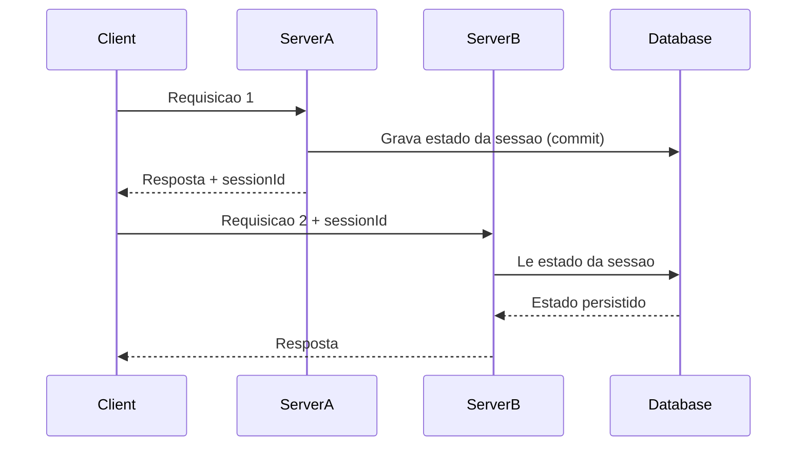

# Database Session State

## Descrição

O Database Session State armazena os dados da sessão como dados confirmados (committed) no banco de dados. Em vez de manter o estado em memória ou no cliente, cada interação grava as informações da sessão em tabelas, normalmente associadas a um identificador de sessão ou de processo.

A diferença central em relação aos outros padrões é a distinção entre dados da sessão e dados de negócio efetivados. Fowler discute duas abordagens: gravar os dados pendentes em tabelas separadas de sessão, ou gravá-los nas tabelas reais marcados como pendentes (com um indicador de status), o que torna as consultas mais complexas, pois precisam filtrar dados pendentes.

Como o estado vive no banco, o servidor fica sem estado e qualquer instância pode atender a próxima requisição. Isso também permite que a sessão sobreviva a falhas e a longos períodos de inatividade, como em fluxos que duram dias.

## Problemas que resolve

- Sessões longas (processos de aprovação, cadastros em várias etapas) que precisam sobreviver a reinícios e a dias de inatividade.
- Estado de sessão que deve ser durável, auditável e recuperável após falhas.
- Necessidade de retomar o trabalho em outro dispositivo ou outra instância.
- Estado grande demais para o cliente e crítico demais para ficar só em memória.

## Quando usar

- Quando a durabilidade da sessão é mais importante que a velocidade de acesso.
- Quando o fluxo de trabalho é longo e pode ser retomado depois, inclusive por outra pessoa ou dispositivo.
- Quando já existe um banco confiável e se quer evitar um componente adicional como o Redis.
- Quando o estado pendente precisa participar de transações com os dados de negócio.

### Quando evitar

- Quando o estado é pequeno, de curta duração e de alto volume de leitura; o banco vira gargalo.
- Quando a latência de cada requisição precisa ser mínima.
- Quando a limpeza de sessões abandonadas não pode ser tratada (exige rotinas de expiração).
- Quando dados pendentes misturados às tabelas reais complicariam consultas e relatórios.

## Trade-offs

| Ganho | Custo / Risco |
| --- | --- |
| Durabilidade e recuperação após falhas | Leituras e escritas no banco a cada requisição aumentam a latência |
| Servidor sem estado, instâncias intercambiáveis | Carga extra no banco, que costuma ser o recurso mais difícil de escalar |
| Sessão retomável por dias, em qualquer dispositivo | Necessidade de limpar sessões abandonadas |
| Estado participa de transações e é auditável | Dados pendentes nas tabelas reais complicam consultas e regras |

- **Consistência:** estado e dados de negócio podem ser atualizados na mesma transação.
- **Concorrência:** requisições simultâneas da mesma sessão exigem controle (por exemplo, lock otimista).
- **Operação:** rotinas de expiração são parte do padrão, não um detalhe.

## Diagrama



O `Client` mantém apenas o `sessionId`. Qualquer servidor lê e grava o estado no `Database`, que é a fonte única e durável da sessão.

## Exemplo

Um cadastro de seguro com várias etapas é salvo a cada passo em uma tabela `session_state`, com expiração em 7 dias. O usuário pode voltar de outro dispositivo e continuar.

```python
import json
import sqlite3

db = sqlite3.connect("app.db")
db.execute("""CREATE TABLE IF NOT EXISTS session_state (
    session_id TEXT PRIMARY KEY,
    data TEXT NOT NULL,
    expires_at TEXT NOT NULL)""")

def save(session_id: str, data: dict) -> None:
    with db:
        db.execute(
            "INSERT OR REPLACE INTO session_state VALUES (?, ?, datetime('now', '+7 days'))",
            (session_id, json.dumps(data)))

def load(session_id: str) -> dict | None:
    row = db.execute(
        "SELECT data FROM session_state WHERE session_id = ? AND expires_at > datetime('now')",
        (session_id,)).fetchone()
    return json.loads(row[0]) if row else None
```

Frameworks como Django (`django.contrib.sessions.backends.db`) e Laravel (driver `database`) oferecem esse armazenamento.

## Padrões relacionados

- [Client Session State](./client-session-state.md) — mantém o estado no cliente, sem tocar o banco.
- [Server Session State](./server-session-state.md) — mantém o estado no servidor ou em um cache, mais rápido porém menos durável.
- [Optimistic Offline Lock](../offline-concurrency/optimistic-offline-lock.md) — protege contra gravações concorrentes sobre o mesmo estado de sessão.
- [Serialized LOB](../object-relational-structural/serialized-lob.md) — o estado costuma ser guardado como um objeto serializado em uma coluna.

## Referência

- [Página do padrão no catálogo do Fowler](https://martinfowler.com/eaaCatalog/databaseSessionState.html)
- *Patterns of Enterprise Application Architecture*, Martin Fowler (Addison-Wesley, 2002)
