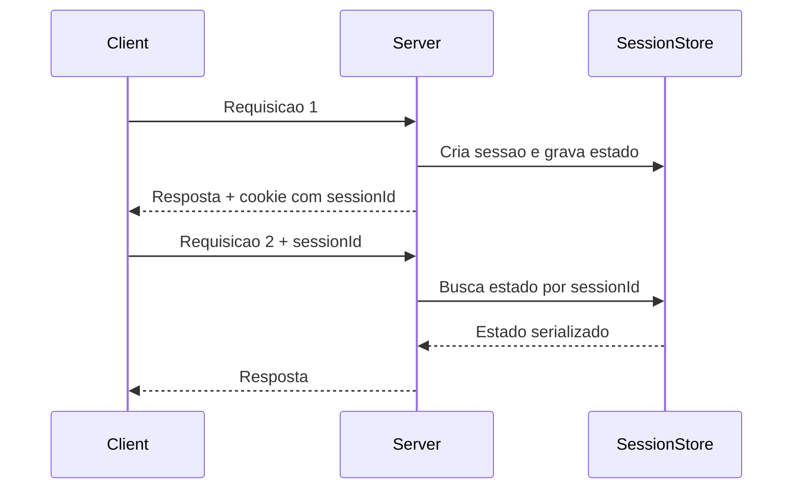

# Server Session State

## Descrição

O Server Session State mantém o estado da sessão no servidor, em forma serializada ou como objetos em memória. O cliente recebe apenas um identificador de sessão (normalmente em um cookie) e o envia a cada requisição; o servidor usa esse identificador para localizar os dados correspondentes.

O estado pode viver na memória do processo, em um objeto serializado em arquivo ou em um armazenamento externo e rápido, como Redis ou Memcached. Esse armazenamento é tratado como cache de sessão: perdê-lo não corrompe dados de negócio, apenas obriga o usuário a recomeçar.

Em memória local, a abordagem é simples e rápida, mas prende o usuário a uma instância (sticky sessions). Com um session store compartilhado, as instâncias voltam a ser intercambiáveis, ao custo de uma ida à rede por requisição.

## Problemas que resolve

- Estado de sessão grande ou sensível que não deve trafegar pelo cliente.
- Acesso rápido a dados de sessão sem ir ao banco principal a cada requisição.
- Necessidade de invalidar uma sessão de imediato (logout, bloqueio de conta).
- Objetos de sessão complexos que seriam caros ou inseguros de enviar ao cliente.

## Quando usar

- Quando o estado é maior do que o cliente comporta ou contém dados que devem ficar no servidor.
- Quando a revogação imediata de sessões é um requisito.
- Quando há um session store compartilhado (Redis) que permite manter as instâncias intercambiáveis.
- Quando a perda ocasional da sessão é tolerável.

### Quando evitar

- Quando o estado precisa sobreviver a reinícios e falhas sem exceção; prefira persistir em banco.
- Quando se usa memória local em várias instâncias sem sticky sessions, o que causa sessões "perdidas".
- Quando o volume de sessões simultâneas pode esgotar a memória do servidor.
- Quando se deseja servidores completamente stateless.

## Trade-offs

| Ganho | Custo / Risco |
| --- | --- |
| Acesso rápido ao estado, sem sair da camada de aplicação | Consome memória do servidor ou do store por sessão ativa |
| Cliente leve: só carrega um identificador | Sticky sessions ou store compartilhado para escalar |
| Revogação imediata e controle total do estado | Perda do estado em falha, se for apenas em memória |
| Suporta objetos complexos e dados sensíveis | Store compartilhado vira ponto de falha e adiciona latência de rede |

- **Escalabilidade:** a memória local limita o balanceamento; o store externo o libera.
- **Segurança:** o identificador de sessão é a credencial e precisa ser aleatório, com cookie `HttpOnly` e `Secure`.
- **Limpeza:** é preciso definir expiração (TTL) para não acumular sessões abandonadas.

## Diagrama



O `Client` guarda apenas o `sessionId`. O `Server` consulta o `SessionStore` (memória local ou Redis) para recuperar o estado a cada requisição.

## Exemplo

Um carrinho de compras fica em Redis, indexado pelo identificador de sessão, com expiração de 30 minutos sem atividade.

```python
import json, secrets
import redis

r = redis.Redis()
TTL = 30 * 60

def create_session(data: dict) -> str:
    session_id = secrets.token_urlsafe(32)
    r.setex(f"session:{session_id}", TTL, json.dumps(data))
    return session_id

def load_session(session_id: str) -> dict | None:
    raw = r.get(f"session:{session_id}")
    if raw is None:
        return None
    r.expire(f"session:{session_id}", TTL)  # renova a expiração
    return json.loads(raw)
```

Aparece como `HttpSession` no Java EE, `Session` no ASP.NET e `express-session` com Redis no Node.js.

## Padrões relacionados

- [Client Session State](/application/poeaa/session-state/client-session-state) — mantém o estado no cliente, deixando o servidor sem estado.
- [Database Session State](/application/poeaa/session-state/database-session-state) — persiste o estado como dados confirmados no banco, com mais durabilidade e menos velocidade.
- [Cache-Aside](/cloud/cloud-design-patterns/data-management/cache-aside) — o session store em Redis usa o mesmo tipo de armazenamento em cache, com expiração.
- [Registry](/application/poeaa/base/registry) — ambos mantêm dados de contexto acessíveis a vários pontos da aplicação, mas o Registry não é indexado por sessão.

## Referência

- [Página do padrão no catálogo do Fowler](https://martinfowler.com/eaaCatalog/serverSessionState.html)
- *Patterns of Enterprise Application Architecture*, Martin Fowler (Addison-Wesley, 2002)
