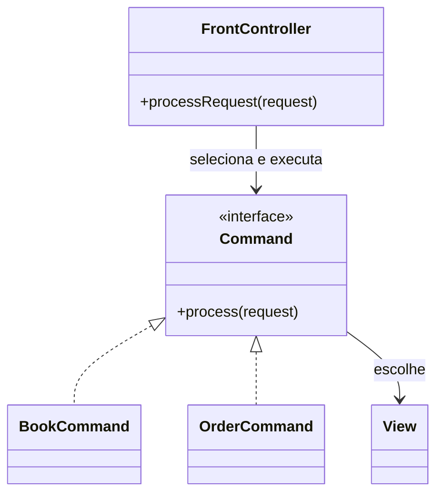

# Front Controller

## Descrição

O Front Controller é um único controller que trata todas as requisições de um site. Ele é dividido em duas partes: um **handler** de entrada, que recebe a requisição e executa o comportamento comum (autenticação, localização, logging), e uma hierarquia de **commands** (ações) para as quais ele delega o tratamento específico de cada requisição.

O handler decide qual command executar, normalmente com base em um mapeamento de URL configurado em arquivo ou descoberto por convenção, e o command escolhe a view. Como o command é uma classe comum, e não um script ligado à URL, o mapeamento pode ser alterado dinamicamente sem mexer no servidor web.

## Problemas que resolve

- Lógica transversal (segurança, sessão, i18n) duplicada em cada Page Controller.
- Necessidade de interceptar todas as requisições em um único ponto.
- Dificuldade de mudar o mapeamento entre URLs e comportamento sem reconfigurar o servidor.

## Quando usar

- Em aplicações com comportamento comum a todas as requisições.
- Quando se quer configurar roteamento e filtros de forma centralizada.
- Quando se precisa de extensibilidade por meio de handlers ou filtros encadeados.

### Quando evitar

- Em sites muito simples, em que o ponto único de entrada é mais complexidade do que benefício.
- Quando o framework já fornece um, e criar outro por cima seria redundante.

## Trade-offs

| Ganho | Custo / Risco |
| --- | --- |
| Comportamento comum implementado uma única vez | Ponto único de falha e possível gargalo, caso mal implementado |
| Roteamento configurável e dinâmico | Mais complexidade inicial que um Page Controller |
| Fácil adicionar filtros e interceptadores | Handler pode virar um "god object" |
| Commands são objetos simples e testáveis | Exige configuração ou convenção de mapeamento |

- **Acoplamento:** os commands não conhecem a infraestrutura HTTP quando bem projetados.
- **Consistência:** segurança e políticas transversais aplicadas de modo uniforme.
- **Desempenho:** um único handler não é problema na prática, pois é leve e sem estado.

## Diagrama



O `FrontController` recebe todas as requisições, escolhe o `Command` apropriado e delega. O command executa a lógica e seleciona a `View`.

## Exemplo

Todas as requisições passam por um servlet que mapeia o caminho para um command, aplicando autenticação antes de delegar.

```java
public class FrontServlet extends HttpServlet {
    private final Map<String, Command> routes = Map.of(
        "/books", new BookCommand(),
        "/orders", new OrderCommand());

    @Override
    protected void service(HttpServletRequest req, HttpServletResponse resp)
            throws IOException {
        if (req.getSession(false) == null) {
            resp.sendRedirect("/login");
            return;
        }
        Command cmd = routes.getOrDefault(req.getPathInfo(), new NotFoundCommand());
        cmd.process(req, resp);
    }
}
```

O `DispatcherServlet` do Spring MVC, o pipeline de middleware do ASP.NET Core e o roteador do Rails são Front Controllers. Em SPAs, o router do cliente (React Router, Angular Router) cumpre papel análogo no navegador, e API gateways o fazem na borda.

## Padrões relacionados

- [Page Controller](./page-controller.md) — alternativa com um controller por página.
- [Application Controller](./application-controller.md) — pode ser chamado pelo Front Controller para decidir fluxo de telas.
- [Model View Controller](./model-view-controller.md) — o Front Controller realiza o papel de controller.
- [Command](../../../coding/gof/behavioral/command.md) — as ações delegadas pelo handler são commands.
- [Chain of Responsibility](../../../coding/gof/behavioral/chain-of-responsibility.md) — filtros e interceptadores são encadeados dessa forma.
- [Facade](../../../coding/gof/structural/facade.md) — o Front Controller funciona como fachada de entrada da camada web.
- [Backend for Front-end](../../../cloud/azure/gateways-and-edge/backends-for-frontends.md) — ponto de entrada dedicado por tipo de cliente em arquiteturas distribuídas.

## Referência

- [Página do padrão no catálogo do Fowler](https://martinfowler.com/eaaCatalog/frontController.html)
- *Patterns of Enterprise Application Architecture*, Martin Fowler (Addison-Wesley, 2002)
- [Front controller na Wikipedia](https://en.wikipedia.org/wiki/Front_controller)
