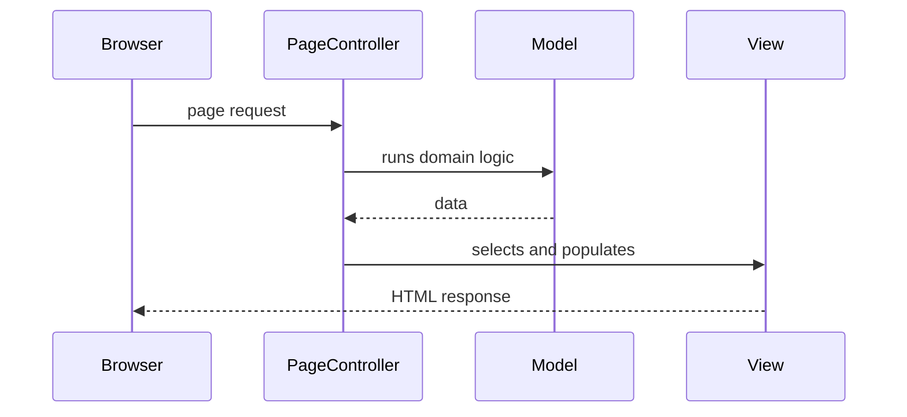

# Page Controller

## Descrição

O Page Controller é um objeto que trata a requisição de uma página ou ação específica de um site. Cada página (ou cada ação lógica) tem seu próprio controller, que extrai os dados da requisição, invoca a lógica de domínio e escolhe a view que produzirá a resposta.

O controller pode ser a própria página (como em scripts CGI, servlets ou code-behind) ou um objeto separado associado a uma URL. O mapeamento entre URL e controller é feito normalmente pelo servidor web ou por convenção de nome, sem um ponto de entrada central. Lógica comum a várias páginas pode ir para uma classe base ou para helpers.

## Problemas que resolve

- Misturar lógica de controle e de formatação em um mesmo script de página.
- Falta de um lugar claro para receber a entrada e decidir o fluxo de uma tela.
- Necessidade de um modelo simples para sites em que cada URL corresponde a uma tela.

## Quando usar

- Em sites com lógica de navegação simples, em que cada página tem comportamento próprio.
- Quando o framework já mapeia URLs diretamente para handlers (code-behind, servlets, ASP.NET Web Forms).
- Quando se quer o modelo mais simples de entender para uma equipe pequena.

### Quando evitar

- Quando há muito comportamento comum (autenticação, logging, i18n) que seria duplicado em cada controller; um Front Controller é mais adequado.
- Quando a navegação é complexa e depende de decisões dinâmicas sobre qual tela mostrar.

## Trade-offs

| Ganho | Custo / Risco |
| --- | --- |
| Modelo simples: uma página, um controller | Duplicação de comportamento comum entre controllers |
| Fácil localizar o código de cada tela | Sem ponto único para interceptar requisições |
| Controllers pequenos e independentes | Herança de classe base pode virar depósito de lógica compartilhada |
| Cada controller é testável isoladamente | Mudanças transversais exigem tocar muitos arquivos |

- **Acoplamento:** controllers independentes entre si; o acoplamento se concentra na classe base compartilhada.
- **Testabilidade:** boa, desde que o controller não dependa diretamente do contexto HTTP.
- **Complexidade:** baixa, a mais simples entre as opções de controller.

## Diagrama



O navegador chama diretamente o controller da página; ele consulta o model e entrega os dados à view, que gera a resposta.

## Exemplo

Uma página de perfil de usuário tem um controller próprio que lê o parâmetro da URL, busca o usuário e renderiza o template.

```java
@WebServlet("/profile")
public class ProfileController extends HttpServlet {
    private final UserService users = new UserService();

    @Override
    protected void doGet(HttpServletRequest req, HttpServletResponse resp)
            throws ServletException, IOException {
        long id = Long.parseLong(req.getParameter("id"));
        User user = users.find(id);
        req.setAttribute("user", user);
        req.getRequestDispatcher("/WEB-INF/profile.jsp").forward(req, resp);
    }
}
```

Em Spring MVC, um método `@GetMapping` em um `@Controller` é um Page Controller por ação, apesar do `DispatcherServlet` ser um Front Controller por baixo. ASP.NET Web Forms (code-behind) e Razor Pages seguem o mesmo modelo.

## Padrões relacionados

- [Front Controller](./front-controller.md) — alternativa com um único ponto de entrada para todas as requisições.
- [Model View Controller](./model-view-controller.md) — o Page Controller é uma forma de realizar o papel de controller.
- [Template View](./template-view.md) — view típica escolhida por um Page Controller.
- [Application Controller](./application-controller.md) — pode decidir fluxo de telas quando a navegação é complexa.
- [Template Method](../../../coding/gof/behavioral/template-method.md) — usado em classes base de controllers para fixar o fluxo comum.

## Referência

- [Página do padrão no catálogo do Fowler](https://martinfowler.com/eaaCatalog/pageController.html)
- *Patterns of Enterprise Application Architecture*, Martin Fowler (Addison-Wesley, 2002)
