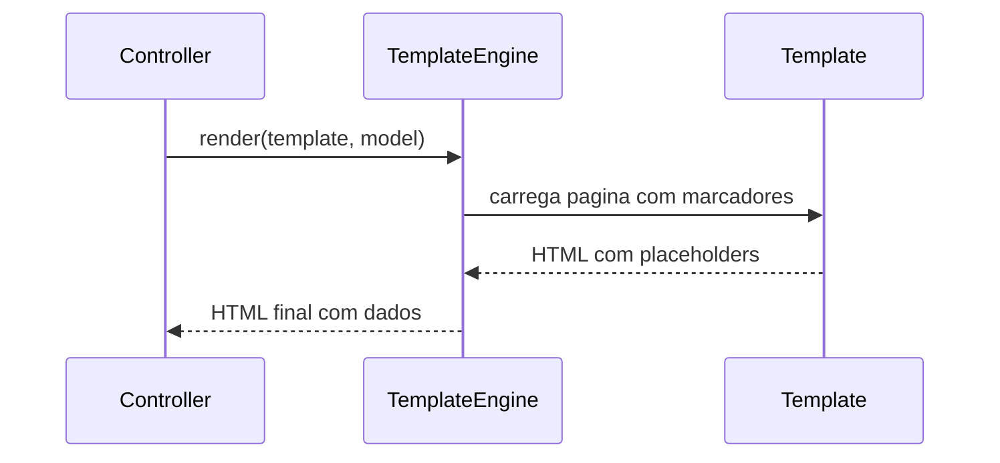

# Template View

## Descrição

O Template View renderiza informação em HTML incorporando marcadores em uma página estática. O desenvolvedor escreve a página como se fosse HTML comum, com pontos onde dados dinâmicos são inseridos, e em tempo de execução um motor substitui os marcadores pelos valores do model.

Os marcadores podem ser tags customizadas, expressões ou, nas formas mais problemáticas, trechos de código (scriptlets). Como a estrutura do HTML fica visível no arquivo, designers podem trabalhar o layout diretamente, o que é a grande vantagem do padrão frente à geração de HTML por código.

## Problemas que resolve

- Gerar HTML por concatenação de strings em código, difícil de ler e de manter.
- Dificuldade de designers editarem a aparência sem mexer em código.
- Necessidade de visualizar a estrutura da página sem executar a aplicação.

## Quando usar

- Em aplicações web que renderizam HTML no servidor (SSR).
- Quando a página tem estrutura fixa com poucos pontos dinâmicos.
- Quando designers e programadores colaboram nos mesmos arquivos.

### Quando evitar

- Quando as páginas exigem muita lógica de apresentação, que tende a vazar para os templates.
- Quando a mesma saída precisa de formatos muito diferentes, caso em que Transform View pode ser melhor.
- Quando a aparência do site inteiro precisa mudar de forma centralizada (considere Two Step View).

## Trade-offs

| Ganho | Custo / Risco |
| --- | --- |
| Estrutura da página legível e editável por designers | Lógica de negócio e scriptlets podem invadir o template |
| Desenvolvimento rápido de páginas | Difícil testar a lógica embutida no template |
| Separação natural entre controller e view | Mudar o layout global exige alterar muitos templates |
| Ferramentas e motores maduros disponíveis | Erros em tempo de execução, muitas vezes só detectados ao renderizar |

- **Acoplamento:** o template depende de um model simples; mantenha-o sem regras de negócio.
- **Testabilidade:** testes de renderização são mais pesados que testes de código; evite lógica no template.
- **Desempenho:** motores costumam compilar e cachear templates, com custo baixo.

## Diagrama



O controller entrega o model ao motor de templates, que carrega a página com marcadores e devolve o HTML com os valores substituídos.

## Exemplo

Uma página lista pedidos do cliente. O template contém o HTML e apenas marcadores simples; o controller fornece a lista.

```html
<!-- orders.html (Thymeleaf) -->
<h1 th:text="${customer.name}">Cliente</h1>
<table>
  <tr th:each="o : ${orders}">
    <td th:text="${o.id}">1</td>
    <td th:text="${#numbers.formatDecimal(o.total, 1, 2)}">0,00</td>
  </tr>
</table>
```

JSP, Razor, Thymeleaf, ERB, Jinja e Blade são Template Views. Com o retorno do SSR e de frameworks como Next.js, Razor Pages e HTMX, o padrão voltou a ter relevância, mesmo com a predominância de SPAs, que aplicam a mesma ideia com JSX.

## Padrões relacionados

- [Transform View](/application/poeaa/web-presentation/transform-view) — alternativa que transforma dados em HTML por código ou por XSLT, em vez de incorporar marcadores.
- [Two Step View](/application/poeaa/web-presentation/two-step-view) — pode ser construído sobre templates para centralizar a aparência.
- [Model View Controller](/application/poeaa/web-presentation/model-view-controller) — o Template View é a implementação típica da view.
- [Page Controller](/application/poeaa/web-presentation/page-controller) — normalmente escolhe e preenche o template.
- [Server-side page fragment composition](/architecture/microservices/ui-design/server-side-page-fragment-composition) — composição de fragmentos HTML no servidor, em microservices.
- [Template Method](/coding/gof/behavioral/template-method) — layouts com blocos substituíveis usam ideia semelhante.

## Referência

- [Página do padrão no catálogo do Fowler](https://martinfowler.com/eaaCatalog/templateView.html)
- *Patterns of Enterprise Application Architecture*, Martin Fowler (Addison-Wesley, 2002)
