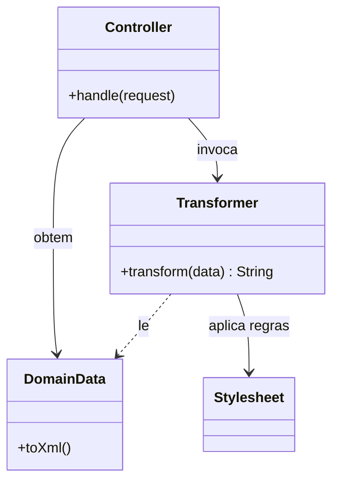

# Transform View

## Descrição

O Transform View é uma view que processa dados de domínio elemento por elemento e os transforma em HTML (ou outro formato). Em vez de partir de uma página com marcadores, ele parte dos dados e aplica regras de transformação que dizem como cada tipo de elemento deve ser exibido.

A implementação clássica usa XSLT: o model é produzido (ou convertido) em XML e uma folha de estilo o transforma em HTML. Mas o padrão também pode ser realizado com código que percorre estruturas de dados e as converte, por exemplo, serializadores JSON ou geradores de relatórios. O fluxo é orientado aos dados, enquanto o Template View é orientado à página.

## Problemas que resolve

- Necessidade de produzir a mesma informação em formatos distintos (HTML, XML, JSON, PDF).
- Dificuldade de testar a lógica de apresentação embutida em templates.
- Risco de lógica de domínio vazar para a view, já que a transformação só enxerga os dados recebidos.

## Quando usar

- Quando a saída é gerada a partir de dados estruturados, como XML ou JSON.
- Quando a apresentação deve ser testada como função pura de entrada e saída.
- Quando a tecnologia de transformação (XSLT, serializadores) já é padrão na organização.

### Quando evitar

- Quando designers precisam editar o HTML diretamente; o Template View é mais amigável.
- Quando a equipe não domina XSLT ou a linguagem de transformação, que tem curva de aprendizado alta.
- Em páginas com layout muito livre e pouco estruturado em torno dos dados.

## Trade-offs

| Ganho | Custo / Risco |
| --- | --- |
| Transformação testável como função de entrada e saída | Curva de aprendizado de XSLT e ferramentas similares |
| Mesma fonte de dados, vários formatos de saída | Difícil para designers visualizarem e editarem a página |
| Isola a view do ambiente web | Menos ferramental de edição visual que HTML com marcadores |
| Evita lógica de domínio na view | Depuração de transformações é mais trabalhosa |

- **Acoplamento:** a view depende apenas do formato dos dados, não do model nem do servidor.
- **Testabilidade:** boa; a transformação pode ser testada com arquivos de entrada e saída esperada.
- **Desempenho:** transformações XML podem ser pesadas; compile e cacheie as folhas de estilo.

## Diagrama



O `Controller` obtém os dados e invoca o `Transformer`, que aplica as regras da `Stylesheet` a cada elemento e devolve a saída.

## Exemplo

Uma lista de produtos em XML é convertida em tabela HTML por uma folha de estilo XSLT, sem acesso ao model.

```xml
<xsl:template match="products">
  <table>
    <xsl:apply-templates select="product"/>
  </table>
</xsl:template>

<xsl:template match="product">
  <tr>
    <td><xsl:value-of select="name"/></td>
    <td><xsl:value-of select="format-number(price, '0.00')"/></td>
  </tr>
</xsl:template>
```

Hoje o padrão aparece sobretudo como serialização de JSON/XML em APIs (Jackson, `System.Text.Json`) e em geradores de relatórios. Em SPAs, o servidor entrega dados e o cliente os transforma em UI, que é essencialmente a mesma ideia levada ao navegador.

## Padrões relacionados

- [Template View](./template-view.md) — alternativa orientada à página, com marcadores no HTML.
- [Two Step View](./two-step-view.md) — pode ser implementado com duas transformações em sequência.
- [Model View Controller](./model-view-controller.md) — o Transform View é uma forma de implementar a view.
- [Data Transfer Object](../distribution/data-transfer-object.md) — os dados transformados costumam ser DTOs ou estruturas serializáveis.
- [Strategy](../../../coding/gof/behavioral/strategy.md) — escolha do transformador conforme o formato de saída.

## Referência

- [Página do padrão no catálogo do Fowler](https://martinfowler.com/eaaCatalog/transformView.html)
- *Patterns of Enterprise Application Architecture*, Martin Fowler (Addison-Wesley, 2002)
