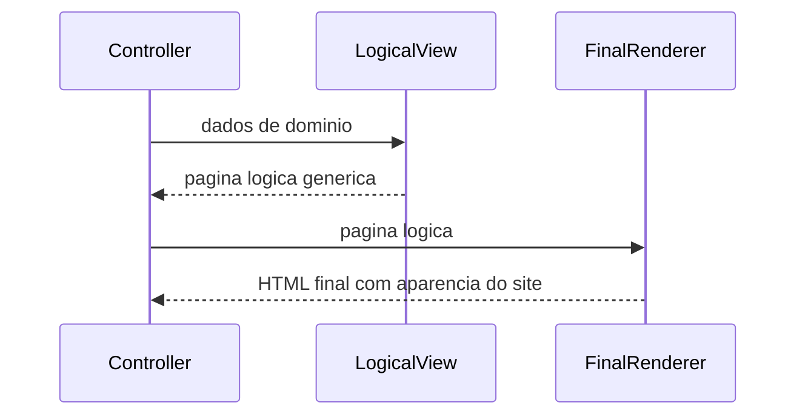

# Two Step View

## Descrição

O Two Step View transforma dados de domínio em HTML em duas etapas. Na primeira, produz-se uma página **lógica**, com elementos de apresentação genéricos (campos, tabelas, títulos, botões) mas sem formatação. Na segunda, essa estrutura lógica é convertida na marcação HTML final, aplicando a aparência do site.

A vantagem é concentrar as decisões visuais na segunda etapa. Para mudar a aparência de todo o site basta alterar um único lugar, enquanto a primeira etapa fica com cada tela, que apenas descreve seu conteúdo. O padrão também permite suportar várias aparências (por exemplo, para clientes ou marcas diferentes) usando uma primeira etapa para todas.

## Problemas que resolve

- Mudanças de visual que exigem alterar dezenas ou centenas de templates.
- Inconsistência de aparência entre telas escritas por pessoas diferentes.
- Necessidade de múltiplos temas ou marcas sobre o mesmo conteúdo.

## Quando usar

- Em sites com muitas telas que devem seguir uma aparência única e centralizada.
- Quando há necessidade de múltiplas aparências sobre o mesmo conteúdo lógico.
- Em portais e sistemas corporativos grandes, com dezenas de telas padronizadas.

### Quando evitar

- Em sites pequenos, em que a camada intermediária é custo sem retorno.
- Quando as páginas têm layouts muito heterogêneos que não cabem em elementos genéricos.
- Quando um sistema de layouts e componentes do próprio framework já resolve a consistência.

## Trade-offs

| Ganho | Custo / Risco |
| --- | --- |
| Aparência alterada em um único lugar | Limita telas que fogem do padrão lógico |
| Consistência visual garantida | Mais complexidade e uma camada de abstração a mais |
| Suporta vários temas sobre o mesmo conteúdo | A linguagem lógica intermediária precisa ser projetada e evoluída |
| Primeira etapa independente de HTML | Menos suporte de ferramentas que Template View |

- **Acoplamento:** telas dependem do vocabulário lógico, não do HTML final.
- **Consistência:** a principal razão de ser do padrão.
- **Complexidade:** alta comparada ao Template View; só compensa em escala.

## Diagrama



A primeira etapa transforma os dados em uma estrutura lógica de apresentação; a segunda a converte em HTML com a aparência do site.

## Exemplo

Cada tela devolve uma estrutura lógica; um único renderizador converte tudo em HTML com o estilo da empresa.

```typescript
type LogicalPage = { title: string; fields: { label: string; value: string }[] };

// Passo 1: específico da tela
const customerScreen = (c: Customer): LogicalPage => ({
  title: `Cliente ${c.name}`,
  fields: [{ label: "E-mail", value: c.email }, { label: "Cidade", value: c.city }],
});

// Passo 2: único para o site inteiro
const renderSite = (p: LogicalPage): string => `
<main class="brand-theme">
  <h1>${p.title}</h1>
  <dl>${p.fields.map(f => `<dt>${f.label}</dt><dd>${f.value}</dd>`).join("")}</dl>
</main>`;

const html = renderSite(customerScreen(customer));
```

Na prática, o padrão aparece em layouts mestres, design systems e bibliotecas de componentes (Razor layouts, Rails layouts, Storybook com componentes React). Em SPAs, componentes genéricos cumprem o papel da segunda etapa.

## Padrões relacionados

- [Template View](/application/poeaa/web-presentation/template-view) — a segunda etapa pode usar templates, ou o padrão pode ser usado em cada passo.
- [Transform View](/application/poeaa/web-presentation/transform-view) — duas transformações em sequência (por exemplo, dois XSLT) realizam o padrão.
- [Model View Controller](/application/poeaa/web-presentation/model-view-controller) — o Two Step View é uma forma de estruturar a view.
- [Client-side UI composition](/architecture/microservices/ui-design/client-side-ui-composition) — composição de UI a partir de componentes em arquiteturas distribuídas.
- [Decorator](/coding/gof/structural/decorator) — a segunda etapa "decora" a página lógica com a aparência do site.

## Referência

- [Página do padrão no catálogo do Fowler](https://martinfowler.com/eaaCatalog/twoStepView.html)
- *Patterns of Enterprise Application Architecture*, Martin Fowler (Addison-Wesley, 2002)
