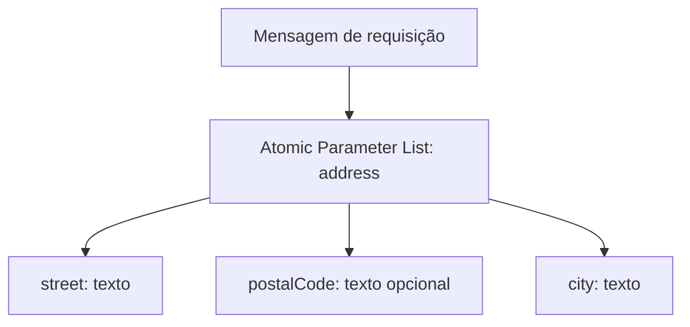

# Atomic Parameter List

## Descrição

O padrão Atomic Parameter List agrupa dois ou mais parâmetros atômicos relacionados em um único elemento coeso de representação, mantendo cada item simples e tornando explícita a ligação entre eles na descrição da API e nas mensagens trocadas. Os itens são identificados por posição (índice) ou por uma chave textual, e a lista como um todo pode receber um nome próprio quando o receptor precisa processá-la como unidade.

Tanto a lista quanto seus elementos podem ser opcionais ou múltiplos, e isso deve aparecer como cardinalidade na [API Description](/architecture/api-patterns/documentation/api-description). Em JSON, costuma ser um objeto plano sem objetos aninhados; em query strings, uma lista separada por vírgulas. O padrão não serve quando a plataforma só permite um valor de retorno ou um objeto por mensagem, caso em que um [Parameter Tree](/architecture/api-patterns/basic-structure/parameter-tree) oferece a expressividade necessária.

## Problemas que resolve

- Um parâmetro isolado não é expressivo o bastante para o dado que precisa ser transmitido
- Valores com forte vínculo semântico (como rua, CEP e cidade) aparecem soltos e sem relação aparente
- A mensagem precisa de partes que cliente, provedor ou intermediários querem distinguir
- Assinaturas de operação com muitos parâmetros avulsos ficam difíceis de ler e de evoluir

## Quando usar

- Para representar registros planos, como um endereço, um período ou um par valor e moeda
- Para listas de campos desejados ou de filtros em uma consulta
- Quando os itens são todos de tipo básico e não há necessidade de aninhamento

## Quando evitar

- Quando um único valor basta: use um [Atomic Parameter](/architecture/api-patterns/basic-structure/atomic-parameter)
- Quando os itens têm subestrutura ou relações de contenção: use um [Parameter Tree](/architecture/api-patterns/basic-structure/parameter-tree)
- Quando a plataforma ou a linguagem não aceita múltiplos escalares na mesma mensagem

## Trade-offs

| Ganho | Custo / Risco |
| --- | --- |
| A relação entre os valores fica explícita e documentada | Adicionar itens muda o contrato e pode quebrar clientes |
| Cada item continua simples de ler e de validar | Identificar por posição é compacto, mas frágil se a ordem mudar |
| Mapeia bem para query strings e objetos planos | Não expressa hierarquia nem coleções de registros |

- **Nomes e ordem:** use nomes do vocabulário do domínio e uma ordem lógica, com itens próximos agrupados.
- **Posição versus chave:** chaves textuais toleram mudanças melhor que índices.
- **Cardinalidade:** documente o que é obrigatório, opcional ou múltiplo e inclua exemplos de combinações válidas.
- **Evolução:** novos itens opcionais são mais seguros que mudanças de significado.

## Diagrama



A lista nomeada reúne três átomos; um deles é opcional.

## Exemplo

Cadastro do endereço de cobrança de uma conta da fintech. O objeto `billingAddress` é uma lista plana de átomos.

```http
PUT /accounts/acc-7f3a/billing-address HTTP/1.1
Content-Type: application/json

{
  "street": "Rua das Flores, 100",
  "postalCode": "01310-100",
  "city": "Curitiba"
}
```

Na consulta, uma lista separada por vírgulas indica quais campos o cliente deseja receber:

```http
GET /accounts/acc-7f3a?fields=holderName,openedAt HTTP/1.1
```

Esse uso é a essência do [Wish List](/architecture/api-patterns/response-shaping/wish-list).

## Padrões relacionados

- [Atomic Parameter](/architecture/api-patterns/basic-structure/atomic-parameter) — o bloco de construção que a lista agrupa
- [Parameter Tree](/architecture/api-patterns/basic-structure/parameter-tree) — a alternativa quando é preciso aninhar
- [Wish List](/architecture/api-patterns/response-shaping/wish-list) — uma lista de campos desejados é uma aplicação direta
- [Linked Information Holder](/architecture/api-patterns/message-granularity/linked-information-holder) — usa listas de átomos para definir o alvo do link
- [Data Transfer Object](/design/poeaa/distribution/data-transfer-object) — no código, um registro plano como este costuma ser modelado como DTO

## Referência

- [Patterns for API Design, capítulo 4: Atomic Parameter List](https://api-patterns.org/)
