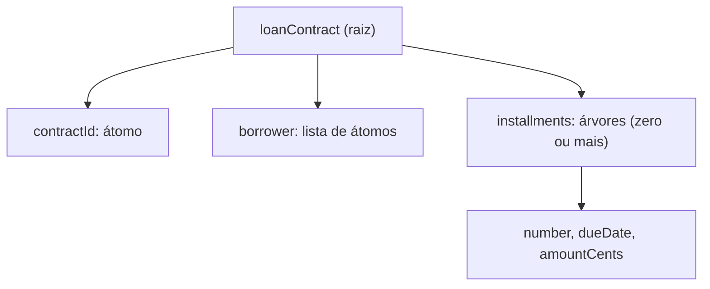

# Parameter Tree

## Descrição

O padrão Parameter Tree define uma estrutura hierárquica com um nó raiz e um ou mais nós filhos, cada um sendo um parâmetro atômico, uma lista de parâmetros atômicos ou outra árvore, para expressar relações de contenção em mensagens de API. Cada nó é identificado localmente por nome e/ou posição e pode ter cardinalidade de um, zero ou um, um ou mais, ou zero ou mais.

A definição é recursiva. Em APIs HTTP, a árvore aparece como objetos JSON aninhados, e nós múltiplos como arrays de objetos. É a escolha natural quando o modelo de domínio é hierárquico (um pedido com itens, um contrato com parcelas) ou quando dados adicionais, como informações de segurança, devem ficar estruturalmente separados dos dados de negócio, como em uma [Context Representation](/architecture/api-patterns/special-purpose-representations/context-representation). Uma árvore é mais cara de processar que um átomo, mas costuma ser mais eficiente que várias mensagens simples quando a hierarquia é profunda.

## Problemas que resolve

- Representar relações de contenção e associação (1:1, 1:N, N:M) em uma só mensagem
- Evitar o achatamento de dados ricos em listas planas e difíceis de interpretar
- Separar estruturalmente metadados e dados de negócio
- Reduzir a quantidade de chamadas necessárias para transferir uma estrutura inteira

## Quando usar

- Para trocar agregados do domínio, como um contrato de crédito com suas parcelas
- Quando o consumidor precisa da estrutura completa em uma única resposta
- Quando é útil agrupar partes da mensagem com papéis distintos (dados, contexto, links)

## Quando evitar

- Quando uma lista plana basta: use um [Atomic Parameter List](/architecture/api-patterns/basic-structure/atomic-parameter-list)
- Quando a estrutura é muito profunda ou grande, o que desperdiça banda e estressa serializadores
- Quando a parte aninhada pode ser obtida sob demanda por um [Linked Information Holder](/architecture/api-patterns/message-granularity/linked-information-holder)
- Quando se quer reduzir o acoplamento de formato: cada nível exposto vira parte do contrato

## Trade-offs

| Ganho | Custo / Risco |
| --- | --- |
| Expressa hierarquias e associações com clareza | Mais complexa de processar e de validar que átomos |
| Menos mensagens que várias chamadas simples | Pode transportar dados e níveis desnecessários se a opcionalidade não for definida |
| Separa dados de negócio de contexto e metadados | Compartilha estrutura interna e aumenta o acoplamento de formato |
| Mapeia bem para JSON, Protocol Buffers e GraphQL | Árvores em query strings têm suporte limitado e pouco portável |

- **Profundidade:** mantenha poucos níveis; cada nível extra pesa no contrato e na carga.
- **Opcionalidade:** declare explicitamente o que é opcional para que o provedor possa omitir nós.
- **Recursão:** definições recursivas são elegantes, mas podem gerar cargas enormes e quebrar serializadores.
- **Evolução:** adicionar nós opcionais é compatível; mudar a forma de um nó existente não é.

## Diagrama



A raiz mistura um átomo, uma lista e uma coleção de sub-árvores.

## Exemplo

Resposta com um contrato de crédito pessoal da fintech: um objeto raiz com átomos, um registro aninhado e uma coleção de parcelas. Valores em centavos, taxa ilustrativa.

```http
GET /loan-contracts/loan-91c2 HTTP/1.1
Accept: application/json
```

```http
HTTP/1.1 200 OK
Content-Type: application/json

{
  "contractId": "loan-91c2",
  "principalCents": 1000000,
  "monthlyRate": "0.0200",
  "borrower": {
    "accountId": "acc-7f3a",
    "name": "Maria Souza"
  },
  "installments": [
    { "number": 1, "dueDate": "2026-12-10", "amountCents": 120000 },
    { "number": 2, "dueDate": "2027-01-10", "amountCents": 118000 }
  ]
}
```

## Padrões relacionados

- [Atomic Parameter](/architecture/api-patterns/basic-structure/atomic-parameter) — as folhas da árvore
- [Atomic Parameter List](/architecture/api-patterns/basic-structure/atomic-parameter-list) — uma árvore plana equivale a uma lista
- [Parameter Forest](/architecture/api-patterns/basic-structure/parameter-forest) — agrupa várias árvores no nível superior
- [Embedded Entity](/architecture/api-patterns/message-granularity/embedded-entity) — entidades embutidas costumam chegar como árvores
- [Context Representation](/architecture/api-patterns/special-purpose-representations/context-representation) — a hierarquia separa dados de contexto
- [Data Transfer Object](/design/poeaa/distribution/data-transfer-object) — um DTO é o tipo de objeto que normalmente materializa uma árvore no código
- [Aggregate](/design/ddd/building-blocks/aggregate) — árvores costumam espelhar a forma de um agregado do domínio

## Referência

- [Patterns for API Design, capítulo 4: Parameter Tree](https://api-patterns.org/)
