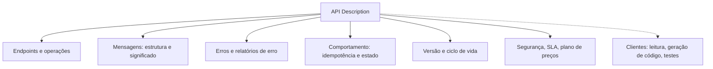

# API Description

## Descrição

O padrão API Description define, de forma legível por pessoas e por máquinas, o contrato técnico e semântico de uma API: endpoints, operações, estrutura e significado das mensagens, erros e demais conhecimento que provedor e clientes precisam compartilhar para interagir com sucesso.

Sem esse contrato, quem desenvolve o cliente precisa adivinhar parâmetros obrigatórios, efeitos sobre o estado, ordem de chamadas e garantias como idempotência. Uma descrição boa troca tentativa e erro por consulta: ela pode ser lida por analistas de negócio, validada por ferramentas e usada para gerar código cliente, esqueletos de servidor e testes. Para APIs HTTP, uma linguagem reconhecida como a OpenAPI Specification costuma cobrir a parte técnica; a parte semântica (o que cada operação significa no domínio, pré e pós-condições, invariantes) é escrita em texto complementar.

Há duas variantes nas pontas de um espectro. A **Minimal Description** traz só o necessário: endereços dos endpoints, nomes das operações e a estrutura e o significado das mensagens de requisição e resposta. A **Elaborate Description** soma exemplos de uso, tabelas de parâmetros e restrições, códigos de erro, requisitos de segurança, comportamento (idempotência, mudanças de estado), informações de versão, casos de teste de conformidade e metadados como responsável e canal de suporte. Formas híbridas são comuns.

## Problemas que resolve

- Clientes que não sabem como montar chamadas nem o que esperar nas respostas
- Suposições implícitas sobre idempotência, transacionalidade e ordem de chamadas que só se revelam em produção
- Engenharia reversa de respostas de exemplo para descobrir estrutura e significado dos campos
- Falta de uma base comum para gerar código, mocks e testes de contrato

## Quando usar

- Sempre que um endpoint for exposto a desenvolvedores que não são a equipe do provedor
- Quando clientes e provedor usam linguagens e plataformas diferentes e precisam de um formato neutro
- Quando a API é de missão crítica e o comportamento (erros, estado, versões) precisa ser inequívoco
- Para alimentar portais de desenvolvedores, geração de SDKs e testes de contrato

## Quando evitar

- Em protótipos descartáveis ou APIs internas de curtíssima vida, onde um exemplo de chamada basta
- Quando a descrição detalhada seria mantida à mão sem ninguém para atualizá-la: uma descrição desatualizada é pior que uma mínima
- Quando uma descrição elaborada exporia detalhes de implementação, como dependências a jusante, que deveriam ficar ocultos

## Trade-offs

| Ganho | Custo / Risco |
| --- | --- |
| Menos suposições e retrabalho para quem consome a API | Manter a descrição em dia a cada evolução da API tem custo contínuo |
| Interoperabilidade e geração de código e testes a partir do contrato | Descrições elaboradas têm redundância e podem se contradizer |
| Linguagem comum entre negócio e tecnologia | Detalhar demais vira desperdício e expõe detalhes internos |
| Base para versionar e comunicar mudanças | Descrições mínimas deixam lacunas que os clientes preenchem por adivinhação |

- **Profundidade:** uma descrição superespecificada é difícil de consumir e manter; uma subespecificada é fácil de ler, mas não garante conversas interoperáveis.
- **Fonte única:** gere a descrição a partir do código ou o código a partir da descrição, para que não divirjam.
- **Ocultação de informação:** descreva o que o cliente precisa saber, não como o provedor implementa.
- **Qualidade de serviço:** metas de disponibilidade e desempenho ficam melhor em um [Service Level Agreement](/architecture/api-patterns/documentation/service-level-agreement) referenciado pela descrição.

## Diagrama



A descrição reúne o contrato técnico e as informações semânticas e organizacionais, e é consumida por pessoas e ferramentas do lado do cliente.

## Exemplo

Trecho de uma descrição OpenAPI para a criação de cobranças Pix de uma fintech fictícia, com os campos que um cliente precisa para integrar: operação, corpo, respostas e a nota semântica sobre idempotência. Valores monetários são inteiros em centavos.

```yaml
openapi: 3.0.3
info:
  title: API de Cobranças Pix
  version: 2.1.0
  description: >
    Cria e consulta cobranças Pix. Contato: apis@fintech.example.
    Limites e disponibilidade: ver Rate Limit e SLA do portal.
paths:
  /v2/pix-charges:
    post:
      operationId: createPixCharge
      summary: Cria uma cobrança Pix
      description: >
        Idempotente quando o cabeçalho Idempotency-Key se repete: a mesma
        chave devolve a cobrança já criada. Efeito: grava uma PixCharge
        com status PENDING.
      parameters:
        - in: header
          name: Idempotency-Key
          required: true
          schema: { type: string, maxLength: 64 }
      requestBody:
        required: true
        content:
          application/json:
            schema:
              type: object
              required: [accountId, amountCents]
              properties:
                accountId: { type: string, example: "acc_1042" }
                amountCents: { type: integer, minimum: 1, example: 15000 }
      responses:
        "201":
          description: Cobrança criada
        "422":
          description: Valor inválido ou conta bloqueada (Error Report)
        "429":
          description: Rate Limit excedido
```

O mesmo documento serve de base para gerar SDKs, validar requisições e montar o portal de desenvolvedores.

## Padrões relacionados

- [Service Level Agreement](/architecture/api-patterns/documentation/service-level-agreement) — complementa a descrição com metas de qualidade mensuráveis
- [Pricing Plan](/architecture/api-patterns/documentation/pricing-plan) — informa o custo de uso e é atribuído à descrição
- [Rate Limit](/architecture/api-patterns/documentation/rate-limit) — os limites de uso fazem parte do que a descrição comunica
- [Version Identifier](/architecture/api-patterns/versioning/version-identifier) — a versão da API é parte do contrato descrito
- [Error Report](/architecture/api-patterns/special-purpose-representations/error-report) — a descrição enumera os erros e sua estrutura
- [Published Language](/design/ddd/context-mapping/published-language) — uma linguagem documentada e compartilhada; a API Description é o artefato que a registra em uma API
- [Open Host Service](/design/ddd/context-mapping/open-host-service) — exige um protocolo bem documentado, papel que a descrição cumpre
- [Consumer-Driven Contract Test](/architecture/microservices/testing/consumer-driven-contract-test) — verifica na prática se o provedor cumpre o contrato descrito

## Referência

- [Patterns for API Design, capítulo 9: API Description](https://api-patterns.org/)
- [OpenAPI Specification](https://spec.openapis.org/oas/latest.html)
