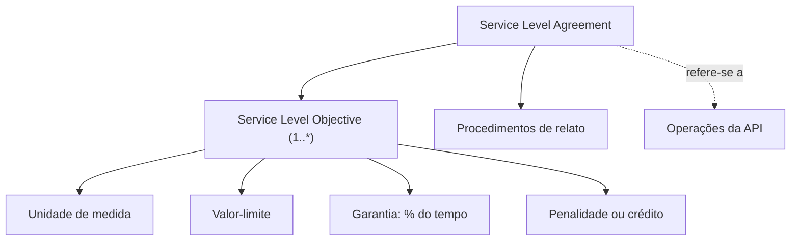

# Service Level Agreement

## Descrição

O padrão Service Level Agreement (SLA) define, em termos mensuráveis, as características de qualidade de serviço que o provedor de uma API garante e as consequências de não cumpri-las.

Um SLA reúne um ou mais objetivos de nível de serviço (SLOs, de Service Level Objectives). Cada SLO ligado a um atributo de qualidade, como latência ou disponibilidade, traz um valor-limite com sua unidade de medida, uma garantia (a fração do tempo ou das requisições em que o limite será respeitado), uma penalidade ou compensação em caso de falha e os procedimentos de relato: quem percebe e reporta a violação, o cliente ou o provedor. O SLA precisa dizer a quais operações se aplica e como a medição é feita e interpretada, por exemplo em que janela de tempo o percentual é calculado e onde o relógio começa e termina.

Os SLOs derivam de requisitos de qualidade levantados na análise e no projeto, e também de normas, como as de proteção de dados pessoais. Categorias típicas são desempenho, segurança, gestão de dados e proteção de dados pessoais. O público principal é o dono do produto de API, e a redação deve envolver cedo as áreas jurídica, de segurança e executiva. Uma variante é o SLA interno, em que o provedor mede o próprio desempenho sem compartilhá-lo com clientes externos.

## Problemas que resolve

- Clientes cujo negócio depende da API e não têm como saber que disponibilidade e latência esperar
- Termos informais e ambíguos que levam a mal-entendidos e a disputas
- Falta de critério mensurável para comparar provedores equivalentes
- Obrigações legais, como localização de dados, sem uma garantia documentada

## Quando usar

- Quando o uso da API é crítico para o negócio do cliente e o risco de indisponibilidade não é tolerável
- Quando clientes exigem, e pagam por, garantias formais (por exemplo, parceiros que oferecem o serviço a terceiros)
- Quando o provedor quer sinalizar maturidade e confiança para se diferenciar
- Como SLA interno, para medir a qualidade da própria equipe, mesmo sem publicá-lo

## Quando evitar

- Em APIs gratuitas, experimentais ou de baixo impacto, em que o melhor esforço é suficiente
- Quando o provedor não consegue medir nem cumprir o que prometeria: um SLA legalmente vinculante sem lastro é risco puro
- Quando aspectos difíceis de formalizar, como segurança, forçariam promessas irreais; nesses casos, prefira um compromisso de "esforço comercialmente razoável"

## Trade-offs

| Ganho | Custo / Risco |
| --- | --- |
| Expectativas claras e mensuráveis para clientes e provedor | Exige esforço para definir, instrumentar, monitorar e relatar |
| Confiança e diferencial competitivo frente a ofertas sem garantias | Responsabilização legal e financeira em caso de descumprimento |
| Base objetiva para tratar incidentes e compensações | Resistência interna ao compromisso formal e à possibilidade de falhar |
| Alinhamento entre áreas técnicas, jurídicas e de negócio | Negociação demorada, com muitas rodadas de revisão |

- **Limitação de risco:** restringir a penalidade a créditos de serviço limita a exposição financeira do provedor.
- **Precisão da medição:** declare onde a latência é medida e em qual janela o percentual é calculado, para evitar leituras diferentes.
- **Escopo:** parte dos SLOs vale para o serviço todo (proteção de dados); outras, para operações específicas (frequência de backup).
- **Custo operacional:** cumprir um SLA exige pessoal de plantão e mecanismos de mitigação, o que é caro.

## Diagrama



O SLA agrega objetivos mensuráveis, cada um com limite, unidade, garantia e compensação, além das regras de relato.

## Exemplo

A fintech oferece a parceiros uma API de criação de cobranças Pix e publica o SLA a seguir, com valores ilustrativos. O SLO de latência vale para a operação `POST /v2/pix-charges`:

```yaml
sla: pix-charges-api
operations: [POST /v2/pix-charges, GET /v2/pix-charges/{id}]
objectives:
  - name: latency
    unit: milliseconds
    threshold: 500
    guarantee: 99%            # das requisições, em janela de 30 dias
    measured: do recebimento no endpoint até o envio da resposta
    penalty: crédito de 10% na fatura do período
  - name: availability
    unit: percent-uptime
    threshold: 99.9
    window: 30 days
    penalty: crédito de 25% na fatura do período
reporting:
  detection: provedor publica o painel de status
  claim: cliente envia o pedido de crédito ao suporte, com datas e horários do incidente
```

Para o cliente, isso se traduz em uma frase verificável: em 99% das requisições, em 30 dias, a resposta sai em menos de 500 ms, e, se não sair, a fatura seguinte recebe um desconto de 10%.

## Padrões relacionados

- [API Description](/architecture/api-patterns/documentation/api-description) — o SLA acompanha o contrato técnico e é referenciado por ele
- [Rate Limit](/architecture/api-patterns/documentation/rate-limit) — os detalhes do limite de uso podem ser incluídos no SLA
- [Pricing Plan](/architecture/api-patterns/documentation/pricing-plan) — os níveis do plano costumam vir com SLAs diferentes
- [Two in Production](/architecture/api-patterns/life-cycle-management/two-in-production) e [Limited Lifetime Guarantee](/architecture/api-patterns/life-cycle-management/limited-lifetime-guarantee) — garantias de ciclo de vida que o SLA pode registrar
- [Health Endpoint Monitoring](/architecture/cloud-design-patterns/resiliency/health-endpoint-monitoring) — fornece a medição de disponibilidade com a qual o SLO é verificado

## Referência

- [Patterns for API Design, capítulo 9: Service Level Agreement](https://api-patterns.org/)
- [Site Reliability Engineering: Service Level Objectives](https://sre.google/sre-book/service-level-objectives/)
