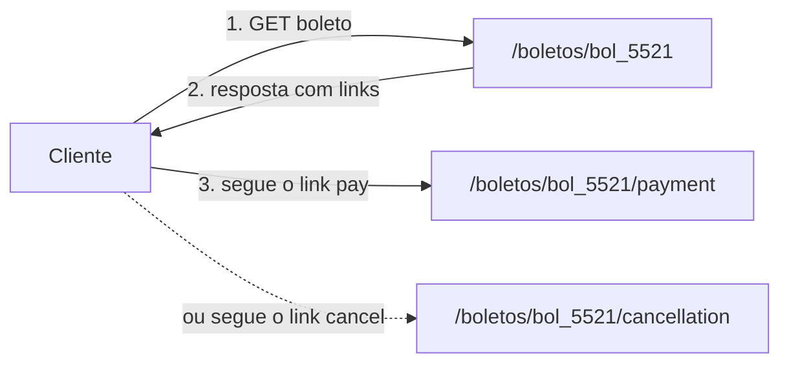

# Link Element

## Descrição

O padrão Link Element inclui nas mensagens de requisição e resposta um ponteiro legível por pessoas e máquinas, acessível pela rede, para outros endpoints e operações, de modo que o cliente os chame remotamente. É um Id Element que, além de nomear o alvo, diz onde ele pode ser chamado.

Em HTTP, o Link Element é uma URI, e o conjunto de links permite ao provedor conduzir o cliente pelos próximos passos possíveis (HATEOAS). Os links podem ser [Atomic Parameters](/architecture/api-patterns/basic-structure/atomic-parameter), entradas de listas ou folhas de árvores. Convém acrescentar [Metadata Elements](/architecture/api-patterns/element-stereotypes/metadata-element) que descrevam a relação: o nome do papel do link (`self`, `next`, `cancel`), o método HTTP aceito, o tipo de mídia esperado e se seguir o link é seguro, reversível ou compensável.

O cliente deve tratar links quebrados e falhas de rede, e o provedor deve cuidar de estabilidade, segurança e autorização do destino, pois o link só revela o que o chamador pode fazer.

Os tipos semânticos de link mais comuns são: **next** (próximo passo de um processo), **undo** (desfazer ou compensar), **more** (mais resultados, um movimento horizontal) e **details** (mais informação sobre a origem do link, um movimento vertical). Alguns tipos têm registro padronizado, como os da IANA, e a estrutura segue a RFC 8288. Em REST, não há distinção entre Id Element e Link Element, o que facilita o endereçamento, mas torna difícil mudar URLs.

## Problemas que resolve

- Clientes que montam URLs a partir de identificadores e de regras de roteamento copiadas da documentação
- Dificuldade de mudar a estrutura de endereços sem quebrar quem a conhece
- Falta de indicação, na resposta, de quais ações estão disponíveis no estado atual
- Necessidade de apontar para outros endpoints, inclusive de outros hosts, sem acoplar o cliente a eles

## Quando usar

- Em APIs REST de nível 3 que usam hipermídia para guiar o cliente
- Para navegação em coleções e paginação (`next`, `prev`)
- Quando um recurso expõe passos seguintes de um processo, como pagar ou cancelar
- Quando os recursos relacionados vivem em outros serviços ou hosts

## Quando evitar

- Quando um simples [Id Element](/architecture/api-patterns/element-stereotypes/id-element) basta e os clientes já conhecem o endereço-base
- Em APIs com clientes que não suportam ou não usam hipermídia, em que os links só aumentam o payload
- Quando a camada de transporte não tem endereços acessíveis, como em mensageria interna
- Quando o provedor não consegue manter os links estáveis, válidos e protegidos por autorização

## Trade-offs

| Ganho | Custo / Risco |
| --- | --- |
| Endereços e ações podem mudar sem que o cliente precise ser alterado | Mensagens maiores e clientes mais elaborados para interpretar links |
| O provedor conduz o fluxo e anuncia só as ações válidas no estado atual | Exige convenção compartilhada (relações, métodos, tipos de mídia) para a semântica dos links |
| Referencia recursos de outros serviços de forma global | Links podem quebrar por falhas de rede, mudança de destino ou expiração |
| Substitui a montagem manual de URLs | URLs absolutas expõem hosts e estrutura interna se mal projetadas |

- **Estabilidade:** links fornecidos pelo provedor reduzem o acoplamento, mas os nomes de relação viram contrato.
- **Segurança:** não inclua links para ações que o usuário não pode executar e valide a autorização no destino.
- **Semântica:** documente o efeito de seguir cada link, se é seguro, se pode ser desfeito e qual método usar.
- **Falhas:** o cliente precisa lidar com links indisponíveis, expirados ou quebrados.
- **Esquema de URIs:** o padrão resolve a identificação global e atemporal ao custo de um modelo de programação mais complexo no cliente; depois de publicados, mudar o esquema de URIs é arriscado e caro.
- **Ameaças:** URIs inválidas não devem derrubar o servidor nem abrir portas a atacantes, então entram no projeto e nos testes de segurança.

## Diagrama



A resposta do boleto traz links com as ações válidas, e o cliente escolhe um deles em vez de construir a URL por conta própria.

## Exemplo

Ao consultar um boleto, a API da fintech devolve links para as ações possíveis no estado atual. Como o boleto está pendente, a resposta anuncia pagamento e cancelamento, e não estorno.

```http
GET /boletos/bol_5521 HTTP/1.1
Accept: application/json
```

```json
{
  "id": "bol_5521",
  "amountCents": 89990,
  "currency": "BRL",
  "dueDate": "2026-11-30",
  "status": "PENDING",
  "links": [
    { "rel": "self",   "href": "/boletos/bol_5521", "method": "GET" },
    { "rel": "pay",    "href": "/boletos/bol_5521/payment", "method": "POST" },
    { "rel": "cancel", "href": "/boletos/bol_5521/cancellation", "method": "POST" },
    { "rel": "account", "href": "/accounts/acc_7f3a91", "method": "GET" }
  ]
}
```

Depois que o boleto for pago, os links `pay` e `cancel` deixam de aparecer, e o cliente se adapta sem alteração.

## Padrões relacionados

- [Id Element](/architecture/api-patterns/element-stereotypes/id-element) — identifica o alvo, mas sem informar onde chamá-lo; o Link Element acrescenta o endereço
- [Metadata Element](/architecture/api-patterns/element-stereotypes/metadata-element) — descreve a relação e o método de cada link
- [Linked Information Holder](/architecture/api-patterns/message-granularity/linked-information-holder) — usa Link Elements para apontar para dados relacionados
- [Link Lookup Resource](/architecture/api-patterns/endpoint-roles/link-lookup-resource) — endpoint que devolve links para outros recursos
- [Pagination](/architecture/api-patterns/response-shaping/pagination) — depende de links como `next` e `prev` para navegar
- [Processing Resource](/architecture/api-patterns/endpoint-roles/processing-resource) — expõe com links os próximos passos de um processo
- [Return Address](/architecture/eip/message-construction/return-address) — em mensageria, indica ao receptor para onde enviar a resposta

## Referência

- [Patterns for API Design, capítulo 6: Link Element](https://api-patterns.org/)
- [RFC 8288: Web Linking](https://www.rfc-editor.org/rfc/rfc8288)
