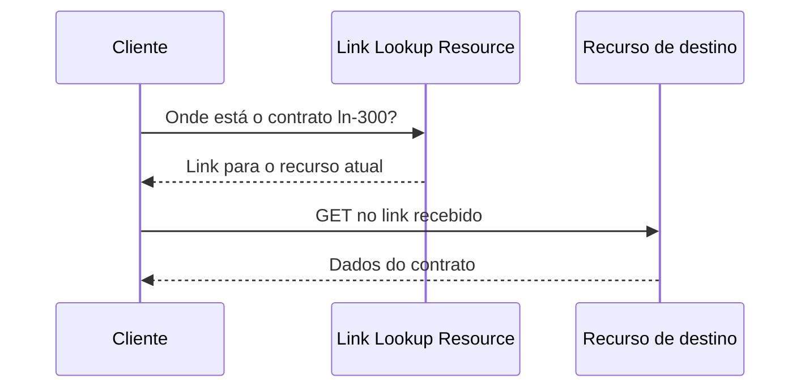

# Link Lookup Resource

## Descrição

O padrão Link Lookup Resource expõe um endpoint que resolve referências, devolvendo ao cliente os endereços atuais de outros recursos, em vez de os dados em si.

O cliente informa o que procura, por exemplo um identificador de negócio, e recebe um ou mais links para os recursos correspondentes. Assim, os endereços reais podem mudar (por migração, balanceamento ou reorganização de serviços) sem que os clientes precisem conhecê-los de antemão. O endpoint funciona como um catálogo de endereços dinâmico e atua como ponto de entrada estável para um conjunto de recursos.

As operações são de recuperação e devolvem um ou vários elementos de link, que podem apontar para qualquer tipo de endpoint: recursos de dados (operacionais, mestres, de referência, de transferência) ou recursos de processamento. A busca mais simples recebe um identificador único; versões mais ricas aceitam vários critérios. Quando os links apontam para Processing Resources, surge a variante conhecida como hipermídia como motor do estado da aplicação (HATEOAS), em que poucos endereços raiz são publicados e o restante é descoberto nas respostas.

O padrão reduz o acoplamento a URLs fixas e dá ao provedor liberdade para mover recursos, ao custo de uma chamada adicional para resolver o link antes de usá-lo.

## Problemas que resolve

- Clientes com endereços de recursos embutidos, que quebram quando eles mudam de lugar
- Necessidade de descobrir dinamicamente onde um recurso está, por exemplo em outra região ou serviço
- Respostas inchadas por conterem dados de muitos recursos relacionados, quando bastam as referências
- Acoplamento entre a estrutura de URLs interna e os consumidores externos

## Quando usar

- Os endereços dos recursos mudam ou variam conforme o contexto, como região, parceiro ou versão
- É útil oferecer um ponto de entrada único que encaminha para vários endpoints
- O cliente quer apenas localizar um recurso e decidirá depois se o consulta
- É preciso permitir reorganizar serviços sem alterar o código dos consumidores

## Quando evitar

- Quando os endereços são estáveis e conhecidos: a indireção só adiciona uma chamada
- Quando o cliente quase sempre precisa dos dados, e não apenas do link: devolva os dados diretamente
- Quando o próprio Link Lookup Resource se tornaria um ponto único de falha sem a devida redundância
- Quando a resposta pode simplesmente embutir os links no recurso que o cliente já consulta

## Trade-offs

| Ganho | Custo / Risco |
| --- | --- |
| Endereços podem mudar sem quebrar os clientes | Chamada extra para resolver o link antes de usar o recurso |
| Ponto de entrada estável e descoberta dinâmica | O endpoint de lookup vira dependência crítica do sistema |
| Respostas menores, só com referências | Links resolvidos podem ficar obsoletos se forem guardados em cache |
| Liberdade para reorganizar a estrutura interna | Exige manter o catálogo de links atualizado e consistente |

- **Disponibilidade:** o lookup precisa ser altamente disponível e rápido, pois muitos fluxos passam por ele.
- **Cache:** links podem ser guardados por pouco tempo; o cliente deve saber refazer a busca se o link falhar.
- **Consistência:** o catálogo deve refletir os recursos que realmente existem, sem referências penduradas.
- **Links quebrados:** se o link falhar, o cliente deve refazer a busca; o cache reduz as chamadas extras quando a consulta só é repetida após detectar um link quebrado.
- **Alternativas:** a descoberta de serviços na infraestrutura (registro de serviços, API gateway) resolve problema parecido, ao custo de outra dependência de execução; se a combinação com links não compensar, use um link direto ou embuta a entidade.
- **Mais endpoints:** o padrão melhora a coesão (a busca fica separada do processamento), mas aumenta o número de endpoints e o custo operacional.
- **Formato:** use um elemento de link padronizado, com relação (`rel`) e endereço.

## Diagrama



O cliente primeiro consulta o lookup, recebe o endereço atual e só então acessa o recurso de destino.

## Exemplo

Os contratos de crédito da fintech passaram a ficar em regiões diferentes, conforme o produto. Em vez de embutir endereços, o cliente consulta um lookup pelo identificador do contrato.

```http
GET /loan-links?contractId=ln-300 HTTP/1.1
Accept: application/json
```

```http
HTTP/1.1 200 OK
Content-Type: application/json

{
  "contractId": "ln-300",
  "links": [
    { "rel": "contract", "href": "https://credit-sp.fintech.example/loans/ln-300" },
    { "rel": "installments", "href": "https://credit-sp.fintech.example/loans/ln-300/installments" }
  ]
}
```

O cliente segue o link `contract` para obter o `LoanContract`. Se o contrato for migrado de região, apenas o catálogo muda.

## Padrões relacionados

- [Link Element](/architecture/api-patterns/element-stereotypes/link-element) — o elemento usado para representar cada endereço devolvido
- [Linked Information Holder](/architecture/api-patterns/message-granularity/linked-information-holder) — a mensagem de um recurso contém links para outros, em vez de uma tabela central
- [Information Holder Resource](/architecture/api-patterns/endpoint-roles/information-holder-resource) — o papel geral de endpoints centrados em dados
- [Id Element](/architecture/api-patterns/element-stereotypes/id-element) — o identificador de negócio usado como chave da busca
- [API Gateway](/architecture/microservices/external-api/api-gateway) — também encaminha para serviços internos, mas atua como proxy, e não só devolve endereços
- [Embedded Entity](/architecture/api-patterns/message-granularity/embedded-entity) — o oposto: embute os dados e dispensa a resolução de links
- [Open Host Service](/design/ddd/context-mapping/open-host-service) — oferece um ponto de acesso publicado e estável a um contexto

## Referência

- [Patterns for API Design, capítulo 5: Link Lookup Resource](https://api-patterns.org/)
