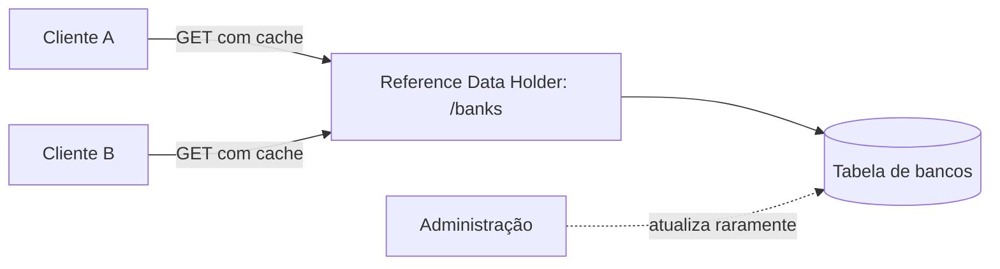

# Reference Data Holder

## Descrição

O padrão Reference Data Holder expõe um endpoint de dados de referência, estáveis e de leitura, que servem de consulta compartilhada e mudam raramente.

Dados de referência são tabelas de apoio usadas por muitos clientes: lista de bancos, códigos de moeda, tipos de chave Pix, categorias de despesa, feriados. O endpoint oferece apenas operações de leitura, sem criar, alterar ou apagar pela API, e as mudanças acontecem fora do contrato, direto nos ativos de retaguarda ou em uma API de administração separada. O cliente pode baixar o conjunto inteiro (para manter uma cópia local), filtrá-lo (por exemplo, para autocompletar um campo) ou consultar um item (por exemplo, para validar um valor). Como os valores mudam pouco, os clientes podem guardá-los em cache por longos períodos e até incorporar cópias locais.

Sem um ponto único de referência, a tentação é copiar os valores dentro de cada cliente, o que viola o princípio DRY: quando os dados mudarem, todos os clientes serão afetados e alguns talvez nem possam ser atualizados. A implementação não precisa ser um banco relacional; um arquivo, um armazenamento chave-valor ou uma CDN podem bastar. O desafio é decidir como as mudanças ocasionais chegam aos clientes, o que envolve prazos de validade de cache, versões do conjunto de dados e avisos de atualização.

## Problemas que resolve

- Muitos clientes consultando repetidamente as mesmas listas estáveis, gerando tráfego desnecessário
- Cópias locais de tabelas de apoio divergindo entre sistemas
- Falta de uma fonte oficial e simples para códigos e catálogos compartilhados
- Custo de acesso a valores que quase nunca mudam

## Quando usar

- Os dados são pequenos ou moderados, estáveis e lidos por muitos clientes
- A frescura absoluta não é crítica, e uma pequena defasagem é aceitável
- O conteúdo pode ser guardado em cache pelo cliente ou por intermediários
- É preciso garantir que todos usem os mesmos códigos e rótulos

## Quando evitar

- Quando os dados mudam com frequência e precisam estar sempre atualizados: use um [Operational Data Holder](/architecture/api-patterns/endpoint-roles/operational-data-holder)
- Quando os dados são entidades centrais com identidade e manutenção controlada: use um [Master Data Holder](/architecture/api-patterns/endpoint-roles/master-data-holder)
- Quando o conjunto é enorme e os clientes só precisam de um pedaço: considere paginação ou filtros
- Quando um valor desatualizado pode causar dano financeiro ou regulatório imediato

## Trade-offs

| Ganho | Custo / Risco |
| --- | --- |
| Cache eficiente reduz tráfego e latência | Clientes podem usar valores desatualizados após uma mudança |
| Contrato simples, em geral apenas leitura | Propagar uma mudança exige estratégia de invalidação ou versão |
| Fonte única e oficial para códigos compartilhados | Uma alteração incorreta afeta todos os consumidores de uma vez |
| Baixo risco de conflito, sem escrita concorrente | Conjuntos grandes pesam se entregues por inteiro |

- **Cache:** declare prazos explícitos de validade e use validadores como ETag para revalidar sem baixar tudo de novo.
- **Versão do conjunto:** exponha um identificador de versão da lista para que o cliente saiba quando atualizar sua cópia.
- **Compatibilidade:** adicionar entradas é seguro; remover ou renomear códigos pode quebrar quem depende deles.
- **Tamanho:** ofereça filtros ou paginação quando a lista crescer.
- **DRY:** o endpoint evita repetir a referência em cada cliente, ao custo de uma dependência de uma API remota que precisa ser desenvolvida, documentada e mantida.
- **Otimização oculta:** como os dados ficam atrás da API, o provedor pode introduzir proxies, caches e réplicas de leitura sem que o cliente perceba.
- **Custo de um endpoint isolado:** se ele der mais trabalho do que valor, funda os dados em um Master Data Holder já existente, como refatoração da API.

## Diagrama



Os clientes leem e guardam em cache a lista de referência; apenas um processo administrativo, fora do contrato, a altera.

## Exemplo

A fintech publica a lista de instituições participantes do Pix. Os aplicativos a guardam em cache e a revalidam com `ETag`.

```http
GET /reference/pix-participants HTTP/1.1
Accept: application/json
If-None-Match: "v42"
```

```http
HTTP/1.1 200 OK
Content-Type: application/json
ETag: "v43"
Cache-Control: max-age=86400

{
  "version": 43,
  "items": [
    { "code": "0001", "name": "Banco Exemplo" },
    { "code": "0002", "name": "Instituição de Pagamento Modelo" }
  ]
}
```

Se nada mudou desde a versão guardada, o servidor responde `304 Not Modified`, sem corpo. Os nomes e códigos acima são fictícios.

## Padrões relacionados

- [Information Holder Resource](/architecture/api-patterns/endpoint-roles/information-holder-resource) — o papel geral do qual este é uma especialização
- [Master Data Holder](/architecture/api-patterns/endpoint-roles/master-data-holder) — dados centrais, de vida longa e mantidos de forma controlada
- [Operational Data Holder](/architecture/api-patterns/endpoint-roles/operational-data-holder) — dados que mudam o tempo todo
- [Conditional Request](/architecture/api-patterns/message-exchange-optimization/conditional-request) — revalida a cópia em cache sem baixar o conteúdo outra vez
- [Cache-Aside](/architecture/cloud-design-patterns/data-management/cache-aside) — estratégia de cache do lado do consumidor que combina bem com dados de referência
- [Embedded Entity](/architecture/api-patterns/message-granularity/embedded-entity) e [Linked Information Holder](/architecture/api-patterns/message-granularity/linked-information-holder) — dados estáticos simples podem ser embutidos, dispensando o endpoint, ou referenciados por link
- [Value Object](/design/poeaa/base/value-object) — muitos itens de referência (moedas, códigos) são valores sem identidade própria

## Referência

- [Patterns for API Design, capítulo 5: Reference Data Holder](https://api-patterns.org/)
