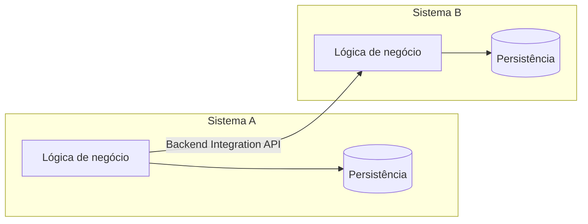

# Backend Integration

## Descrição

O padrão Backend Integration integra o backend de uma aplicação distribuída a outros backends, da mesma aplicação ou de outras, expondo seus serviços por meio de uma API remota baseada em mensagens. Essas APIs nunca são usadas diretamente por frontends: quem as consome são exclusivamente outros backends.

Existem dois contextos de uso. O primeiro é a integração entre sistemas, de empresa para empresa ou de sistema para sistema, em que aplicações construídas e implantadas de forma independente trocam dados e disparam atividades umas nas outras. O segundo é a decomposição interna de uma aplicação em serviços, como em microsserviços, que se comunicam por [Solution-Internal APIs](/architecture/api-patterns/foundations/solution-internal-api). O ponto de entrada adequado costuma ser a camada de lógica de negócio, onde já estão controle de acesso, transações e regras; em cenários centrados em dados, às vezes faz sentido integrar na camada de persistência.

Como as partes são independentes, a integração precisa preservar a integridade conceitual de cada sistema sem criar acoplamento indesejado. Isso pede planejamento do conjunto de sistemas, por exemplo com Domain-Driven Design estratégico, e uma tecnologia de comunicação madura, com formatos padronizados. Mensageria assíncrona baseada em filas é muito usada aqui, além do HTTP.

## Problemas que resolve

- Fazer sistemas construídos de forma independente trocarem dados e acionarem atividades uns nos outros
- Manter a coerência do modelo interno de cada sistema ao integrá-lo com os demais
- Evitar acoplamento indesejado entre componentes implantados separadamente
- Dar a serviços de uma mesma aplicação um contrato explícito de colaboração

## Quando usar

- Quando o núcleo bancário da fintech precisa notificar o sistema antifraude, ou consultar o sistema de crédito
- Quando se integra com parceiros e instituições externas, como o arranjo de pagamentos
- Quando uma aplicação é dividida em serviços que evoluem e escalam separadamente
- Quando o fluxo é de sistema para sistema e pode se beneficiar de mensageria assíncrona

## Quando evitar

- Para alimentar a interface do usuário: use [Frontend Integration](/architecture/api-patterns/foundations/frontend-integration)
- Quando os componentes são inseparáveis e rodam no mesmo processo, sem ganho em ter uma fronteira remota
- Quando o desenho dos serviços ainda é incerto: cortes mal feitos geram APIs que mudam o tempo todo e acoplamento distribuído

## Trade-offs

| Ganho | Custo / Risco |
| --- | --- |
| Sistemas e serviços implantados e evoluídos de forma independente | Falhas de rede e consistência eventual passam a fazer parte do desenho |
| Fronteiras explícitas que protegem o modelo interno de cada sistema | Exige planejamento do conjunto e governança dos contratos |
| Liberdade para escolher protocolo, inclusive mensageria assíncrona | Operar e observar integrações assíncronas é mais complexo |
| Reuso de capacidades entre vários consumidores | Mudanças no contrato afetam todos os consumidores |

- **Visibilidade:** o mesmo padrão cobre APIs públicas, de comunidade ou internas; decida cedo, pois isso define segurança e promessas de estabilidade.
- **Protocolo:** HTTP favorece a simplicidade; filas favorecem o desacoplamento no tempo e a tolerância a indisponibilidades.
- **Cortes dos serviços:** use critérios funcionais, operacionais e de mudança independente, sem multiplicar serviços sem necessidade.

## Diagrama



Cada backend expõe a própria lógica de negócio por uma API remota que somente outros backends consomem.

## Exemplo

O serviço de crédito da fintech pede ao serviço de contas o saldo disponível antes de aprovar um `LoanContract`. A chamada é de sistema para sistema, sem interface envolvida, e usa um identificador de correlação para rastreamento.

```http
GET /internal/accounts/acc-7781/available-balance HTTP/1.1
Accept: application/json
X-Correlation-Id: 5b1c2f0e-77d4-4f43-a1c1-0d6f2b7e9a10

HTTP/1.1 200 OK
Content-Type: application/json

{ "accountId": "acc-7781", "available": { "amountCents": 125090, "currency": "BRL" } }
```

Em um cenário assíncrono, o serviço de contas publicaria o mesmo dado como evento em uma fila, e o serviço de crédito o consumiria quando estivesse disponível.

## Padrões relacionados

- [Frontend Integration](/architecture/api-patterns/foundations/frontend-integration) — o tipo de integração oposto, voltado à interface do usuário
- [Solution-Internal API](/architecture/api-patterns/foundations/solution-internal-api) — a visibilidade típica quando os serviços pertencem à mesma aplicação
- [Public API](/architecture/api-patterns/foundations/public-api) e [Community API](/architecture/api-patterns/foundations/community-api) — visibilidades possíveis quando a integração cruza organizações
- [Bounded Context](/design/ddd/model-in-practice/bounded-context) — critério de corte entre sistemas que a integração deve respeitar
- [Anti-Corruption Layer](/architecture/cloud-design-patterns/integration-and-modernization/anti-corruption-layer) — protege o modelo interno de um sistema ao integrá-lo com outro
- [Command Message](/architecture/eip/message-construction/command-message) e [Event Message](/architecture/eip/message-construction/event-message) — formas de mensagem comuns na integração assíncrona
- [Shared Database](/architecture/microservices/service-collaboration/shared-database) — integração pela persistência, que traz acoplamento forte

## Referência

- [Patterns for API Design, capítulo 4: Backend Integration](https://api-patterns.org/)
