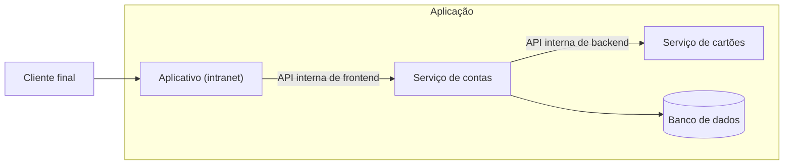

# Solution-Internal API

## Descrição

O padrão Solution-Internal API limita o acesso e o uso de uma API a uma única aplicação, decompondo-a logicamente em componentes que expõem APIs locais ou remotas apenas a seus parceiros internos de comunicação. Esses componentes podem ser serviços e microsserviços ou módulos dentro de um mesmo programa, e clientes e provedores costumam rodar no mesmo datacenter, ou até no mesmo nó de computação.

Esse tipo de API serve tanto ao frontend da aplicação quanto a outros componentes do backend, por isso aparece como API interna de frontend ou de backend. Um conjunto de APIs internas relacionadas é às vezes chamado de API de plataforma, como as APIs web de um provedor de nuvem ou as de gerenciamento de um broker de mensagens.

Ser independentemente implantável não significa ser implantado de forma independente. Um monólito modular, por exemplo, troca objetos de transferência de dados por APIs locais e pode ser convertido em microsserviços com menos esforço que um emaranhado de objetos acoplados por referência remota. Projetar APIs internas que melhorem o acoplamento é um trabalho complexo, e é isso que tanto as arquiteturas orientadas a serviços quanto os microsserviços procuram resolver.

## Problemas que resolve

- Estruturar uma aplicação em componentes com fronteiras explícitas
- Impedir que clientes externos dependam de detalhes que a equipe quer poder mudar
- Reduzir o acoplamento entre as partes, mesmo quando rodam juntas
- Preparar um monólito modular para uma eventual separação em serviços

## Quando usar

- Quando a fintech divide o backend em serviços de contas, cartões e crédito que conversam entre si
- Quando a aplicação precisa de fronteiras de módulo claras, mesmo dentro de um único processo
- Quando só equipes da mesma solução consomem a API e é possível coordenar mudanças
- Quando se quer liberdade para evoluir o contrato sem as promessas de estabilidade de uma API pública

## Quando evitar

- Quando consumidores de fora da organização precisam da capacidade: exponha uma [Public API](/architecture/api-patterns/foundations/public-api) ou uma [Community API](/architecture/api-patterns/foundations/community-api), com a segurança e a estabilidade devidas
- Quando a aplicação é pequena e a divisão em muitos componentes só acrescentaria chamadas remotas e complexidade
- Quando "interna" serve de desculpa para pular contrato, documentação e testes: APIs internas também têm consumidores

## Trade-offs

| Ganho | Custo / Risco |
| --- | --- |
| Liberdade para mudar o contrato, pois os consumidores são conhecidos | Mudanças ainda exigem coordenação entre as equipes |
| Menos exigência de segurança, documentação externa e comercial | Tentação de relaxar controles que ainda importam |
| Proximidade de rede e de implantação, com baixa latência | A suposição de rede confiável e rápida pode esconder falhas |
| Fronteiras que facilitam evoluir de módulos para serviços | Cortes errados geram acoplamento distribuído |

- **Rede e confiança:** estar na mesma rede não dispensa autenticação entre serviços.
- **Visibilidade pode crescer:** uma API interna que passa a ser usada por fora precisa ser repensada como pública ou de comunidade.
- **Documentação:** mesmo para uso interno, mantenha um contrato mínimo e testes de contrato.

## Diagrama



Todas as chamadas acontecem dentro da fronteira da aplicação: nenhum cliente externo alcança essas APIs diretamente.

## Exemplo

O serviço de cartões da fintech consulta o serviço de contas para saber se há saldo antes de autorizar uma compra. A API não é exposta fora da rede interna e pode mudar de acordo com as necessidades das duas equipes.

```http
POST /internal/accounts/acc-7781/holds HTTP/1.1
Host: accounts.internal
Content-Type: application/json

{ "amountCents": 8990, "currency": "BRL", "reason": "card-authorization", "cardId": "card-204" }

HTTP/1.1 201 Created
Content-Type: application/json

{ "holdId": "hold-6107", "available": { "amountCents": 116100, "currency": "BRL" } }
```

O nome `internal` no caminho e no host deixa claro que esse contrato não é público.

## Padrões relacionados

- [Public API](/architecture/api-patterns/foundations/public-api) e [Community API](/architecture/api-patterns/foundations/community-api) — as outras visibilidades, mais abertas e com mais exigências de estabilidade
- [Backend Integration](/architecture/api-patterns/foundations/backend-integration) — o tipo de integração que a API interna de backend realiza
- [Frontend Integration](/architecture/api-patterns/foundations/frontend-integration) — o tipo de integração da API interna de frontend
- [Bounded Context](/design/ddd/model-in-practice/bounded-context) — critério para cortar os componentes que expõem as APIs
- [Data Transfer Object](/design/poeaa/distribution/data-transfer-object) — as mensagens trocadas por APIs locais de um monólito modular
- [Consumer-Driven Contract Test](/architecture/microservices/testing/consumer-driven-contract-test) — mantém o contrato interno confiável entre equipes
- [Strangler Fig](/architecture/cloud-design-patterns/integration-and-modernization/strangler-fig) — migração gradual que se apoia em APIs internas bem definidas

## Referência

- [Patterns for API Design, capítulo 4: Solution-Internal API](https://api-patterns.org/)
