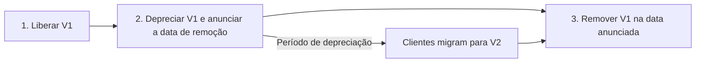

# Aggressive Obsolescence

## Descrição

O padrão Aggressive Obsolescence anuncia o mais cedo possível uma data de desativação para a API inteira ou para suas partes obsoletas, mantém essas partes disponíveis, porém desaconselhadas, durante um prazo curto e as remove assim que a data vence.

O provedor deixa claro, desde o lançamento, que se reserva o direito de depreciar e depois retirar endpoints, operações ou elementos de representação (um parâmetro de entrada ou de saída, por exemplo). O prazo é contado a partir do anúncio da depreciação, ou seja, é relativo, e não fixado na publicação. O ciclo tem três passos: liberar a versão, depreciá-la com a data de remoção definida e removê-la quando o prazo acabar. O período de depreciação é curto, tipicamente de um ano ou menos em uma API corporativa, o suficiente para o cliente migrar para a versão nova ou para uma alternativa. Quem não migrar a tempo perde o acesso; dependendo de sua posição de mercado e das alternativas disponíveis, o cliente também pode trocar de provedor.

## Problemas que resolve

- Reduzir o esforço de manter partes pouco usadas ou superadas com qualidade de serviço garantida, inclusive a habilidade exigida para dar suporte a clientes antigos
- Desacoplar o ciclo de vida de clientes e provedor: clientes raramente atualizam no mesmo momento, e o provedor pode nem conhecê-los
- Retirar só uma parte (operação ou elemento de mensagem) em vez de uma versão inteira, afetando menos clientes

- Manter versões antigas por tempo indefinido, com custo crescente de suporte e de código legado
- Clientes que só migram quando são forçados e atrasam a evolução da API
- Falta de uma regra previsível sobre quando um recurso deixa de existir
- Partes da API que o provedor quer corrigir ou substituir sem carregar compatibilidade eterna, por motivos econômicos, legais ou de segurança (como trocar algoritmos criptográficos fracos)

## Quando usar

- Quando o provedor tem poder de impor prazos, por exemplo em APIs internas ou entre parceiros próximos
- Quando manter várias versões é caro ou impede melhorias importantes, como correções de segurança
- Quando as necessidades do provedor pesam mais que as dos clientes
- Quando o provedor ainda não declarou nenhuma política de ciclo de vida e precisa de um caminho para mudanças incompatíveis
- Quando os clientes são poucos, conhecidos e podem ser avisados diretamente
- Quando a API ainda evolui rápido e o provedor precisa de liberdade para remover o que não deu certo

## Quando evitar

- Quando os clientes são numerosos, desconhecidos ou lentos para mudar, e uma quebra teria custo alto para eles
- Quando há contrato ou regulação que exija suporte por um prazo mínimo
- Quando não há canal confiável para avisar os clientes sobre a depreciação
- Quando o provedor não tem poder de mercado e perderia clientes para alternativas

## Trade-offs

| Ganho | Custo / Risco |
| --- | --- |
| Menos versões e menos código legado para manter | Clientes são obrigados a migrar dentro do prazo do provedor |
| Evolução mais rápida e correções sem carregar compatibilidade antiga | Quem não acompanhar os avisos tem integrações quebradas |
| Regra simples e previsível: toda funcionalidade tem uma data de fim | Esforço de comunicação e de acompanhamento da migração |
| Libera equipe e infraestrutura da versão antiga | Risco de perder clientes que não aceitam a pressa |

- **Aviso:** sinalize a depreciação também na própria resposta (cabeçalhos `Deprecation` e `Sunset`, campo de aviso no corpo), não só em e-mails ou no portal.
- **Prazo:** o período deve ser curto, mas suficiente para o cliente planejar e liberar a mudança; prazo curto demais gera quebra, longo demais perde o efeito.
- **Granularidade:** é possível depreciar a API inteira, uma operação ou só um elemento de uma mensagem.
- **Monitoramento:** acompanhe quem ainda usa o recurso antes da data e entre em contato direto com os retardatários.
- **Preço:** retirar funcionalidades pode ter efeito comercial se há um [Pricing Plan](/architecture/api-patterns/documentation/pricing-plan); a medição de uso ajuda a decidir o que retirar.
- **Dados mestres:** costumam ser mais difíceis de retirar das mensagens que dados operacionais.
- **Após a data:** responda com um erro claro (por exemplo `410 Gone`) apontando o sucessor, em vez de falhar de forma obscura.

## Diagrama



A versão é liberada, depois depreciada com data fixa de remoção e retirada quando o prazo termina, quer os clientes tenham migrado ou não.

## Exemplo

A fintech decide aposentar a versão 1 da API de cobranças Pix, que devolvia o valor como número decimal, em favor da versão 2, que usa centavos inteiros. A V1 continua respondendo até 31/03/2027, com cabeçalhos de depreciação, e depois passa a devolver `410 Gone`. A requisição e a resposta durante o período de depreciação:

```http
GET /v1/pix-charges/pix-9f3a HTTP/1.1
Host: api.fintech.example
```

```http
HTTP/1.1 200 OK
Deprecation: true
Sunset: Wed, 31 Mar 2027 23:59:59 GMT
Link: </v2/pix-charges/pix-9f3a>; rel="successor-version"
Content-Type: application/json

{"id": "pix-9f3a", "status": "PAID", "amount": "1250.00"}
```

Depois da data, a mesma chamada passa a falhar com um erro que aponta para o sucessor. A lógica de resposta da V1 em cada linguagem:

<Tabs groupId="lang" queryString>
<TabItem value="java" label="Java">

```java
import java.time.LocalDate;

public class Main {
    static final LocalDate SUNSET = LocalDate.of(2027, 3, 31);

    static String respondV1(LocalDate today) {
        if (today.isAfter(SUNSET)) {
            return "410 Gone";
        }
        return "200 OK | Deprecation: true | Sunset: Wed, 31 Mar 2027 23:59:59 GMT"
            + " | Link: </v2/pix-charges>; rel=\"successor-version\"";
    }

    public static void main(String[] args) {
        for (LocalDate day : new LocalDate[] {LocalDate.of(2026, 11, 17), LocalDate.of(2027, 4, 1)}) {
            System.out.println(day + " -> " + respondV1(day));
        }
    }
}
```

</TabItem>
<TabItem value="python" label="Python">

```python
from datetime import date

SUNSET = date(2027, 3, 31)


def respond_v1(today: date) -> str:
    if today > SUNSET:
        return "410 Gone"
    return ("200 OK | Deprecation: true | Sunset: Wed, 31 Mar 2027 23:59:59 GMT"
            ' | Link: </v2/pix-charges>; rel="successor-version"')


for day in (date(2026, 11, 17), date(2027, 4, 1)):
    print(f"{day} -> {respond_v1(day)}")
```

</TabItem>
<TabItem value="go" label="Go">

```go
package main

import (
	"fmt"
	"time"
)

var sunset = time.Date(2027, 3, 31, 0, 0, 0, 0, time.UTC)

func respondV1(today time.Time) string {
	if today.After(sunset) {
		return "410 Gone"
	}
	return "200 OK | Deprecation: true | Sunset: Wed, 31 Mar 2027 23:59:59 GMT" +
		` | Link: </v2/pix-charges>; rel="successor-version"`
}

func main() {
	days := []time.Time{
		time.Date(2026, 11, 17, 0, 0, 0, 0, time.UTC),
		time.Date(2027, 4, 1, 0, 0, 0, 0, time.UTC),
	}
	for _, day := range days {
		fmt.Printf("%s -> %s\n", day.Format("2006-01-02"), respondV1(day))
	}
}
```

</TabItem>
</Tabs>

```text
2026-11-17 -> 200 OK | Deprecation: true | Sunset: Wed, 31 Mar 2027 23:59:59 GMT | Link: </v2/pix-charges>; rel="successor-version"
2027-04-01 -> 410 Gone
```

## Padrões relacionados

- [Limited Lifetime Guarantee](/architecture/api-patterns/life-cycle-management/limited-lifetime-guarantee) — também proíbe quebras dentro do prazo anunciado, mas o prazo é absoluto e fixado na publicação, enquanto aqui é relativo e anunciado na depreciação
- [Two in Production](/architecture/api-patterns/life-cycle-management/two-in-production) — retira a versão mais antiga quando uma nova é lançada, em vez de usar uma data de calendário; a obsolescência pode forçar a saída de uma das duas versões
- [Experimental Preview](/architecture/api-patterns/life-cycle-management/experimental-preview) — compromisso ainda mais fraco: nenhuma garantia; a depreciação agressiva ao menos avisa antes de retirar
- [Version Identifier](/architecture/api-patterns/versioning/version-identifier) — identifica qual versão está depreciada e qual a substitui
- [Semantic Versioning](/architecture/api-patterns/versioning/semantic-versioning) — a mudança de versão principal indica quebra de compatibilidade e dispara o ciclo de depreciação
- [Metadata Element](/architecture/api-patterns/element-stereotypes/metadata-element) — pode carregar os marcadores de depreciação nas mensagens
- [API Description](/architecture/api-patterns/documentation/api-description) — deve listar as partes depreciadas e as datas; o [Service Level Agreement](/architecture/api-patterns/documentation/service-level-agreement) pode registrar a política
- [Pricing Plan](/architecture/api-patterns/documentation/pricing-plan) — a medição de uso ajuda a decidir o que retirar
- [Error Report](/architecture/api-patterns/special-purpose-representations/error-report) — formato do erro devolvido depois da remoção
- [Strangler Fig](/architecture/cloud-design-patterns/integration-and-modernization/strangler-fig) — substitui um sistema aos poucos; aqui o que se substitui é a versão da API, com data final fixa

## Referência

- [Patterns for API Design, capítulo 8: Aggressive Obsolescence](https://api-patterns.org/)
- [RFC 8594: The Sunset HTTP Header Field](https://www.rfc-editor.org/rfc/rfc8594)
