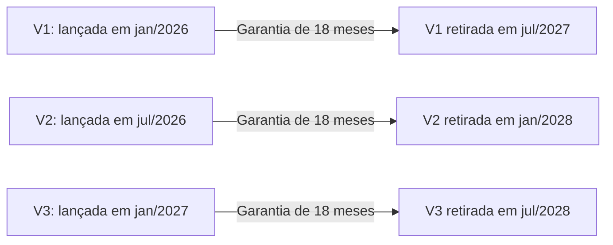

# Limited Lifetime Guarantee

## Descrição

O padrão Limited Lifetime Guarantee garante que a API publicada não será quebrada durante um período fixo, e rotula cada versão com uma data de expiração conhecida desde o lançamento.

O provedor promete manter a versão utilizável, de forma compatível, por um tempo limitado porém confortável, e a retira quando o prazo chega. O cliente fica protegido de quebras e interrupções inesperadas e, ao adotar a versão, já sabe até quando precisa adaptar e liberar uma nova versão de sua aplicação. Como a janela é medida em tempo e não em número de versões ativas, não é necessária nenhuma coordenação adicional entre as organizações, e o lançamento de outras versões não altera a data de aposentadoria. O fim da garantia equivale a uma depreciação implícita: depois dele o provedor pode mudar o que quiser, inclusive quebrar a compatibilidade ou descontinuar a versão. Na prática, os prazos costumam ser múltiplos de seis meses (6, 12, 18 ou 24).

## Problemas que resolve

- Clientes que não conseguem planejar porque não sabem por quanto tempo a versão que usam continuará disponível
- Quebras inesperadas de integrações por mudanças incompatíveis na API
- Suporte indefinido a versões antigas, sem data para encerrar
- Necessidade de coordenar caso a caso a migração de cada cliente
- Custo de manter por muito tempo partes antigas ou pouco usadas da API

## Quando usar

- Quando os clientes precisam de previsibilidade para planejar seus próprios ciclos de entrega, como bancos e parceiros integrados
- Quando a API é pública ou usada por muitas organizações, e negociar prazos individualmente é inviável
- Quando o provedor consegue manter várias versões ativas durante a janela prometida
- Quando regulação ou contratos pedem um prazo mínimo de estabilidade
- Quando o provedor não controla o roteiro dos clientes e considera alto o dano financeiro ou de reputação de forçar mudanças
- Quando o provedor quer uma forma institucionalizada de forçar atualizações, por exemplo diante de falhas de desenho ou de criptografia que ameacem todo o ecossistema

## Quando evitar

- Quando a API ainda é experimental e o desenho muda com frequência: prefira o [Experimental Preview](/architecture/api-patterns/life-cycle-management/experimental-preview)
- Quando o provedor não pode sustentar o custo de manter versões antigas pelo prazo prometido
- Quando um defeito grave de segurança obrigaria a quebrar a promessa
- Quando o provedor precisa de liberdade para retirar funcionalidades em prazos curtos: considere o [Aggressive Obsolescence](/architecture/api-patterns/life-cycle-management/aggressive-obsolescence)

## Trade-offs

| Ganho | Custo / Risco |
| --- | --- |
| Previsibilidade: o cliente sabe a data final desde o primeiro dia | O provedor assume o custo de manter cada versão até o fim do prazo |
| Sem coordenação individual com cada cliente | Várias versões podem ficar ativas ao mesmo tempo, em número imprevisível |
| Data de retirada independente de novos lançamentos | Prazo longo atrasa a remoção de código legado e de correções incompatíveis |
| Confiança e adoção maiores | Quebrar a promessa causa dano grande de reputação e talvez jurídico |

- **Dívida técnica:** manter compatibilidade ao longo do tempo gera interfaces desajeitadas, nomes estranhos e mais esforço de teste de regressão; o provedor convive com essa dívida até poder mudar a API.
- **Congelamento:** a API congelada pode atrasar a adoção de novas tecnologias e funcionalidades, e o provedor perde agilidade para atender pedidos urgentes que quebrem compatibilidade.
- **Clientes sem manutenção:** quem usa clientes que ninguém mais mantém pode ser forçado a uma troca impossível na data final.
- **Duração:** escolha um prazo que equilibre a necessidade dos clientes e o custo do provedor; múltiplos de seis meses são comuns.
- **Compatibilidade:** durante a janela, só são permitidas mudanças compatíveis; correções que quebrem a compatibilidade exigem uma nova versão.
- **Comunicação:** publique a data de expiração na descrição da API e nas respostas, e lembre os clientes à medida que ela se aproxima.
- **Aplicação:** combine com um [Version Identifier](/architecture/api-patterns/versioning/version-identifier) para saber a qual versão cada data se refere.

## Diagrama



Cada versão carrega sua própria data de retirada, definida na publicação e independente do lançamento das demais.

## Exemplo

A fintech publica a versão 2 da API de contratos de crédito pessoal e informa, no próprio recurso, a data até a qual a compatibilidade é garantida. A data e os valores são ilustrativos.

```http
GET /v2/loan-contracts/loan-5521 HTTP/1.1
Host: api.fintech.example
Accept: application/json
```

```http
HTTP/1.1 200 OK
Content-Type: application/json
API-Version: 2.0
Sunset: Fri, 31 Dec 2027 23:59:59 GMT
Link: <https://api.fintech.example/docs/lifecycle>; rel="sunset"

{
  "id": "loan-5521",
  "accountId": "acc-4821",
  "principalCents": 1500000,
  "monthlyRatePercent": "1.89",
  "installments": 24,
  "status": "ACTIVE"
}
```

A versão 2 só recebe mudanças compatíveis até 31/12/2027. A versão 3, quando lançada, terá o próprio prazo, sem alterar este.

## Padrões relacionados

- [Two in Production](/architecture/api-patterns/life-cycle-management/two-in-production) — abordagem mais leniente para o provedor: fixa o número de versões ativas em vez do tempo; pode ser combinada com esta garantia quando os clientes pedem data certa
- [Aggressive Obsolescence](/architecture/api-patterns/life-cycle-management/aggressive-obsolescence) — também proíbe quebras dentro do prazo anunciado, mas o prazo é relativo e anunciado na depreciação, não na publicação; é mais leniente com o provedor
- [Experimental Preview](/architecture/api-patterns/life-cycle-management/experimental-preview) — o extremo oposto: nenhuma garantia de estabilidade ou de tempo de vida
- [Version Identifier](/architecture/api-patterns/versioning/version-identifier) — identifica a versão à qual a data de expiração se aplica
- [Semantic Versioning](/architecture/api-patterns/versioning/semantic-versioning) — comunica o que muda em cada versão dentro da janela de garantia
- [Service Level Agreement](/architecture/api-patterns/documentation/service-level-agreement) — o lugar natural para formalizar a garantia de tempo de vida
- [API Description](/architecture/api-patterns/documentation/api-description) — onde a data de expiração é publicada, junto com o SLA

## Referência

- [Patterns for API Design, capítulo 8: Limited Lifetime Guarantee](https://api-patterns.org/)
