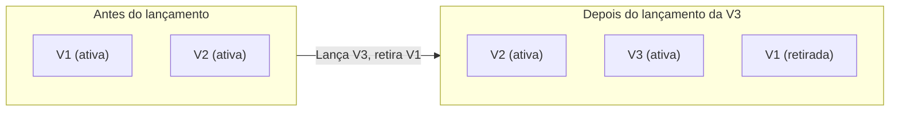

# Two in Production

## Descrição

O padrão Two in Production mantém duas versões de um endpoint e suas operações em produção ao mesmo tempo, sem exigir compatibilidade entre elas, e as atualiza e desativa em uma janela deslizante e sobreposta.

Ao lançar uma versão nova, o provedor retira a mais antiga que ainda estava no ar e continua dando suporte à anterior. Assim o cliente escolhe quando migrar: pode seguir com a versão em uso, estudar as mudanças e adaptar-se com calma, sem arriscar a estabilidade do seu sistema principal. O provedor informa de antemão essa política, identifica as versões (por exemplo com um [Version Identifier](/architecture/api-patterns/versioning/version-identifier)) e redireciona ou rejeita as chamadas à versão aposentada, usando recursos do protocolo como os do HTTP. As duas versões em produção são duas versões principais: versões totalmente compatíveis (a de correção, na [Semantic Versioning](/architecture/api-patterns/versioning/semantic-versioning)) podem substituir uma ativa sem violar a regra. Como os clientes existentes ficam na versão antiga até migrar, o provedor pode fazer mudanças ousadas na nova. Uma variante, N in Production, amplia a janela para mais de duas versões: dá mais tempo e opções aos clientes, ao custo de mais manutenção e operação para o provedor.

## Problemas que resolve

- Clientes que precisam de tempo para migrar quando uma versão nova quebra a compatibilidade
- A obrigação de manter indefinidamente todas as versões já lançadas
- Mudanças incompatíveis que o provedor precisa fazer, mas sem derrubar os clientes atuais
- Provedor e cliente, sobretudo de uma [Public API](/architecture/api-patterns/foundations/public-api) ou [Community API](/architecture/api-patterns/foundations/community-api), que evoluem em velocidades diferentes e não podem ser obrigados a atualizar de imediato
- O custo de manter cada versão antiga viva (correções, patches de segurança, dependências, testes de regressão)
- A incerteza dos clientes sobre quantas versões estarão disponíveis a cada momento

## Quando usar

- Quando novas versões trazem quebras de compatibilidade e há clientes que não migram no mesmo dia do lançamento
- Quando o provedor consegue operar duas versões em paralelo, inclusive dados e implantação
- Quando a migração depende de ciclos de entrega dos clientes que o provedor não controla
- Quando se quer uma política simples, baseada no número de versões e não em datas de calendário

## Quando evitar

- Quando o custo de operar duas versões é alto demais, por exemplo por exigir bancos ou modelos de dados incompatíveis
- Quando os clientes precisam de uma data fixa para se planejar: o [Limited Lifetime Guarantee](/architecture/api-patterns/life-cycle-management/limited-lifetime-guarantee) dá essa previsibilidade
- Quando as versões podem ser sempre compatíveis, o que dispensa a coexistência de versões
- Quando há clientes que não acompanham os lançamentos: a cada versão nova, eles perdem o acesso sem aviso prévio claro

## Trade-offs

| Ganho | Custo / Risco |
| --- | --- |
| Clientes escolhem o momento de migrar dentro de uma janela | Duas versões a manter, testar, implantar e monitorar |
| Quebras de compatibilidade são possíveis sem derrubar clientes | O custo cresce na variante N in Production |
| Política simples e fácil de explicar | Quem não migra a tempo é cortado quando sai uma nova versão |
| Menos pressa para o cliente do que em uma depreciação com data fixa | Tempo de coexistência imprevisível: depende da cadência de lançamentos do provedor |

- **Identificação:** use um identificador de versão explícito (na URL, em cabeçalho ou no tipo de mídia) para o roteamento.
- **Lançamento:** ao liberar a versão N+1, a versão N-1 é retirada; avise os clientes dela com antecedência e indique a migração.
- **Redirecionamento:** chamadas à versão retirada podem receber uma resposta clara apontando para o sucessor, em vez de um erro genérico.
- **Cadência:** lançar versões com muita frequência encurta o tempo de vida de cada uma e pressiona os clientes; planeje o ritmo.
- **Responsabilidades:** o provedor pode lançar versões incompatíveis, mas deve sustentar várias; o cliente deve migrar em tempo limitado, mas planeja seu calendário com liberdade.
- **Imprevisibilidade:** diferente do Limited Lifetime Guarantee, a retirada depende de outros lançamentos e não pode ser planejada com tanta antecedência, a menos que os padrões sejam combinados.
- **Dados:** as duas versões costumam compartilhar o mesmo modelo de domínio; um adaptador por versão evita duplicar a lógica de negócio.

## Diagrama



A janela desliza a cada lançamento: sempre duas versões ativas, e a mais antiga sai quando uma nova entra.

## Exemplo

A fintech mantém a V1 e a V2 da API de extrato no ar. Quando lançar a V3, a V1 será retirada. Chamadas à V1 depois disso recebem uma resposta apontando para o sucessor. Antes do lançamento da V3, as duas funcionam:

```http
GET /v1/accounts/acc-4821/ledger-entries HTTP/1.1
Host: api.fintech.example
```

```http
HTTP/1.1 200 OK
Content-Type: application/json
API-Version: 1
Link: </docs/lifecycle>; rel="describedby"

[{"id": "le-7001", "amount": "125.00", "type": "PIX_IN"}]
```

```http
GET /v2/accounts/acc-4821/ledger-entries HTTP/1.1
Host: api.fintech.example
```

```http
HTTP/1.1 200 OK
Content-Type: application/json
API-Version: 2

[{"id": "le-7001", "amountCents": 12500, "currency": "BRL", "type": "PIX_IN"}]
```

Depois do lançamento da V3, a chamada à V1 é recusada com um erro que indica a migração:

```http
HTTP/1.1 410 Gone
Content-Type: application/json
Link: </v3/accounts/acc-4821/ledger-entries>; rel="successor-version"

{"error": "VERSION_RETIRED", "message": "A versão 1 foi retirada. Use a versão 2 ou 3.", "supportedVersions": [2, 3]}
```

A V2 e a V3 passam a ser as duas em produção. O valor da V1 em decimal vira centavos inteiros a partir da V2, uma mudança incompatível que justifica a coexistência.

## Padrões relacionados

- [Version Identifier](/architecture/api-patterns/versioning/version-identifier) — quase sempre necessário para distinguir as versões ativas; a política deve constar na [API Description](/architecture/api-patterns/documentation/api-description) ou no [Service Level Agreement](/architecture/api-patterns/documentation/service-level-agreement)
- [Limited Lifetime Guarantee](/architecture/api-patterns/life-cycle-management/limited-lifetime-guarantee) — usa um prazo em vez de um número de versões ativas; combine-o com este padrão quando os clientes exigirem data certa de expiração
- [Aggressive Obsolescence](/architecture/api-patterns/life-cycle-management/aggressive-obsolescence) — retira versões em um prazo curto anunciado, sem janela deslizante; pode ser aplicado a uma das duas versões para forçar a migração e liberar espaço a uma versão mais nova
- [Experimental Preview](/architecture/api-patterns/life-cycle-management/experimental-preview) — pode ser uma das duas (ou N) versões em produção
- [Semantic Versioning](/architecture/api-patterns/versioning/semantic-versioning) — indica quais mudanças quebram a compatibilidade e pedem uma nova versão principal
- [Error Report](/architecture/api-patterns/special-purpose-representations/error-report) — formato do erro devolvido para a versão retirada
- [Strangler Fig](/architecture/cloud-design-patterns/integration-and-modernization/strangler-fig) — também mantém o antigo e o novo lado a lado durante a transição, mas para sistemas e não para versões de API
- [API Gateway](/architecture/microservices/external-api/api-gateway) — ponto comum para rotear cada versão para sua implementação

## Referência

- [Patterns for API Design, capítulo 8: Two in Production](https://api-patterns.org/)
