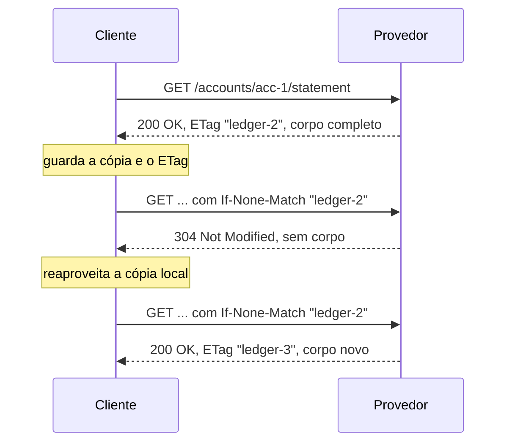

# Conditional Request

## Descrição

O padrão Conditional Request torna uma requisição condicional, acrescentando a ela metadados que descrevem a versão dos dados que o cliente já possui, de modo que o provedor só devolva a representação completa se ela tiver mudado.

O cliente guarda a resposta anterior junto com uma marca de versão e a reenvia na chamada seguinte. Se a condição não se verifica, ou seja, se nada mudou, o provedor responde com um código de status especial e sem corpo, e o cliente reaproveita a cópia que tem. Há duas variantes: a **baseada em tempo**, em que a marca é a data da última modificação, e a **baseada em impressão digital**, em que o provedor etiqueta o recurso com um hash ou um número de versão. Em HTTP, isso se traduz em `Last-Modified` com `If-Modified-Since`, ou em `ETag` com `If-None-Match`, e a resposta vazia é o `304 Not Modified`.

O número de mensagens não diminui; o que encolhe é o tamanho das respostas repetidas. Como o cliente é quem lembra a versão que viu, o provedor não precisa guardar estado por cliente.

## Problemas que resolve

- Clientes que consultam repetidamente dados que raramente mudam e re-baixam a mesma resposta grande
- Processamento do lado do servidor e uso de banda gastos para reenviar o que o cliente já tem
- Trabalho do cliente para reprocessar um resultado idêntico ao anterior
- Necessidade de uma "consulta prévia" (pergunta se mudou e depois pede), que dobra o número de requisições

## Quando usar

- Quando as respostas são grandes ou a rede é limitada, e os dados mudam com menos frequência do que são lidos
- Quando os clientes já mantêm uma cópia local e precisam decidir quando atualizá-la
- Quando o provedor consegue calcular barato uma marca de versão (número de versão, hash ou data de modificação)
- Para extratos, catálogos de produtos, tabelas de taxas e dados cadastrais consultados com frequência

## Quando evitar

- Quando as respostas já são pequenas e baratas de produzir: a lógica de decisão pode custar mais do que economiza
- Quando os dados mudam a cada requisição, e a condição quase nunca permite reaproveitar a cópia
- Quando o cliente não pode ou não deve manter cache local
- Quando a marca de versão não cobre os metadados: se só os metadados mudam, uma condição baseada apenas nos dados vai esconder a mudança

## Trade-offs

| Ganho | Custo / Risco |
| --- | --- |
| Menos banda e menos bytes processados nas respostas repetidas | O número de mensagens continua o mesmo |
| O provedor não guarda estado de qual cliente viu qual versão | O cliente precisa guardar a cópia e a marca de versão |
| Releitura local é bem mais rápida que nova chamada completa | Lógica extra de avaliação de condições e de erros no endpoint |
| Costuma ser transparente para a implementação, se feito em um filtro | Como filtro, a resposta ainda é calculada e depois descartada: economiza banda, não processamento |

- **Tipo de condição:** a data de modificação é simples, mas exige relógios razoavelmente sincronizados; a impressão digital é mais precisa e independe de relógio.
- **Processamento:** para também economizar computação, a verificação precisa acontecer antes de montar a resposta, por exemplo com um cache no servidor.
- **Limites e cobrança:** defina se uma resposta condicional conta no [Rate Limit](/architecture/api-patterns/documentation/rate-limit) e se recebe tratamento especial no [Pricing Plan](/architecture/api-patterns/documentation/pricing-plan).
- **Paginação:** uma página pode não ter mudado enquanto o total de páginas cresceu; essa mudança de metadados também deve entrar na condição.

## Diagrama



O primeiro retorno traz o corpo e o `ETag`. Enquanto os dados não mudam, a condição se verifica e o provedor devolve só o `304`; quando um novo lançamento altera o estado, o `ETag` muda e a resposta completa volta.

## Exemplo

Um aplicativo da fintech consulta o resumo do extrato de uma conta. Como o saldo só muda quando entra um `LedgerEntry`, o provedor etiqueta a resposta com um `ETag` e responde `304` quando o cliente já tem a versão atual. As mensagens HTTP:

```http
GET /accounts/acc-1/statement HTTP/1.1

HTTP/1.1 200 OK
ETag: "ledger-2"
Content-Type: application/json

{"accountId": "acc-1", "balanceCents": 15000, "currency": "BRL"}
```

```http
GET /accounts/acc-1/statement HTTP/1.1
If-None-Match: "ledger-2"

HTTP/1.1 304 Not Modified
ETag: "ledger-2"
```

Em código, o serviço deriva o `ETag` da quantidade de lançamentos, e o cliente guarda a última cópia. O saldo é sempre em centavos, nunca em ponto flutuante.

<Tabs groupId="lang" queryString>
<TabItem value="java" label="Java">

```java
import java.util.*;

public class Main {
    record LedgerEntry(String id, long amountCents) {}
    record Response(int status, String etag, Long balanceCents) {}

    static class StatementService {
        private final List<LedgerEntry> entries = new ArrayList<>();

        void post(LedgerEntry entry) { entries.add(entry); }

        // O ETag deriva da quantidade de lançamentos: muda a cada novo lançamento.
        Response get(String ifNoneMatch) {
            String etag = "\"ledger-" + entries.size() + "\"";
            if (etag.equals(ifNoneMatch)) {
                return new Response(304, etag, null);
            }
            long balance = entries.stream().mapToLong(LedgerEntry::amountCents).sum();
            return new Response(200, etag, balance);
        }
    }

    public static void main(String[] args) {
        StatementService service = new StatementService();
        service.post(new LedgerEntry("e1", 10000));
        service.post(new LedgerEntry("e2", 5000));

        String cachedEtag = null;
        long cachedBalance = 0;
        for (int i = 0; i < 3; i++) {
            if (i == 2) service.post(new LedgerEntry("e3", 2500));
            Response r = service.get(cachedEtag);
            if (r.status() == 200) {
                cachedEtag = r.etag();
                cachedBalance = r.balanceCents();
            }
            System.out.println(r.status() + " " + r.etag() + " balance=" + cachedBalance);
        }
    }
}
```

</TabItem>
<TabItem value="python" label="Python">

```python
from dataclasses import dataclass
from typing import List, Optional


@dataclass
class LedgerEntry:
    id: str
    amount_cents: int


@dataclass
class Response:
    status: int
    etag: str
    balance_cents: Optional[int] = None


class StatementService:
    def __init__(self) -> None:
        self.entries: List[LedgerEntry] = []

    def post(self, entry: LedgerEntry) -> None:
        self.entries.append(entry)

    # O ETag deriva da quantidade de lançamentos: muda a cada novo lançamento.
    def get(self, if_none_match: Optional[str]) -> Response:
        etag = '"ledger-%d"' % len(self.entries)
        if etag == if_none_match:
            return Response(304, etag)
        return Response(200, etag, sum(e.amount_cents for e in self.entries))


service = StatementService()
service.post(LedgerEntry("e1", 10000))
service.post(LedgerEntry("e2", 5000))

cached_etag, cached_balance = None, 0
for i in range(3):
    if i == 2:
        service.post(LedgerEntry("e3", 2500))
    r = service.get(cached_etag)
    if r.status == 200:
        cached_etag, cached_balance = r.etag, r.balance_cents
    print(f"{r.status} {r.etag} balance={cached_balance}")
```

</TabItem>
<TabItem value="go" label="Go">

```go
package main

import "fmt"

type LedgerEntry struct {
	ID          string
	AmountCents int64
}

type Response struct {
	Status       int
	ETag         string
	BalanceCents int64
}

type StatementService struct {
	entries []LedgerEntry
}

func (s *StatementService) Post(e LedgerEntry) { s.entries = append(s.entries, e) }

// O ETag deriva da quantidade de lançamentos: muda a cada novo lançamento.
func (s *StatementService) Get(ifNoneMatch string) Response {
	etag := fmt.Sprintf("\"ledger-%d\"", len(s.entries))
	if etag == ifNoneMatch {
		return Response{Status: 304, ETag: etag}
	}
	var balance int64
	for _, e := range s.entries {
		balance += e.AmountCents
	}
	return Response{Status: 200, ETag: etag, BalanceCents: balance}
}

func main() {
	service := &StatementService{}
	service.Post(LedgerEntry{"e1", 10000})
	service.Post(LedgerEntry{"e2", 5000})

	cachedETag := ""
	var cachedBalance int64
	for i := 0; i < 3; i++ {
		if i == 2 {
			service.Post(LedgerEntry{"e3", 2500})
		}
		r := service.Get(cachedETag)
		if r.Status == 200 {
			cachedETag, cachedBalance = r.ETag, r.BalanceCents
		}
		fmt.Printf("%d %s balance=%d\n", r.Status, r.ETag, cachedBalance)
	}
}
```

</TabItem>
</Tabs>

O segundo ciclo termina em `304` e o cliente mantém o saldo em cache; o terceiro, depois de um novo lançamento, recebe um `ETag` e um saldo atualizados.

## Padrões relacionados

- [Wish List](/architecture/api-patterns/response-shaping/wish-list) e [Wish Template](/architecture/api-patterns/response-shaping/wish-template) — combinam bem: indicam quais dados enviar quando a condição se verifica e a resposta precisa ser reenviada
- [Pagination](/architecture/api-patterns/response-shaping/pagination) — pode ser combinado, com cuidado com mudanças no total de páginas
- [Request Bundle](/architecture/api-patterns/message-exchange-optimization/request-bundle) — um pacote de requisições também pode ser entregue de forma condicional
- [Metadata Element](/architecture/api-patterns/element-stereotypes/metadata-element) — carrega a condição (data ou impressão digital) na mensagem
- [Rate Limit](/architecture/api-patterns/documentation/rate-limit) — respostas condicionais reduzem o volume de dados transferido, o que ajuda quando o limite considera bytes
- [Cache-Aside](/architecture/cloud-design-patterns/data-management/cache-aside) — o cache fica do lado do consumidor dos dados e o cliente decide quando atualizar; aqui, a condição é parte do contrato da própria API, e o cache é só a cópia que o cliente reaproveita

## Referência

- [Patterns for API Design, capítulo 7: Conditional Request](https://api-patterns.org/)
- [RFC 7232: Conditional Requests (HTTP/1.1)](https://datatracker.ietf.org/doc/html/rfc7232)
