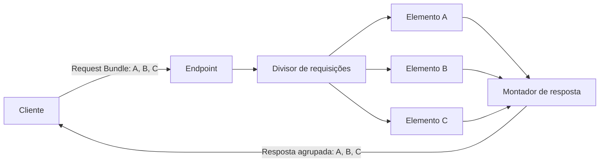

# Request Bundle

## Descrição

O padrão Request Bundle agrupa várias requisições independentes em uma única mensagem de requisição, para reduzir o número de chamadas e de respostas trocadas entre cliente e provedor.

A mensagem é um contêiner com metadados, como o identificador de cada elemento do pacote e um contador de elementos. Ele costuma ser estruturado como uma [Parameter Tree](/architecture/api-patterns/basic-structure/parameter-tree) ou uma [Parameter Forest](/architecture/api-patterns/basic-structure/parameter-forest). A resposta pode seguir duas formas: **uma resposta agrupada**, em que um contêiner espelha o pacote recebido, ou **várias respostas** para uma única requisição, em que o provedor devolve os resultados à medida que cada elemento é processado, por exemplo por long polling.

O provedor precisa dividir o pacote e montar a resposta, e o cliente precisa separar a resposta agrupada de volta em resultados individuais. Erros são tratados nos dois níveis: um relatório para o pacote inteiro e relatórios individuais por elemento, localizáveis pelo identificador.

## Problemas que resolve

- Interações "tagarelas", com muitas requisições pequenas e independentes que prejudicam a escalabilidade e a vazão
- Latência acumulada por vários round-trips em redes com alta latência
- Sobrecarga de enviar e receber muitas mensagens para um processamento em lote ou em massa
- Complexidade no cliente para acompanhar várias requisições em andamento

## Quando usar

- Quando os clientes fazem processamento em lote, como cargas periódicas ou atualizações de cadastro
- Quando os elementos são logicamente independentes e podem ser processados em qualquer ordem
- Quando a rede tem latência alta e o custo de cada chamada domina
- Quando o protocolo de transporte não consegue tratar várias requisições de uma vez

## Quando evitar

- Quando os elementos dependem uns dos outros ou precisam de uma ordem de execução garantida
- Quando os elementos são todos do mesmo tipo e podem ser obtidos por [Pagination](/architecture/api-patterns/response-shaping/pagination)
- Quando o controle de acesso é por elemento e difícil de comunicar ao cliente em respostas parciais
- Quando o cliente precisa da primeira resposta o mais cedo possível, pois o pacote só devolve resultado depois de processado

## Trade-offs

| Ganho | Custo / Risco |
| --- | --- |
| Menos mensagens e menos round-trips, com mais vazão | O cliente espera mais até receber o primeiro resultado |
| Menos requisições em andamento para o cliente acompanhar | Provedor e cliente precisam dividir e remontar o pacote |
| Útil quando o protocolo não suporta várias requisições juntas | Payload mais complexo, com dados de várias fontes em uma mensagem |
| Menos chamadas contadas em um [Rate Limit](/architecture/api-patterns/documentation/rate-limit) por invocação | Pode tornar o provedor com estado, o que dificulta a escala horizontal |

- **Ordem:** os elementos são independentes e podem rodar em paralelo; documente na [API Description](/architecture/api-patterns/documentation/api-description) que o cliente não deve presumir ordem. Garantir ordem custa trabalho extra.
- **Erros:** retorne sucesso ou falha por elemento com um [Error Report](/architecture/api-patterns/special-purpose-representations/error-report), e não só para o pacote inteiro.
- **Tamanho:** defina um limite de elementos por pacote para proteger o provedor.
- **Unidade de escala:** não é óbvio se o pacote ou o elemento deve ser a unidade de escala; evite estado entre chamadas.

## Diagrama



O endpoint divide o pacote em elementos independentes, processa cada um e monta uma única resposta que espelha o pacote. Na variante com várias respostas, o montador é substituído por envios individuais.

## Exemplo

Um parceiro da fintech precisa gerar várias cobranças Pix de uma vez, no fechamento do dia. Em vez de uma chamada por `PixCharge`, ele envia um pacote; cada elemento tem um identificador de correlação, e o resultado de cada um é devolvido individualmente, de modo que um valor inválido não impede as demais cobranças. As mensagens HTTP:

```http
POST /pix-charges/bundle HTTP/1.1
Content-Type: application/json

{
  "elements": [
    {"id": "1", "amountCents": 15000},
    {"id": "2", "amountCents": 0},
    {"id": "3", "amountCents": 4990}
  ]
}

HTTP/1.1 200 OK
Content-Type: application/json

{
  "results": [
    {"id": "1", "status": "CREATED", "detail": "charge-1"},
    {"id": "2", "status": "REJECTED", "detail": "amount must be positive"},
    {"id": "3", "status": "CREATED", "detail": "charge-3"}
  ]
}
```

Em código, o provedor valida o tamanho do pacote e processa cada elemento de forma independente, com valores em centavos:

<Tabs groupId="lang" queryString>
<TabItem value="java" label="Java">

```java
import java.util.*;

public class Main {
    record PixChargeRequest(String id, long amountCents) {}
    record ElementResult(String id, String status, String detail) {}

    static final int MAX_ELEMENTS = 100;

    // Os elementos são independentes: um erro não derruba os demais.
    static List<ElementResult> createCharges(List<PixChargeRequest> bundle) {
        if (bundle.size() > MAX_ELEMENTS) {
            throw new IllegalArgumentException("bundle exceeds " + MAX_ELEMENTS + " elements");
        }
        List<ElementResult> results = new ArrayList<>();
        for (PixChargeRequest element : bundle) {
            if (element.amountCents() <= 0) {
                results.add(new ElementResult(element.id(), "REJECTED", "amount must be positive"));
            } else {
                results.add(new ElementResult(element.id(), "CREATED", "charge-" + element.id()));
            }
        }
        return results;
    }

    public static void main(String[] args) {
        List<PixChargeRequest> bundle = List.of(
                new PixChargeRequest("1", 15000),
                new PixChargeRequest("2", 0),
                new PixChargeRequest("3", 4990));
        for (ElementResult r : createCharges(bundle)) {
            System.out.println(r.id() + " " + r.status() + " " + r.detail());
        }
    }
}
```

</TabItem>
<TabItem value="python" label="Python">

```python
from dataclasses import dataclass
from typing import List

MAX_ELEMENTS = 100


@dataclass
class PixChargeRequest:
    id: str
    amount_cents: int


@dataclass
class ElementResult:
    id: str
    status: str
    detail: str


# Os elementos são independentes: um erro não derruba os demais.
def create_charges(bundle: List[PixChargeRequest]) -> List[ElementResult]:
    if len(bundle) > MAX_ELEMENTS:
        raise ValueError(f"bundle exceeds {MAX_ELEMENTS} elements")
    results = []
    for element in bundle:
        if element.amount_cents <= 0:
            results.append(ElementResult(element.id, "REJECTED", "amount must be positive"))
        else:
            results.append(ElementResult(element.id, "CREATED", "charge-" + element.id))
    return results


bundle = [
    PixChargeRequest("1", 15000),
    PixChargeRequest("2", 0),
    PixChargeRequest("3", 4990),
]
for r in create_charges(bundle):
    print(r.id, r.status, r.detail)
```

</TabItem>
<TabItem value="go" label="Go">

```go
package main

import (
	"errors"
	"fmt"
)

const maxElements = 100

type PixChargeRequest struct {
	ID          string
	AmountCents int64
}

type ElementResult struct {
	ID     string
	Status string
	Detail string
}

// Os elementos são independentes: um erro não derruba os demais.
func CreateCharges(bundle []PixChargeRequest) ([]ElementResult, error) {
	if len(bundle) > maxElements {
		return nil, errors.New("bundle exceeds the element limit")
	}
	results := make([]ElementResult, 0, len(bundle))
	for _, element := range bundle {
		if element.AmountCents <= 0 {
			results = append(results, ElementResult{element.ID, "REJECTED", "amount must be positive"})
		} else {
			results = append(results, ElementResult{element.ID, "CREATED", "charge-" + element.ID})
		}
	}
	return results, nil
}

func main() {
	bundle := []PixChargeRequest{{"1", 15000}, {"2", 0}, {"3", 4990}}
	results, err := CreateCharges(bundle)
	if err != nil {
		panic(err)
	}
	for _, r := range results {
		fmt.Println(r.ID, r.Status, r.Detail)
	}
}
```

</TabItem>
</Tabs>

## Padrões relacionados

- [Parameter Tree](/architecture/api-patterns/basic-structure/parameter-tree) e [Parameter Forest](/architecture/api-patterns/basic-structure/parameter-forest) — estruturam as mensagens de requisição e resposta do pacote
- [Id Element](/architecture/api-patterns/element-stereotypes/id-element) e [Metadata Element](/architecture/api-patterns/element-stereotypes/metadata-element) — identificam cada elemento e descrevem o pacote
- [Error Report](/architecture/api-patterns/special-purpose-representations/error-report) — relata sucesso ou falha por elemento
- [Conditional Request](/architecture/api-patterns/message-exchange-optimization/conditional-request), [Wish List](/architecture/api-patterns/response-shaping/wish-list) e [Wish Template](/architecture/api-patterns/response-shaping/wish-template) — podem ser combinados, desde que o ganho justifique a complexidade
- [Pagination](/architecture/api-patterns/response-shaping/pagination) — alternativa quando os elementos pedidos são do mesmo tipo
- [Rate Limit](/architecture/api-patterns/documentation/rate-limit) — pacotes ajudam a ficar dentro de limites que contam invocações
- [Request Batch](/architecture/distributed-systems/node-communication/request-batch) — também agrupa pedidos para reduzir mensagens, mas entre nós de um sistema distribuído; aqui o foco é o contrato de uma API entre cliente e provedor
- [Correlation Identifier](/architecture/eip/message-construction/correlation-identifier) — os identificadores dos elementos cumprem esse papel, ligando cada resultado à requisição de origem
- [Command Message](/architecture/eip/message-construction/command-message) — cada requisição do pacote pode ser vista como um comando

## Referência

- [Patterns for API Design, capítulo 7: Request Bundle](https://api-patterns.org/)
