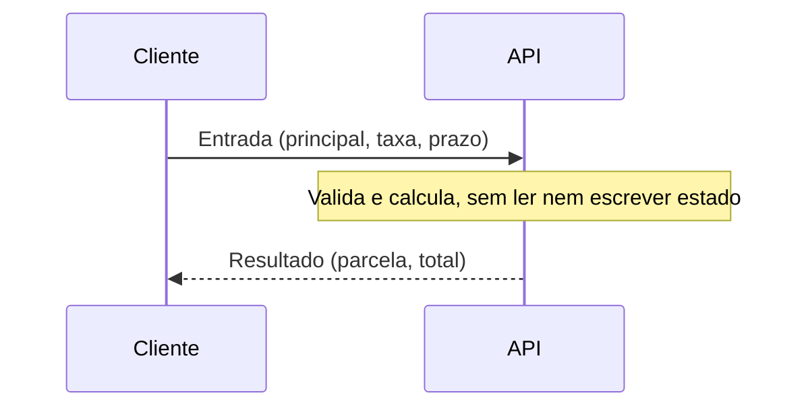

# Computation Function

## Descrição

O padrão Computation Function é uma operação de API sem estado e sem efeitos colaterais que recebe dados do cliente, calcula um resultado que depende exclusivamente dessa entrada e o devolve na resposta. Ela não lê nem escreve o estado da aplicação do provedor, o que a torna fácil de escalar, mover e implantar.

A operação serve para terceirizar um cálculo que o cliente não deveria ou não consegue executar sozinho, por custo, capacidade, confiança ou conhecimento especializado. O contrato deve definir ao menos uma pré-condição sobre os elementos da requisição e pós-condições sobre o conteúdo da resposta. Não há necessidade de gerenciar transações no provedor, pois a função não guarda nada.

Há três variantes: o Transformation Service, que muda a representação dos dados sem mudar o significado; o Validation Service, que verifica a correção de uma entrada e devolve um resultado simples; e a Long Running Computation, que usa invocação assíncrona (mensageria, callback ou uma requisição longa com link de acompanhamento) quando o processamento é demorado.

## Problemas que resolve

- Cálculos que exigem CPU, memória ou conhecimento que o cliente não tem
- Regras de cálculo ou validação que mudam e não devem exigir reinstalar todos os clientes
- Necessidade de validar dados de forma independente, antes de uma operação que os grava
- Conversão de formatos ou notações entre sistemas, centralizada em um único serviço

## Quando usar

- Para simular um empréstimo ou calcular parcelas, taxas e impostos a partir dos dados informados
- Para validar um documento, um endereço ou uma chave Pix antes de enviar o pedido de gravação
- Para converter representações, como de uma estrutura para outra ou de uma notação para outra
- Para um teste de vida (heartbeat) de um serviço crítico

## Quando evitar

- Quando o cálculo precisa do estado do provedor: ele passa a ser uma [Retrieval Operation](/architecture/api-patterns/operation-responsibilities/retrieval-operation)
- Quando o cálculo é simples e rápido o bastante para uma biblioteca local, sem o custo de rede
- Quando a regulação ou a política interna impede enviar os dados a um terceiro
- Quando o resultado precisa ser guardado: use uma [State Creation Operation](/architecture/api-patterns/operation-responsibilities/state-creation-operation) ou uma [State Transition Operation](/architecture/api-patterns/operation-responsibilities/state-transition-operation)

## Trade-offs

| Ganho | Custo / Risco |
| --- | --- |
| Sem estado, escala e se move livremente entre nós | Latência de rede e serialização que um cálculo local não teria |
| Lógica centralizada, atualizada sem alterar os clientes | O cliente depende de um serviço externo, que pode ficar indisponível ou mudar |
| Capacidade de processamento concentrada no provedor | Cálculos pesados criam gargalos e afetam o cumprimento do [Service Level Agreement](/architecture/api-patterns/documentation/service-level-agreement) |
| Fácil de testar, pois só depende da entrada | Mensagens podem crescer, já que o provedor não guarda resultados intermediários |

- **Reprodutibilidade e confiança:** o cliente precisa confiar que o provedor calcula certo e responde de modo coerente.
- **Cache:** só vale se vários clientes pedirem o mesmo cálculo e o resultado for determinístico.
- **Segurança:** a proteção depende da sensibilidade dos dados; todo endpoint remoto está sujeito a negação de serviço.
- **Processamento demorado:** use a variante assíncrona e um [Link Element](/architecture/api-patterns/element-stereotypes/link-element) para acompanhar o andamento.

## Diagrama



A resposta depende só dos dados enviados na requisição; o provedor não consulta nem altera nenhum armazenamento.

## Exemplo

A fintech expõe uma simulação de crédito pessoal: o cliente informa valor, taxa mensal ilustrativa e prazo, e recebe a parcela fixa e o total. Nada é gravado, e a chamada pode ser repetida à vontade. Os valores trafegam em centavos inteiros.

```http
POST /loan-simulations HTTP/1.1
Content-Type: application/json

{ "principalCents": 1000000, "monthlyRate": 0.02, "months": 10 }
```

```http
HTTP/1.1 200 OK
Content-Type: application/json

{ "installmentCents": 111327, "totalCents": 1113270 }
```

<Tabs groupId="lang" queryString>
<TabItem value="java" label="Java">

```java
public class Main {
    public static void main(String[] args) {
        LoanSimulation result = new LoanSimulationFunction().simulate(1_000_000, 0.02, 10);
        System.out.println(result.installmentCents() + " " + result.totalCents()); // 111327 1113270
    }
}

record LoanSimulation(long installmentCents, long totalCents) {}

class LoanSimulationFunction {
    // Sem estado: o resultado depende apenas dos argumentos.
    LoanSimulation simulate(long principalCents, double monthlyRate, int months) {
        if (principalCents <= 0 || months <= 0) {
            throw new IllegalArgumentException("principal e prazo devem ser positivos");
        }
        double factor = monthlyRate / (1 - Math.pow(1 + monthlyRate, -months));
        long installment = Math.round(principalCents * factor);
        return new LoanSimulation(installment, installment * months);
    }
}
```

</TabItem>
<TabItem value="python" label="Python">

```python
from typing import NamedTuple

class LoanSimulation(NamedTuple):
    installment_cents: int
    total_cents: int

# Sem estado: o resultado depende apenas dos argumentos.
def simulate(principal_cents: int, monthly_rate: float, months: int) -> LoanSimulation:
    if principal_cents <= 0 or months <= 0:
        raise ValueError("principal e prazo devem ser positivos")
    factor = monthly_rate / (1 - (1 + monthly_rate) ** -months)
    installment = round(principal_cents * factor)
    return LoanSimulation(installment, installment * months)

result = simulate(1_000_000, 0.02, 10)
print(result.installment_cents, result.total_cents)  # 111327 1113270
```

</TabItem>
<TabItem value="go" label="Go">

```go
package main

import (
	"errors"
	"fmt"
	"math"
)

type LoanSimulation struct {
	InstallmentCents int64
	TotalCents       int64
}

// Sem estado: o resultado depende apenas dos argumentos.
// Em Go, a entrada inválida volta como error.
func Simulate(principalCents int64, monthlyRate float64, months int) (LoanSimulation, error) {
	if principalCents <= 0 || months <= 0 {
		return LoanSimulation{}, errors.New("principal e prazo devem ser positivos")
	}
	factor := monthlyRate / (1 - math.Pow(1+monthlyRate, float64(-months)))
	installment := int64(math.Round(float64(principalCents) * factor))
	return LoanSimulation{installment, installment * int64(months)}, nil
}

func main() {
	result, _ := Simulate(1_000_000, 0.02, 10)
	fmt.Println(result.InstallmentCents, result.TotalCents) // 111327 1113270
}
```

</TabItem>
</Tabs>

## Padrões relacionados

- [Retrieval Operation](/architecture/api-patterns/operation-responsibilities/retrieval-operation) — lê o estado; um Validation Service que consulta estado interno vira uma Retrieval Operation
- [State Creation Operation](/architecture/api-patterns/operation-responsibilities/state-creation-operation) — só escreve estado
- [State Transition Operation](/architecture/api-patterns/operation-responsibilities/state-transition-operation) — lê e escreve estado; uma Computation Function costuma validar o pedido antes dela
- [Processing Resource](/architecture/api-patterns/endpoint-roles/processing-resource) — o endpoint que normalmente hospeda a função
- [Parameter Tree](/architecture/api-patterns/basic-structure/parameter-tree) — estrutura comum das mensagens de transformações complexas
- [Error Report](/architecture/api-patterns/special-purpose-representations/error-report) — informa por que uma entrada foi rejeitada
- [Asynchronous Request-Reply](/architecture/cloud-design-patterns/messaging/asynchronous-request-reply) — modela a variante Long Running Computation
- [Health Endpoint Monitoring](/architecture/cloud-design-patterns/resiliency/health-endpoint-monitoring) — o teste de vida é um exemplo de Validation Service
- [Service Layer](/design/poeaa/domain-logic/service-layer) — camada interna de serviços cujas operações sem estado são candidatas a Computation Functions

## Referência

- [Patterns for API Design, capítulo 5: Computation Function](https://api-patterns.org/)
