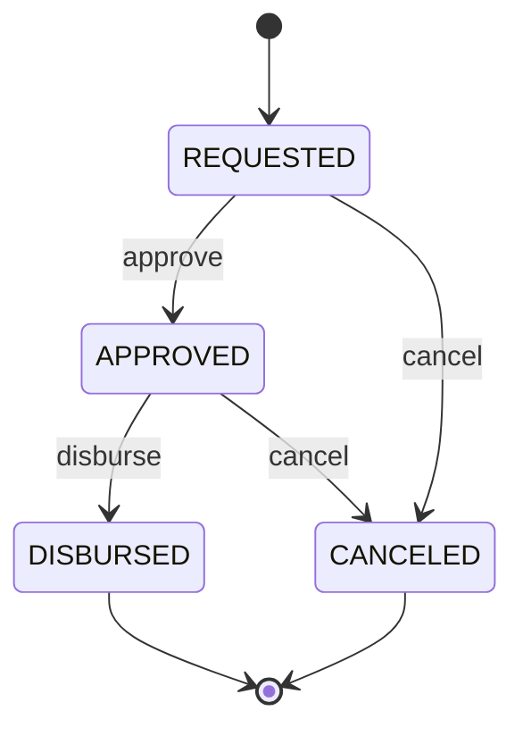

# State Transition Operation

## Descrição

O padrão State Transition Operation é uma operação de API que combina a entrada do cliente com o estado atual do provedor para provocar uma mudança de estado, lendo e escrevendo o armazenamento do lado do provedor. O provedor modela as transições válidas e verifica, a cada chamada, se o pedido é permitido no estado em que o recurso se encontra.

A operação pode representar uma atividade de negócio isolada (aprovar, cancelar), uma atualização de uma entidade (substituição completa ou alteração parcial) ou até a execução de um processo inteiro. É a base para dividir responsabilidades de processos de negócio entre cliente e provedor, de modo que o andamento fique visível na API e o cliente possa avançá-lo, acompanhá-lo ou cancelá-lo.

A variante Business Activity Processor expõe os estados e as primitivas de uma atividade (preparar, iniciar, suspender, retomar, concluir, falhar, cancelar, desfazer, reiniciar e limpar) como uma máquina de estados documentada. Internamente, cada chamada deve ter uma fronteira transacional igual à da operação (transação ACID ou saga) e parecer idempotente, por exemplo preferindo valores absolutos a incrementos.

## Problemas que resolve

- Processos de negócio de longa duração que precisam avançar passo a passo por chamadas distintas
- Atividades que só podem ocorrer em certos estados e que não devem ser executadas fora de ordem
- Clientes e provedor que precisam concordar sobre quem é o dono do estado do processo
- Fluxos inválidos ou fraudulentos, que devem ser rejeitados em tempo de execução

## Quando usar

- Para atividades com ciclo de vida, como aprovar, liberar ou cancelar uma contratação de crédito
- Para atualizações de entidades que dependem do estado atual (alteração parcial, incrementos, mudança de status)
- Quando o cliente precisa acompanhar, cancelar ou desfazer uma atividade em andamento
- Quando há auditoria sobre quais transições ocorreram e por quem

## Quando evitar

- Quando a operação só informa um fato e não depende do estado: uma [State Creation Operation](/architecture/api-patterns/operation-responsibilities/state-creation-operation) basta
- Quando o endpoint precisa ser totalmente sem estado, para escalar ou rodar como função serverless
- Quando todo o estado pode ser transferido pelo cliente a cada chamada, com os riscos de segurança que isso traz
- Quando o fluxo é uma simples leitura ou cálculo: use [Retrieval Operation](/architecture/api-patterns/operation-responsibilities/retrieval-operation) ou [Computation Function](/architecture/api-patterns/operation-responsibilities/computation-function)

## Trade-offs

| Ganho | Custo / Risco |
| --- | --- |
| Transições válidas verificadas no provedor, com auditoria do processo | Operações com estado são difíceis de escalar e de mover entre nós |
| Cliente acompanha e controla o andamento de processos longos | Pedidos podem ser negados porque o cliente tem uma visão desatualizada do estado |
| Contrato explícito, com pré e pós-condições por estado | Pré e pós-condições complexas precisam ser documentadas e testadas |
| Pode usar atualizações absolutas e idempotentes | Atualizações incrementais não são idempotentes e corrompem dados se forem repetidas |

- **Granularidade:** decida se cada atividade, cada subprocesso ou o processo inteiro vira uma operação.
- **Consistência:** a fronteira transacional coincide com a operação; processos longos pedem sagas, não uma única transação.
- **Conflitos:** outras chamadas, eventos e jobs podem alterar o mesmo estado; valide a transição e trate a recusa.
- **Idempotência:** prefira "definir o valor como n" a "somar um"; um [Id Element](/architecture/api-patterns/element-stereotypes/id-element) identifica o recurso e a atividade.
- **Segurança:** só clientes autorizados devem disparar certas transições; protege-se com [API Key](/architecture/api-patterns/special-purpose-representations/api-key) ou token mais forte.

## Diagrama



Cada operação move o contrato de um estado para outro. Pedidos que não seguem uma das setas, como cancelar um contrato já liberado, são rejeitados.

## Exemplo

Um `LoanContract` de crédito pessoal percorre os estados solicitado, aprovado e liberado, e pode ser cancelado enquanto o dinheiro não foi liberado. Cada transição é uma chamada que verifica o estado atual.

```http
POST /loan-contracts/loan-77/approve HTTP/1.1
Content-Type: application/json

{ "approvedBy": "analyst-9" }
```

```http
HTTP/1.1 200 OK
Content-Type: application/json

{ "id": "loan-77", "status": "APPROVED" }
```

Uma tentativa de cancelar um contrato já liberado é recusada:

```http
HTTP/1.1 409 Conflict
Content-Type: application/json

{ "error": "INVALID_TRANSITION", "message": "DISBURSED -> CANCELED" }
```

<Tabs groupId="lang" queryString>
<TabItem value="java" label="Java">

```java
import java.util.*;

public class Main {
    public static void main(String[] args) {
        LoanContract contract = new LoanContract("loan-77");
        contract.transitionTo(LoanStatus.APPROVED);
        System.out.println(contract.status); // APPROVED
        contract.transitionTo(LoanStatus.DISBURSED);
        System.out.println(contract.status); // DISBURSED
        try {
            contract.transitionTo(LoanStatus.CANCELED);
        } catch (IllegalStateException e) {
            System.out.println(e.getMessage()); // DISBURSED -> CANCELED
        }
    }
}

enum LoanStatus { REQUESTED, APPROVED, DISBURSED, CANCELED }

class LoanContract {
    private static final Map<LoanStatus, Set<LoanStatus>> ALLOWED = Map.of(
            LoanStatus.REQUESTED, Set.of(LoanStatus.APPROVED, LoanStatus.CANCELED),
            LoanStatus.APPROVED, Set.of(LoanStatus.DISBURSED, LoanStatus.CANCELED),
            LoanStatus.DISBURSED, Set.of(),
            LoanStatus.CANCELED, Set.of());

    final String id;
    LoanStatus status = LoanStatus.REQUESTED;

    LoanContract(String id) { this.id = id; }

    // Lê o estado atual e só escreve se a transição for válida.
    void transitionTo(LoanStatus target) {
        if (!ALLOWED.get(status).contains(target)) {
            throw new IllegalStateException(status + " -> " + target);
        }
        status = target;
    }
}
```

</TabItem>
<TabItem value="python" label="Python">

```python
from enum import Enum

class LoanStatus(Enum):
    REQUESTED = "REQUESTED"
    APPROVED = "APPROVED"
    DISBURSED = "DISBURSED"
    CANCELED = "CANCELED"

ALLOWED = {
    LoanStatus.REQUESTED: {LoanStatus.APPROVED, LoanStatus.CANCELED},
    LoanStatus.APPROVED: {LoanStatus.DISBURSED, LoanStatus.CANCELED},
    LoanStatus.DISBURSED: set(),
    LoanStatus.CANCELED: set(),
}

class LoanContract:
    def __init__(self, id: str) -> None:
        self.id = id
        self.status = LoanStatus.REQUESTED

    # Lê o estado atual e só escreve se a transição for válida.
    def transition_to(self, target: LoanStatus) -> None:
        if target not in ALLOWED[self.status]:
            raise ValueError(f"{self.status.value} -> {target.value}")
        self.status = target

contract = LoanContract("loan-77")
contract.transition_to(LoanStatus.APPROVED)
print(contract.status.value)  # APPROVED
contract.transition_to(LoanStatus.DISBURSED)
print(contract.status.value)  # DISBURSED
try:
    contract.transition_to(LoanStatus.CANCELED)
except ValueError as e:
    print(e)  # DISBURSED -> CANCELED
```

</TabItem>
<TabItem value="go" label="Go">

```go
package main

import (
	"fmt"
)

type LoanStatus string

const (
	Requested LoanStatus = "REQUESTED"
	Approved  LoanStatus = "APPROVED"
	Disbursed LoanStatus = "DISBURSED"
	Canceled  LoanStatus = "CANCELED"
)

var allowed = map[LoanStatus][]LoanStatus{
	Requested: {Approved, Canceled},
	Approved:  {Disbursed, Canceled},
	Disbursed: {},
	Canceled:  {},
}

type LoanContract struct {
	ID     string
	Status LoanStatus
}

// Lê o estado atual e só escreve se a transição for válida.
// Em Go, a transição inválida volta como error, não como exceção.
func (c *LoanContract) TransitionTo(target LoanStatus) error {
	for _, next := range allowed[c.Status] {
		if next == target {
			c.Status = target
			return nil
		}
	}
	return fmt.Errorf("%s -> %s", c.Status, target)
}

func main() {
	contract := &LoanContract{ID: "loan-77", Status: Requested}
	_ = contract.TransitionTo(Approved)
	fmt.Println(contract.Status) // APPROVED
	_ = contract.TransitionTo(Disbursed)
	fmt.Println(contract.Status) // DISBURSED
	if err := contract.TransitionTo(Canceled); err != nil {
		fmt.Println(err) // DISBURSED -> CANCELED
	}
}
```

</TabItem>
</Tabs>

## Padrões relacionados

- [State Creation Operation](/architecture/api-patterns/operation-responsibilities/state-creation-operation) — só escreve e em geral não identifica um elemento existente; a State Transition Operation lê e escreve
- [Retrieval Operation](/architecture/api-patterns/operation-responsibilities/retrieval-operation) — consulta o andamento do processo sem alterá-lo
- [Computation Function](/architecture/api-patterns/operation-responsibilities/computation-function) — pode validar um passo antes de a transição ser pedida
- [Processing Resource](/architecture/api-patterns/endpoint-roles/processing-resource) e [Information Holder Resource](/architecture/api-patterns/endpoint-roles/information-holder-resource) — os endpoints que hospedam a operação
- [Context Representation](/architecture/api-patterns/special-purpose-representations/context-representation) — propaga contexto para log e depuração em conversas longas
- [Error Report](/architecture/api-patterns/special-purpose-representations/error-report) — descreve a recusa de uma transição inválida
- [Command Message](/architecture/eip/message-construction/command-message) e [Document Message](/architecture/eip/message-construction/document-message) — a requisição costuma combinar um comando com um documento
- [Aggregate](/design/ddd/building-blocks/aggregate) — fronteira de consistência que normalmente guarda as regras de transição por trás da operação
- [Idempotent Consumer](/architecture/cloud-design-patterns/messaging/idempotent-consumer) — ajuda a tolerar a repetição de pedidos de transição
- [Asynchronous Request-Reply](/architecture/cloud-design-patterns/messaging/asynchronous-request-reply) — padrão de conversa para atividades demoradas que o cliente acompanha

## Referência

- [Patterns for API Design, capítulo 5: State Transition Operation](https://api-patterns.org/)
