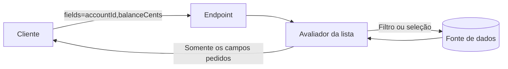

# Wish List

## Descrição

O padrão Wish List permite que o cliente enumere, na própria requisição, os elementos de dados que deseja, e o provedor devolve apenas esses elementos na resposta. É a forma mais simples de moldar a resposta (response shaping) conforme a necessidade de cada consumidor.

A lista costuma ser um [Atomic Parameter List](/architecture/api-patterns/basic-structure/atomic-parameter-list) ou uma [Parameter Tree](/architecture/api-patterns/basic-structure/parameter-tree) plana, como `fields=a,b,c` na query string. Um caso particular é um único [Atomic Parameter](/architecture/api-patterns/basic-structure/atomic-parameter) de nível de detalhe (`minimal`, `medium`, `full`). No provedor, um avaliador da lista pode traduzi-la para um filtro na fonte de dados (por exemplo, as colunas de um `SELECT`) ou buscar tudo e selecionar os campos ao montar a resposta. Variantes comuns: a **expansão**, em que a primeira resposta é enxuta e indica campos que podem ser pedidos depois, e o uso de **curingas**, como `*` ou `holder.*`.

## Problemas que resolve

- Clientes com necessidades diferentes de informação consumindo a mesma operação
- Respostas inchadas com campos que a maioria dos clientes ignora, gastando rede e processamento
- Proliferação de operações especializadas, uma para cada combinação de campos
- Carga desnecessária na fonte de dados quando só uma parte dos atributos é usada

## Quando usar

- Quando a rede é limitada (aplicativos móveis) e os clientes normalmente precisam só de um subconjunto dos dados
- Quando o recurso tem muitos atributos e há perfis de consumo bem distintos
- Quando se quer atender ao princípio da parcimônia de dados (Datensparsamkeit)
- Quando a estrutura da resposta é simples o bastante para ser descrita por nomes de campos

## Quando evitar

- Quando os clientes quase sempre usam tudo, e a lista só acrescentaria complexidade
- Quando a resposta tem estrutura aninhada que precisa ser selecionada por níveis: prefira o [Wish Template](/architecture/api-patterns/response-shaping/wish-template)
- Quando expor os nomes dos campos acoplaria demais os clientes ao modelo de dados interno
- Quando a equipe não consegue arcar com os testes e a manutenção extras

## Trade-offs

| Ganho | Custo / Risco |
| --- | --- |
| Menos dados na rede e menos carga na fonte de dados | O provedor ganha lógica extra nas camadas de serviço e de acesso a dados |
| Um único contrato atende clientes com necessidades diferentes | Os nomes dos campos expõem o modelo de dados e aumentam o acoplamento |
| Evita operações sob medida para cada cliente | Mais superfície de teste, com muitas combinações de campos |
| Fácil de entender e de documentar, por ser plana | Erros de digitação podem ser ignorados em silêncio, escondendo o problema |

- **Campos desconhecidos:** decida entre rejeitar com um [Error Report](/architecture/api-patterns/special-purpose-representations/error-report) ou ignorar; ignorar esconde erros de grafia e renomeações.
- **Evolução:** renomear um atributo quebra os clientes que o listam, então a lista passa a fazer parte do contrato.
- **Segurança:** valide a lista e aplique autorização por campo, pois o cliente escolhe o que sai.
- **Valor padrão:** sem lista, devolva um conjunto padrão e documente-o.
- **Variantes:** expansão e curingas ajudam, mas são mais difíceis de construir e de entender.

## Diagrama



O avaliador lê a lista de desejos da requisição e restringe a consulta ou a montagem da resposta aos campos enumerados.

## Exemplo

Na API da conta digital da fintech, `Account` tem vários atributos, mas uma tela de saldo precisa de apenas dois. O cliente faz a lista na query string. Valores em centavos.

```http
GET /accounts/acc-123?fields=accountId,balanceCents
```

```json
{ "accountId": "acc-123", "balanceCents": 152340 }
```

A seleção no provedor, rejeitando campos desconhecidos:

<Tabs groupId="lang" queryString>
<TabItem value="java" label="Java">

```java
import java.util.*;

public class Main {
    static final Map<String, Object> ACCOUNT = Map.of(
            "accountId", "acc-123", "holder", "Maria Silva",
            "balanceCents", 152340, "currency", "BRL", "status", "ACTIVE");

    static Map<String, Object> shape(String fields) {
        Map<String, Object> out = new LinkedHashMap<>();
        for (String f : fields.split(",")) {
            if (!ACCOUNT.containsKey(f)) {
                throw new IllegalArgumentException("unknown field: " + f);
            }
            out.put(f, ACCOUNT.get(f));
        }
        return out;
    }

    public static void main(String[] args) {
        System.out.println(shape("accountId,balanceCents")); // {accountId=acc-123, balanceCents=152340}
        try {
            shape("accountId,saldo");
        } catch (IllegalArgumentException e) {
            System.out.println(e.getMessage()); // unknown field: saldo
        }
    }
}
```

</TabItem>
<TabItem value="python" label="Python">

```python
from typing import Any, Dict

ACCOUNT = {"accountId": "acc-123", "holder": "Maria Silva",
           "balanceCents": 152340, "currency": "BRL", "status": "ACTIVE"}

def shape(fields: str) -> Dict[str, Any]:
    out = {}
    for f in fields.split(","):
        if f not in ACCOUNT:
            raise ValueError("unknown field: " + f)
        out[f] = ACCOUNT[f]
    return out

out = shape("accountId,balanceCents")
print("{" + ", ".join(f"{k}={v}" for k, v in out.items()) + "}")  # {accountId=acc-123, balanceCents=152340}
try:
    shape("accountId,saldo")
except ValueError as e:
    print(e)  # unknown field: saldo
```

</TabItem>
<TabItem value="go" label="Go">

```go
package main

import (
	"fmt"
	"strings"
)

var account = map[string]any{
	"accountId": "acc-123", "holder": "Maria Silva",
	"balanceCents": 152340, "currency": "BRL", "status": "ACTIVE",
}

// Go: o erro é um valor de retorno, não uma exceção.
func shape(fields string) (map[string]any, error) {
	out := map[string]any{}
	for _, f := range strings.Split(fields, ",") {
		v, ok := account[f]
		if !ok {
			return nil, fmt.Errorf("unknown field: %s", f)
		}
		out[f] = v
	}
	return out, nil
}

func main() {
	fields := "accountId,balanceCents"
	out, _ := shape(fields)
	parts := []string{}
	for _, f := range strings.Split(fields, ",") {
		parts = append(parts, fmt.Sprintf("%s=%v", f, out[f]))
	}
	fmt.Println("{" + strings.Join(parts, ", ") + "}") // {accountId=acc-123, balanceCents=152340}
	if _, err := shape("accountId,saldo"); err != nil {
		fmt.Println(err) // unknown field: saldo
	}
}
```

</TabItem>
</Tabs>

## Padrões relacionados

- [Wish Template](/architecture/api-patterns/response-shaping/wish-template) — mesmo problema, mas com uma estrutura aninhada no lugar de uma lista plana
- [Pagination](/architecture/api-patterns/response-shaping/pagination) — reduz a resposta dividindo coleções em páginas; combina bem com a Wish List
- [Conditional Request](/architecture/api-patterns/message-exchange-optimization/conditional-request) — evita reenviar o que o cliente já tem; pode ser somado para reduzir ainda mais a transferência
- [Rate Limit](/architecture/api-patterns/documentation/rate-limit) — menos dados por resposta ajudam a respeitar a cota
- [Atomic Parameter List](/architecture/api-patterns/basic-structure/atomic-parameter-list) — a forma típica da lista de desejos
- [Embedded Entity](/architecture/api-patterns/message-granularity/embedded-entity) e [Linked Information Holder](/architecture/api-patterns/message-granularity/linked-information-holder) — a expansão de campos decide, por pedido, entre embutir e linkar
- [Backends for Frontends](/architecture/cloud-design-patterns/gateways-and-edge/backends-for-frontends) — outra resposta ao problema de clientes diferentes, com um backend por cliente em vez de um contrato configurável

## Referência

- [Patterns for API Design, capítulo 7: Wish List](https://api-patterns.org/)
