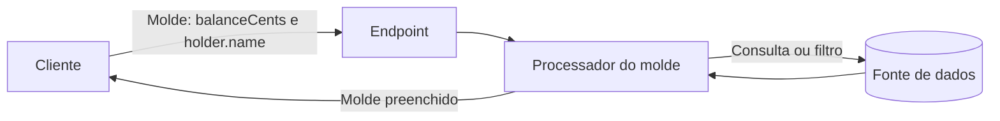

# Wish Template

## Descrição

O padrão Wish Template permite que o cliente descreva, na requisição, uma estrutura que espelha a forma da resposta desejada, marcando quais elementos, inclusive aninhados, quer receber. O provedor usa esse modelo como molde e o preenche com os dados reais.

O modelo costuma ser uma [Parameter Tree](/architecture/api-patterns/basic-structure/parameter-tree) cujos elementos são opcionais ou booleanos: `true` indica interesse, e um valor de exemplo ou vazio também pode servir. Um processador do modelo percorre a árvore para montar a consulta ou extrair as partes relevantes do resultado, o que pode ser feito com navegação em JSON, XPath ou, em modelos mais ricos, uma linguagem de consulta declarativa que exige análise sintática. O GraphQL é uma realização avançada do padrão: o esquema de consulta é o molde, e os resolvers fazem o preenchimento.

## Problemas que resolve

- Clientes que precisam de partes diferentes de dados profundamente aninhados
- Uma lista plana ([Wish List](/architecture/api-patterns/response-shaping/wish-list)) que não consegue dizer "só o nome do titular, mas o saldo todo"
- Respostas de tamanho único que crescem com a evolução da API até virarem a união de todos os desejos
- Dificuldade de remover campos de uma API sem quebrar clientes desconhecidos

## Quando usar

- Quando o recurso tem estrutura aninhada rica e os clientes usam subconjuntos muito diferentes
- Quando a resposta plana e a Wish List não têm expressividade suficiente
- Quando há muitos atributos e opções de configuração, como em domínios de infraestrutura ou análise de dados
- Quando o custo de um processador de moldes é compensado pela flexibilidade e pelo ganho de desempenho

## Quando evitar

- Quando uma Wish List simples já expressa o desejo: ela é mais fácil de especificar e de entender
- Quando a equipe não consegue sustentar o componente extra (teste, manutenção e risco técnico) embutido na API
- Quando aninhamentos profundos podem sobrecarregar a infraestrutura e o provedor não limita a profundidade
- Quando um backend por cliente ([Backends for Frontends](/architecture/cloud-design-patterns/gateways-and-edge/backends-for-frontends)) é mais simples de operar

## Trade-offs

| Ganho | Custo / Risco |
| --- | --- |
| Expressa desejos aninhados com precisão, por nível | A notação do molde é mais complexa de definir, de validar e de entender |
| Respostas menores e menos carga na fonte de dados | O processador do molde pode virar um middleware grande dentro da API |
| Os clientes escolhem o que veem, sem operações sob medida | Moldes profundos ou custosos podem sobrecarregar o provedor e abrir brechas de segurança |
| Favorece a parcimônia de dados e a evolução gradual | Sem esquema validado nos dois lados, repete os problemas da Wish List |

- **Erros:** decida o que fazer com desejos impossíveis; ignorá-los em silêncio esconde erros de digitação e renomeações.
- **Profundidade:** limite o nível de aninhamento e o custo por requisição.
- **Esquema:** valide o molde contra um esquema (por exemplo, JSON Schema) para evitar surpresas.
- **GraphQL:** adotá-lo traz um servidor próprio, que analisa as consultas e chama resolvers; é um investimento maior.
- **Autorização:** aplique-a por campo, já que o cliente escolhe o que pede.

## Diagrama



O processador percorre o molde recebido, busca só o que foi marcado e devolve uma resposta com a mesma estrutura.

## Exemplo

Uma tela da conta digital precisa do saldo e apenas do nome do titular, sem o CPF. O molde espelha a estrutura de `Account`. Valores em centavos.

```http
POST /accounts/acc-123/query
Content-Type: application/json

{ "wish": { "balanceCents": true, "holder": { "name": true } } }
```

```json
{ "balanceCents": 152340, "holder": { "name": "Maria Silva" } }
```

O preenchimento do molde no provedor, com um laço recursivo (a saída lista cada caminho em ordem alfabética):

<Tabs groupId="lang" queryString>
<TabItem value="java" label="Java">

```java
import java.util.*;

public class Main {
    static void fill(Map<String, Object> data, Map<String, Object> wish, String prefix) {
        for (String key : new TreeMap<>(wish).keySet()) {
            if (!data.containsKey(key)) {
                throw new IllegalArgumentException("unknown field: " + prefix + key);
            }
            Object w = wish.get(key);
            if (w instanceof Map<?, ?> nested) {
                @SuppressWarnings("unchecked")
                Map<String, Object> n = (Map<String, Object>) nested;
                @SuppressWarnings("unchecked")
                Map<String, Object> child = (Map<String, Object>) data.get(key);
                fill(child, n, prefix + key + ".");
            } else if (Boolean.TRUE.equals(w)) {
                System.out.println(prefix + key + "=" + data.get(key));
            }
        }
    }

    public static void main(String[] args) {
        Map<String, Object> account = Map.of(
                "accountId", "acc-123", "balanceCents", 152340,
                "holder", Map.of("name", "Maria Silva", "taxId", "123.456.789-09"));
        Map<String, Object> wish = Map.of("balanceCents", true, "holder", Map.of("name", true));
        fill(account, wish, "");
        // balanceCents=152340
        // holder.name=Maria Silva
    }
}
```

</TabItem>
<TabItem value="python" label="Python">

```python
from typing import Any, Dict

ACCOUNT = {"accountId": "acc-123", "balanceCents": 152340,
           "holder": {"name": "Maria Silva", "taxId": "123.456.789-09"}}

def fill(data: Dict[str, Any], wish: Dict[str, Any], prefix: str = "") -> None:
    for key in sorted(wish):
        if key not in data:
            raise ValueError("unknown field: " + prefix + key)
        if isinstance(wish[key], dict):
            fill(data[key], wish[key], prefix + key + ".")
        elif wish[key] is True:
            print(prefix + key + "=" + str(data[key]))

fill(ACCOUNT, {"balanceCents": True, "holder": {"name": True}})
# balanceCents=152340
# holder.name=Maria Silva
```

</TabItem>
<TabItem value="go" label="Go">

```go
package main

import (
	"fmt"
	"sort"
)

// Go: o erro é um valor de retorno, não uma exceção.
func fill(data, wish map[string]any, prefix string) error {
	keys := make([]string, 0, len(wish))
	for k := range wish {
		keys = append(keys, k)
	}
	sort.Strings(keys)
	for _, key := range keys {
		value, ok := data[key]
		if !ok {
			return fmt.Errorf("unknown field: %s%s", prefix, key)
		}
		switch w := wish[key].(type) {
		case map[string]any:
			if err := fill(value.(map[string]any), w, prefix+key+"."); err != nil {
				return err
			}
		case bool:
			if w {
				fmt.Printf("%s%s=%v\n", prefix, key, value)
			}
		}
	}
	return nil
}

func main() {
	account := map[string]any{
		"accountId": "acc-123", "balanceCents": 152340,
		"holder": map[string]any{"name": "Maria Silva", "taxId": "123.456.789-09"},
	}
	wish := map[string]any{"balanceCents": true, "holder": map[string]any{"name": true}}
	_ = fill(account, wish, "")
	// balanceCents=152340
	// holder.name=Maria Silva
}
```

</TabItem>
</Tabs>

## Padrões relacionados

- [Wish List](/architecture/api-patterns/response-shaping/wish-list) — mesmo problema com uma lista plana de nomes; mais simples, mas menos expressiva para dados aninhados
- [Parameter Tree](/architecture/api-patterns/basic-structure/parameter-tree) — a estrutura do molde e, em geral, a da resposta
- [Pagination](/architecture/api-patterns/response-shaping/pagination) — reduz a resposta dividindo coleções em páginas, e pode ser combinada com o molde
- [Rate Limit](/architecture/api-patterns/documentation/rate-limit) — menos dados e menos requisições ajudam a ficar dentro da cota
- [Embedded Entity](/architecture/api-patterns/message-granularity/embedded-entity) — o molde decide por pedido quais entidades aninhadas vêm embutidas
- [Gateway Aggregation](/architecture/cloud-design-patterns/gateways-and-edge/gateway-aggregation) — agrega dados de vários serviços numa resposta; o molde define a forma da resposta no cliente
- [Data Transfer Object](/design/poeaa/distribution/data-transfer-object) — objeto de transferência de forma fixa; o molde torna a forma variável por requisição

## Referência

- [Patterns for API Design, capítulo 7: Wish Template](https://api-patterns.org/)
- [GraphQL](https://graphql.org/learn/)
