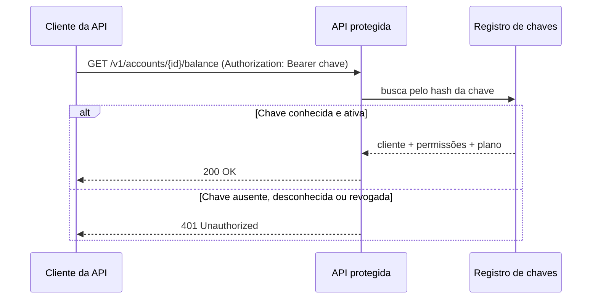

# API Key

## Descrição

O padrão API Key identifica o cliente de uma API por meio de um token único e difícil de adivinhar, emitido pelo provedor e enviado em cada requisição como um simples texto.

A chave é um segredo compartilhado entre o cliente (um programa, não uma pessoa) e o endpoint. Como é uma única string, cabe em um cabeçalho de requisição (o mais comum e recomendado), no corpo da mensagem ou, só em último caso, na query string, onde acaba em logs e ferramentas de análise. Ela identifica o *chamador*, não o usuário final: o provedor a usa para associar a requisição a um cliente cadastrado, aplicar [Rate Limit](/architecture/api-patterns/documentation/rate-limit), cobrar conforme um [Pricing Plan](/architecture/api-patterns/documentation/pricing-plan) e liberar ou negar operações.

Separar a chave das credenciais da conta do cliente permite emitir várias chaves por cliente, com permissões distintas, e revogar uma delas sem afetar o cadastro. O provedor deve gerar chaves únicas e imprevisíveis (por exemplo, bytes aleatórios de um gerador criptográfico), guardar apenas o hash delas e exigir HTTPS, já que quem possui a chave é tratado como o cliente.

## Problemas que resolve

- Associar cada requisição a um cliente cadastrado sem exigir usuário e senha a cada chamada
- Evitar que equipes técnicas precisem usar as credenciais da conta (e, com elas, os dados de cobrança) para configurar integrações
- Medir uso, aplicar limites e cobrar por cliente ou por chave
- Revogar ou rotacionar o acesso de uma integração sem afetar as demais

## Quando usar

- Em APIs com clientes cadastrados, como uma [Public API](/architecture/api-patterns/foundations/public-api) ou uma [Community API](/architecture/api-patterns/foundations/community-api), em que o requisito é identificar o chamador
- Quando o ganho de segurança de protocolos completos não compensa o custo de adoção para quem integra
- Quando é preciso ter limites, métricas e cobrança por cliente
- Em integrações entre servidores, em que a chave pode ficar guardada com segurança

## Quando evitar

- Quando a API age em nome de um usuário final ou de terceiros: prefira OAuth 2.0 e OpenID Connect
- Em aplicações executadas no dispositivo do usuário (web ou móvel), onde a chave fica exposta
- Quando há requisitos fortes de confidencialidade, não repúdio ou controle fino de permissões, que pedem um protocolo de autenticação e autorização completo
- Quando a chave teria de trafegar sem HTTPS ou outra proteção de canal

## Trade-offs

| Ganho | Custo / Risco |
| --- | --- |
| Identificação simples, de baixo custo de adoção e de processamento | É só um identificador: não carrega expiração, escopos ou dados do usuário |
| Chaves múltiplas e revogáveis, independentes da conta | Quem obtém a chave se passa pelo cliente, então o vazamento é crítico |
| Base para Rate Limit, métricas e cobrança por cliente | Não autentica usuários finais nem serve para delegação a terceiros |
| Pequena o bastante para ir em toda requisição | Depende de canal seguro e de boa gestão (emissão, rotação, armazenamento) |

- **Armazenamento:** guarde no servidor apenas o hash da chave, como se faz com senhas, e mostre o valor original uma única vez, na criação.
- **Transporte:** envie no cabeçalho `Authorization`, sempre sobre HTTPS; evite a query string.
- **Integridade:** quando é preciso garantir que a requisição não foi alterada, combine a chave com um segredo compartilhado usado para assinar a mensagem, sem nunca transmiti-lo.
- **Escopo:** a chave identifica o cliente; as permissões ficam associadas a ela no provedor, e não dentro dela.

## Diagrama



O cliente envia a chave em todas as chamadas; o endpoint a resolve para um cliente cadastrado, que determina permissões, limites e cobrança.

## Exemplo

A fintech oferece uma API de consulta de saldo a parceiros. Cada parceiro recebe uma chave, e a requisição fica assim (chave ilustrativa):

```http
GET /v1/accounts/acc-1042/balance HTTP/1.1
Host: api.fintech.example
Authorization: Bearer fk_7f3a9c21d84be650
```

O registro guarda apenas o hash SHA-256 de cada chave e resolve o cabeçalho para o identificador do parceiro.

<Tabs groupId="lang" queryString>
<TabItem value="java" label="Java">

```java
import java.nio.charset.StandardCharsets;
import java.security.MessageDigest;
import java.util.HashMap;
import java.util.Map;
import java.util.Optional;

class ApiKeyRegistry {
    private final Map<String, String> clientByHash = new HashMap<>();

    static String sha256(String key) throws Exception {
        byte[] digest = MessageDigest.getInstance("SHA-256")
                .digest(key.getBytes(StandardCharsets.UTF_8));
        StringBuilder hex = new StringBuilder();
        for (byte b : digest) hex.append(String.format("%02x", b));
        return hex.toString();
    }

    void register(String clientId, String key) throws Exception {
        clientByHash.put(sha256(key), clientId); // só o hash é guardado
    }

    Optional<String> authenticate(String authorization) throws Exception {
        if (authorization == null || !authorization.startsWith("Bearer ")) {
            return Optional.empty();
        }
        return Optional.ofNullable(clientByHash.get(sha256(authorization.substring(7))));
    }
}

public class Main {
    public static void main(String[] args) throws Exception {
        ApiKeyRegistry registry = new ApiKeyRegistry();
        registry.register("partner-42", "fk_7f3a9c21d84be650");

        System.out.println(registry.authenticate("Bearer fk_7f3a9c21d84be650").orElse("rejected"));
        System.out.println(registry.authenticate("Bearer fk_wrong").orElse("rejected"));
    }
}
```

</TabItem>
<TabItem value="python" label="Python">

```python
import hashlib
from typing import Dict, Optional


def sha256(key: str) -> str:
    return hashlib.sha256(key.encode("utf-8")).hexdigest()


class ApiKeyRegistry:
    def __init__(self) -> None:
        self._client_by_hash: Dict[str, str] = {}

    def register(self, client_id: str, key: str) -> None:
        self._client_by_hash[sha256(key)] = client_id  # só o hash é guardado

    def authenticate(self, authorization: Optional[str]) -> Optional[str]:
        if not authorization or not authorization.startswith("Bearer "):
            return None
        return self._client_by_hash.get(sha256(authorization[len("Bearer "):]))


registry = ApiKeyRegistry()
registry.register("partner-42", "fk_7f3a9c21d84be650")

print(registry.authenticate("Bearer fk_7f3a9c21d84be650") or "rejected")
print(registry.authenticate("Bearer fk_wrong") or "rejected")
```

</TabItem>
<TabItem value="go" label="Go">

```go
package main

import (
	"crypto/sha256"
	"encoding/hex"
	"fmt"
	"strings"
)

func hashKey(key string) string {
	sum := sha256.Sum256([]byte(key))
	return hex.EncodeToString(sum[:])
}

type ApiKeyRegistry struct {
	clientByHash map[string]string
}

func NewApiKeyRegistry() *ApiKeyRegistry {
	return &ApiKeyRegistry{clientByHash: map[string]string{}}
}

func (r *ApiKeyRegistry) Register(clientID, key string) {
	r.clientByHash[hashKey(key)] = clientID // só o hash é guardado
}

// Em Go o "não encontrado" é o segundo retorno, em vez de Optional ou None.
func (r *ApiKeyRegistry) Authenticate(authorization string) (string, bool) {
	if !strings.HasPrefix(authorization, "Bearer ") {
		return "", false
	}
	clientID, ok := r.clientByHash[hashKey(strings.TrimPrefix(authorization, "Bearer "))]
	return clientID, ok
}

func main() {
	registry := NewApiKeyRegistry()
	registry.Register("partner-42", "fk_7f3a9c21d84be650")

	for _, header := range []string{"Bearer fk_7f3a9c21d84be650", "Bearer fk_wrong"} {
		if clientID, ok := registry.Authenticate(header); ok {
			fmt.Println(clientID)
		} else {
			fmt.Println("rejected")
		}
	}
}
```

</TabItem>
</Tabs>

Saída:

```text
partner-42
rejected
```

## Padrões relacionados

- [Rate Limit](/architecture/api-patterns/documentation/rate-limit) — usa a identidade da chave para contar e limitar o uso por cliente
- [Pricing Plan](/architecture/api-patterns/documentation/pricing-plan) — associa a chave ao plano contratado e à cobrança
- [Atomic Parameter](/architecture/api-patterns/basic-structure/atomic-parameter) — é a forma de representação da chave: um valor simples e único
- [Context Representation](/architecture/api-patterns/special-purpose-representations/context-representation) — pode transportar a chave no corpo, quando não se quer depender de cabeçalhos do protocolo
- [Access Token](/architecture/microservices/security/access-token) — um token pode carregar identidade, escopos e expiração do usuário; a API Key só identifica o cliente da API
- [Public API](/architecture/api-patterns/foundations/public-api) — o tipo de API em que a identificação do cliente costuma ser exigida

## Referência

- [Patterns for API Design, capítulo 6: API Key](https://api-patterns.org/)
- [OWASP REST Security Cheat Sheet](https://cheatsheetseries.owasp.org/cheatsheets/REST_Security_Cheat_Sheet.html)
