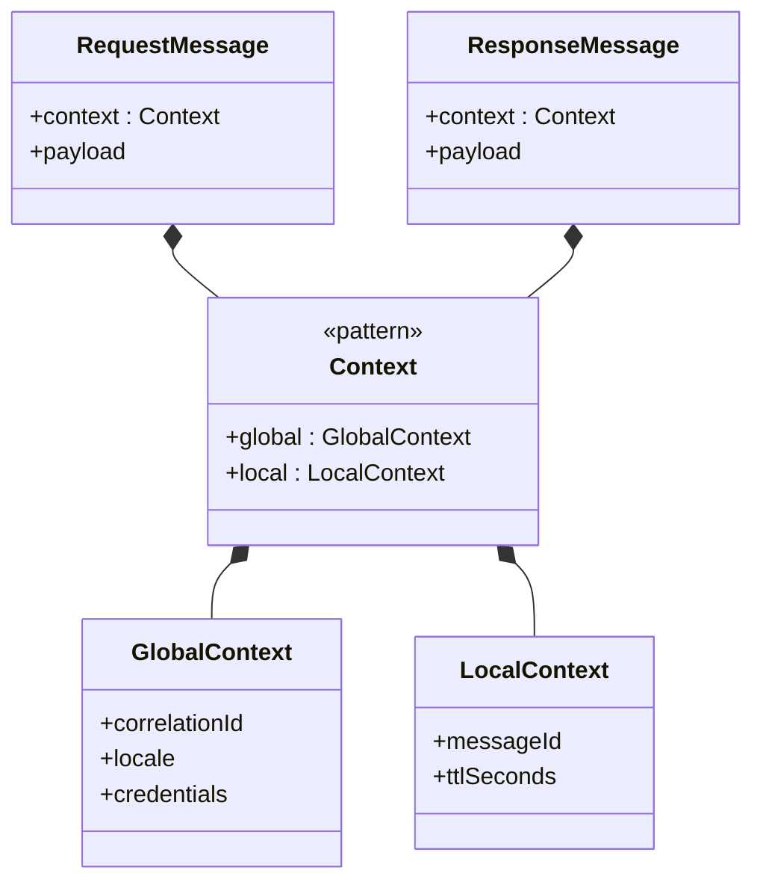

# Context Representation

## Descrição

O padrão Context Representation agrupa as informações de contexto trocadas entre cliente e provedor (identidade, preferências, qualidade de serviço, correlação) em um elemento próprio e reconhecível dentro do corpo da mensagem, em vez de espalhá-las em cabeçalhos do protocolo de comunicação.

O elemento é normalmente uma [Parameter Tree](/architecture/api-patterns/basic-structure/parameter-tree) de complexidade baixa ou média, composta de [Metadata Elements](/architecture/api-patterns/element-stereotypes/metadata-element) como identificadores de correlação e de sessão, prioridade, idioma, localização, versão do cliente ou credenciais como uma [API Key](/architecture/api-patterns/special-purpose-representations/api-key). Quando só há números ou enumerações, uma [Atomic Parameter List](/architecture/api-patterns/basic-structure/atomic-parameter-list) basta. Por viver no payload, o contexto atravessa gateways, filas e trocas de protocolo sem depender de como cada um trata cabeçalhos, e permanece sob controle do desenhista da API.

O padrão tem duas variantes. O **contexto global** vale por toda uma conversa (várias chamadas, um processo de negócio, chamadas aninhadas em que o provedor age também como cliente) e é repassado de operação em operação, como o identificador de correlação ou o token do usuário. O **contexto local** vale só para a mensagem atual, como o identificador da mensagem ou seu tempo de vida. Separá-los na estrutura deixa claro quem os processa: o global costuma ser tratado por gateways e bibliotecas compartilhadas; o local, pela implementação da operação.

## Problemas que resolve

- Informações de controle (idioma, prioridade, correlação, credenciais) que se perdem ao cruzar intermediários ou ao trocar de protocolo
- Dependência de cabeçalhos específicos de um protocolo, que complicam a migração de HTTP para outro transporte
- Falta de um local único e previsível para metadados, o que os mistura aos dados de negócio
- Rastreamento e auditoria de uma conversa que passa por várias chamadas e serviços

## Quando usar

- Quando as mensagens podem atravessar gateways, barramentos ou protocolos diferentes e o contexto precisa chegar intacto
- Quando uma operação depende de metadados de conversa, como correlação, sessão ou token, repassados em chamadas encadeadas
- Quando a API deve ser independente do protocolo de comunicação
- Quando várias operações compartilham os mesmos metadados e vale padronizar onde eles ficam

## Quando evitar

- Quando um único protocolo é garantido e seus cabeçalhos padrão (como `Authorization` ou `Accept-Language` no HTTP) já cobrem o necessário, com suporte de frameworks e infraestrutura
- Quando o contexto é mínimo, de um ou dois valores, e uma [Atomic Parameter](/architecture/api-patterns/basic-structure/atomic-parameter) resolve
- Quando a infraestrutura (caches, balanceadores) precisa enxergar o valor sem ler o corpo
- Quando cada operação teria um contexto diferente, o que tira o ganho da padronização

## Trade-offs

| Ganho | Custo / Risco |
| --- | --- |
| Independência do protocolo e dos cabeçalhos dos intermediários | Perde-se o suporte pronto de frameworks e da infraestrutura para cabeçalhos padrão |
| Ponto único e reconhecível para metadados, sob controle da API | Cliente e provedor precisam implementar, documentar e testar o tratamento |
| Contexto global propagado em conversas e chamadas aninhadas | O contexto cresce com o tempo e pode virar um depósito de dados avulsos |
| Rastreabilidade e auditoria de ponta a ponta | Cada mensagem fica um pouco maior, e o corpo precisa ser lido para extrair o contexto |

- **Consistência:** use a mesma estrutura e o mesmo lugar em todas as operações; se o contexto variar muito, modele uma hierarquia de abstração e refinamento ou campos opcionais com valores padrão.
- **Escopo:** separe contexto global de local, para saber o que deve ser repassado adiante e o que vale apenas para a mensagem.
- **Segurança:** credenciais e tokens no contexto exigem canal protegido e cuidado para não vazarem em logs.
- **Encadeamento:** em chamadas aninhadas, o provedor que age como cliente repassa o contexto global e gera um novo contexto local.

## Diagrama



Requisição e resposta carregam um elemento de contexto no corpo, dividido em uma parte global, que acompanha a conversa, e uma local, que vale só para a mensagem.

## Exemplo

A API de pagamentos da fintech recebe, junto com uma `PixCharge`, um elemento `context` no corpo. O `correlationId` e o idioma são globais; o `messageId` e o tempo de vida são locais:

```http
POST /v1/pix-charges/charge-881/payments HTTP/1.1
Content-Type: application/json

{
  "context": {
    "global": {"correlationId": "corr-9d2e", "locale": "pt-BR"},
    "local": {"messageId": "msg-1", "ttlSeconds": 30}
  },
  "amountCents": 25000
}
```

Ao chamar o serviço de razão contábil (`LedgerEntry`), o provedor repassa o contexto global e gera um novo contexto local.

<Tabs groupId="lang" queryString>
<TabItem value="java" label="Java">

```java
record GlobalContext(String correlationId, String locale) {}

record LocalContext(String messageId, int ttlSeconds) {}

record RequestContext(GlobalContext global, LocalContext local) {
    // Chamada aninhada: o contexto global segue, o local é novo.
    RequestContext next(String messageId) {
        return new RequestContext(global, new LocalContext(messageId, local.ttlSeconds()));
    }

    String toJson() {
        return String.format(
            "{\"global\":{\"correlationId\":\"%s\",\"locale\":\"%s\"},"
                + "\"local\":{\"messageId\":\"%s\",\"ttlSeconds\":%d}}",
            global.correlationId(), global.locale(), local.messageId(), local.ttlSeconds());
    }
}

public class Main {
    public static void main(String[] args) {
        RequestContext incoming = new RequestContext(
            new GlobalContext("corr-9d2e", "pt-BR"), new LocalContext("msg-1", 30));
        System.out.println(incoming.toJson());
        System.out.println(incoming.next("msg-2").toJson());
    }
}
```

</TabItem>
<TabItem value="python" label="Python">

```python
import json
from dataclasses import asdict, dataclass, replace


@dataclass(frozen=True)
class GlobalContext:
    correlationId: str
    locale: str


@dataclass(frozen=True)
class LocalContext:
    messageId: str
    ttlSeconds: int


@dataclass(frozen=True)
class RequestContext:
    glob: GlobalContext  # "global" é palavra reservada em Python
    local: LocalContext

    def next(self, message_id: str) -> "RequestContext":
        # Chamada aninhada: o contexto global segue, o local é novo.
        return RequestContext(self.glob, replace(self.local, messageId=message_id))

    def to_json(self) -> str:
        data = asdict(self)
        return json.dumps({"global": data["glob"], "local": data["local"]}, separators=(",", ":"))


incoming = RequestContext(GlobalContext("corr-9d2e", "pt-BR"), LocalContext("msg-1", 30))
print(incoming.to_json())
print(incoming.next("msg-2").to_json())
```

</TabItem>
<TabItem value="go" label="Go">

```go
package main

import (
	"encoding/json"
	"fmt"
)

type GlobalContext struct {
	CorrelationID string `json:"correlationId"`
	Locale        string `json:"locale"`
}

type LocalContext struct {
	MessageID  string `json:"messageId"`
	TTLSeconds int    `json:"ttlSeconds"`
}

type RequestContext struct {
	Global GlobalContext `json:"global"`
	Local  LocalContext  `json:"local"`
}

// Chamada aninhada: o contexto global segue, o local é novo.
// Em Go a struct é copiada por valor, então o original não muda.
func (c RequestContext) Next(messageID string) RequestContext {
	c.Local.MessageID = messageID
	return c
}

func main() {
	incoming := RequestContext{
		Global: GlobalContext{CorrelationID: "corr-9d2e", Locale: "pt-BR"},
		Local:  LocalContext{MessageID: "msg-1", TTLSeconds: 30},
	}
	for _, ctx := range []RequestContext{incoming, incoming.Next("msg-2")} {
		body, _ := json.Marshal(ctx)
		fmt.Println(string(body))
	}
}
```

</TabItem>
</Tabs>

Saída:

```text
{"global":{"correlationId":"corr-9d2e","locale":"pt-BR"},"local":{"messageId":"msg-1","ttlSeconds":30}}
{"global":{"correlationId":"corr-9d2e","locale":"pt-BR"},"local":{"messageId":"msg-2","ttlSeconds":30}}
```

## Padrões relacionados

- [Metadata Element](/architecture/api-patterns/element-stereotypes/metadata-element) — os itens que compõem o contexto
- [Parameter Tree](/architecture/api-patterns/basic-structure/parameter-tree) — a estrutura usual do elemento de contexto
- [Atomic Parameter List](/architecture/api-patterns/basic-structure/atomic-parameter-list) — alternativa quando o contexto tem só valores simples
- [API Key](/architecture/api-patterns/special-purpose-representations/api-key) — uma credencial que pode viajar no contexto
- [Error Report](/architecture/api-patterns/special-purpose-representations/error-report) — pode fazer parte do contexto das respostas
- [Wish List](/architecture/api-patterns/response-shaping/wish-list) — preferências do cliente podem ser transportadas no contexto
- [Envelope Wrapper](/architecture/eip/message-transformation/envelope-wrapper) — também separa metadados da carga útil, mas na camada de mensageria, para a infraestrutura; aqui o contexto é parte do contrato da API
- [Correlation Identifier](/architecture/eip/message-construction/correlation-identifier) — o identificador de correlação é o item mais comum do contexto global

## Referência

- [Patterns for API Design, capítulo 6: Context Representation](https://api-patterns.org/)
