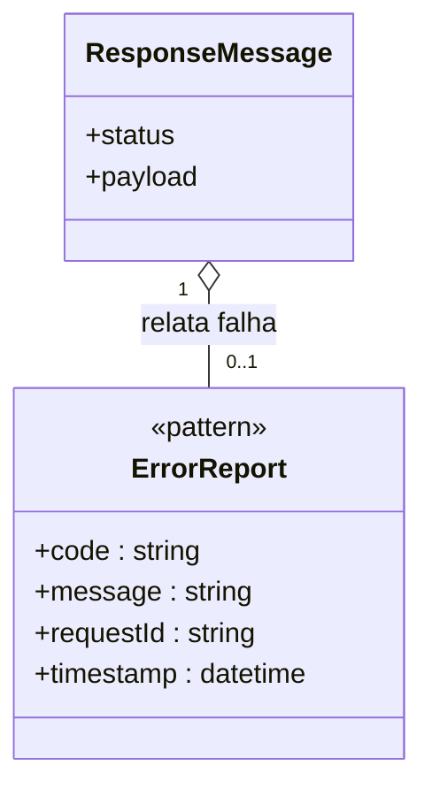

# Error Report

## Descrição

O padrão Error Report informa ao cliente que uma requisição falhou por meio de uma representação na própria mensagem de resposta, com um código de erro legível por máquina e uma descrição textual para pessoas, independente do protocolo de transporte.

O relatório é, em essência, uma [Atomic Parameter List](/architecture/api-patterns/basic-structure/atomic-parameter-list): um código (que pode ser um [Id Element](/architecture/api-patterns/element-stereotypes/id-element)) e um texto, muitas vezes acompanhados de um identificador de correlação para que o provedor localize a requisição em seus logs e de um carimbo de data e hora. O código permite ao cliente tratar o erro de forma programática; o texto ajuda desenvolvedores, operadores e suporte a entender o que houve e como corrigir.

Os códigos do protocolo (como os status HTTP 4xx e 5xx) continuam úteis para intermediários e ferramentas de monitoramento, mas não deveriam ser o único meio: o relatório no corpo descreve falhas de negócio com mais granularidade e sobrevive a uma troca de protocolo. O formato do RFC 7807 (Problem Details for HTTP APIs) é uma forma padronizada de fazer isso.

## Problemas que resolve

- Clientes que só recebem um status genérico e não sabem se devem corrigir a requisição, tentar de novo ou desistir
- Dificuldade de diagnóstico, por falta de informação sobre a causa e de um identificador para correlacionar com os logs do provedor
- Dependência de códigos específicos do protocolo, que não existem ao trocar HTTP por mensageria ou outro transporte
- Mensagens ad hoc, diferentes em cada operação, que obrigam o cliente a interpretar texto livre

## Quando usar

- Em qualquer API em que clientes precisem reagir de forma diferente a diferentes falhas
- Quando erros de negócio (saldo insuficiente, limite excedido) precisam ser distinguidos de erros de transporte
- Quando o suporte e as equipes de integração dependem de um identificador para investigar chamadas que falharam
- Em APIs que podem ser expostas por mais de um protocolo ou atravessar intermediários que reescrevem cabeçalhos

## Quando evitar

- Quando o único requisito é sinalizar sucesso ou falha, e o status do protocolo já basta, como em chamadas internas simples
- Quando a mensagem revelaria detalhes internos (pilhas de execução, nomes de tabelas) ou a existência de uma conta, o que facilitaria ataques
- Quando não há padrão de códigos definido: um relatório sem códigos estáveis obriga o cliente a ler o texto

## Trade-offs

| Ganho | Custo / Risco |
| --- | --- |
| Tratamento programático de erros por código estável | Os códigos viram parte do contrato e precisam ser mantidos e documentados |
| Diagnóstico mais rápido, com mensagem e identificador de correlação | Mensagens detalhadas podem vazar informações internas ou sensíveis |
| Independência do protocolo de transporte | Duplica parte da informação do status HTTP, com risco de inconsistência |
| Granularidade maior que as categorias do protocolo | Mensagens para pessoas podem precisar de internacionalização |

- **Segurança:** não exponha pilhas de execução nem detalhes de implementação; em falhas de login, não diga se o usuário existe.
- **Código sempre presente:** mesmo com mensagens traduzidas, mantenha um código legível por máquina, para que o cliente possa trocar o texto exibido.
- **Separação de responsabilidades:** problemas de comunicação ficam no status do protocolo; problemas de processamento da aplicação, no relatório do corpo.
- **Lotes:** em um [Request Bundle](/architecture/api-patterns/message-exchange-optimization/request-bundle), relate o resultado de cada item e também o do lote como um todo.

## Diagrama



Quando a operação falha, a resposta traz um `ErrorReport` com o código, a descrição, o identificador da requisição e o momento em que o erro ocorreu.

## Exemplo

Um cliente tenta pagar uma `PixCharge` de R$ 250,00, mas o saldo da `Account` é insuficiente. A resposta combina o status HTTP com um relatório no corpo:

```http
HTTP/1.1 422 Unprocessable Entity
Content-Type: application/json

{"code":"INSUFFICIENT_FUNDS","message":"Saldo insuficiente","requestId":"req-7f3a","timestamp":"2026-11-15T10:32:00Z"}
```

O código abaixo converte uma falha de domínio em um `ErrorReport`, sem expor detalhes internos, e o serializa.

<Tabs groupId="lang" queryString>
<TabItem value="java" label="Java">

```java
class InsufficientFundsException extends RuntimeException {
    InsufficientFundsException(long balanceCents, long amountCents) {
        super("balance " + balanceCents + " < " + amountCents); // detalhe interno, não vai ao cliente
    }
}

record ErrorReport(String code, String message, String requestId, String timestamp) {
    String toJson() {
        return String.format(
            "{\"code\":\"%s\",\"message\":\"%s\",\"requestId\":\"%s\",\"timestamp\":\"%s\"}",
            code, message, requestId, timestamp);
    }
}

public class Main {
    static ErrorReport toReport(RuntimeException e, String requestId, String now) {
        if (e instanceof InsufficientFundsException) {
            return new ErrorReport("INSUFFICIENT_FUNDS", "Saldo insuficiente", requestId, now);
        }
        return new ErrorReport("INTERNAL_ERROR", "Erro inesperado", requestId, now);
    }

    public static void main(String[] args) {
        try {
            throw new InsufficientFundsException(12_000, 25_000);
        } catch (RuntimeException e) {
            System.out.println(toReport(e, "req-7f3a", "2026-11-15T10:32:00Z").toJson());
        }
    }
}
```

</TabItem>
<TabItem value="python" label="Python">

```python
import json
from dataclasses import asdict, dataclass


class InsufficientFundsError(Exception):
    def __init__(self, balance_cents: int, amount_cents: int) -> None:
        super().__init__("balance %d < %d" % (balance_cents, amount_cents))  # detalhe interno, não vai ao cliente


@dataclass
class ErrorReport:
    code: str
    message: str
    requestId: str
    timestamp: str

    def to_json(self) -> str:
        return json.dumps(asdict(self), separators=(",", ":"))


def to_report(error: Exception, request_id: str, now: str) -> ErrorReport:
    if isinstance(error, InsufficientFundsError):
        return ErrorReport("INSUFFICIENT_FUNDS", "Saldo insuficiente", request_id, now)
    return ErrorReport("INTERNAL_ERROR", "Erro inesperado", request_id, now)


try:
    raise InsufficientFundsError(12_000, 25_000)
except Exception as error:
    print(to_report(error, "req-7f3a", "2026-11-15T10:32:00Z").to_json())
```

</TabItem>
<TabItem value="go" label="Go">

```go
package main

import (
	"encoding/json"
	"errors"
	"fmt"
)

var ErrInsufficientFunds = errors.New("insufficient funds") // detalhe interno, não vai ao cliente

type ErrorReport struct {
	Code      string `json:"code"`
	Message   string `json:"message"`
	RequestID string `json:"requestId"`
	Timestamp string `json:"timestamp"`
}

func toReport(err error, requestID, now string) ErrorReport {
	if errors.Is(err, ErrInsufficientFunds) {
		return ErrorReport{"INSUFFICIENT_FUNDS", "Saldo insuficiente", requestID, now}
	}
	return ErrorReport{"INTERNAL_ERROR", "Erro inesperado", requestID, now}
}

// Em Go a falha chega como valor de error, não como exceção.
func pay(balanceCents, amountCents int64) error {
	if balanceCents < amountCents {
		return fmt.Errorf("balance %d < %d: %w", balanceCents, amountCents, ErrInsufficientFunds)
	}
	return nil
}

func main() {
	if err := pay(12_000, 25_000); err != nil {
		body, _ := json.Marshal(toReport(err, "req-7f3a", "2026-11-15T10:32:00Z"))
		fmt.Println(string(body))
	}
}
```

</TabItem>
</Tabs>

Saída:

```text
{"code":"INSUFFICIENT_FUNDS","message":"Saldo insuficiente","requestId":"req-7f3a","timestamp":"2026-11-15T10:32:00Z"}
```

## Padrões relacionados

- [Context Representation](/architecture/api-patterns/special-purpose-representations/context-representation) — o relatório de erro pode ser parte do contexto da resposta
- [Metadata Element](/architecture/api-patterns/element-stereotypes/metadata-element) — o relatório pode incluir metadados, como os próximos passos possíveis para contornar o problema
- [Id Element](/architecture/api-patterns/element-stereotypes/id-element) — o código de erro e o identificador da requisição seguem esse estereótipo
- [Atomic Parameter List](/architecture/api-patterns/basic-structure/atomic-parameter-list) — a estrutura típica do relatório: poucos valores simples
- [Request Bundle](/architecture/api-patterns/message-exchange-optimization/request-bundle) — pede relatórios por item além do relatório do lote
- [Correlation Identifier](/architecture/eip/message-construction/correlation-identifier) — o `requestId` cumpre esse papel, ligando a falha à requisição original
- [Envelope Wrapper](/architecture/eip/message-transformation/envelope-wrapper) — o envelope transporta metadados como o relatório sem alterar a carga útil

## Referência

- [Patterns for API Design, capítulo 6: Error Report](https://api-patterns.org/)
- [RFC 9457: Problem Details for HTTP APIs](https://www.rfc-editor.org/rfc/rfc9457)
