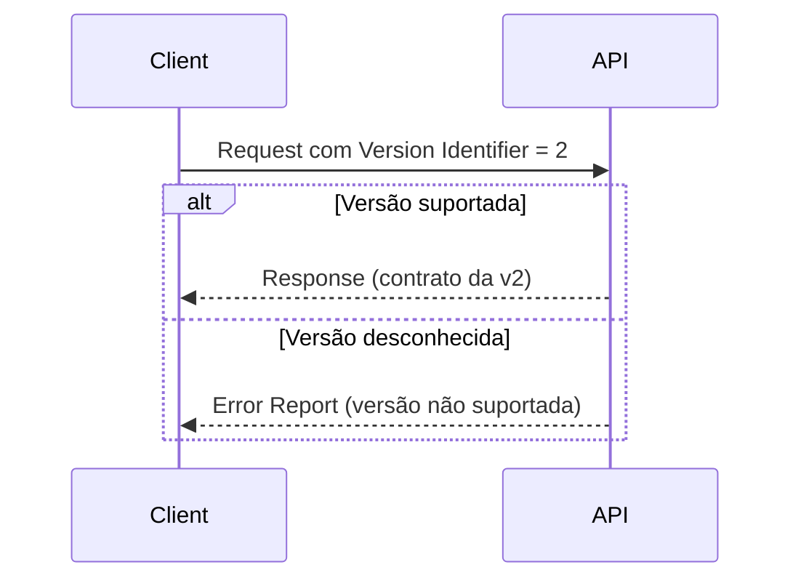

# Version Identifier

## Descrição

O padrão Version Identifier introduz um indicador explícito de versão na API e nas mensagens trocadas, para que provedor e clientes saibam qual contrato estão usando e rejeitem o que não entendem em vez de interpretá-lo errado.

O identificador costuma ser um número que mostra o grau de evolução da API. Ele pode viver no endereço (`/v2/...`), em um cabeçalho de protocolo, no tipo de mídia negociado (`Accept`) ou em um campo do corpo da mensagem, ou seja, funciona como um [Metadata Element](/architecture/api-patterns/element-stereotypes/metadata-element). Também deve constar na [API Description](/architecture/api-patterns/documentation/api-description). A regra prática é que ele apareça em um único lugar de cada troca de mensagens, para evitar inconsistências entre cópias.

Quem recebe uma mensagem com versão desconhecida ou incompatível pode abortar a interpretação e devolver um erro claro, em vez de seguir adiante com dados lidos de forma errada. Como o provedor também enxerga quais versões cada cliente usa, ele consegue planejar a aposentadoria de versões antigas. Vale lembrar que a versão da API e a da implementação evoluem em ritmos diferentes, e que as dependências (como o esquema do banco) precisam acompanhar o versionamento.

## Problemas que resolve

- Quebra de clientes por mudanças incompatíveis que ninguém percebeu, como a semântica de um campo que muda sem aviso
- Falta de como identificar exatamente qual contrato um cliente espera e qual o provedor oferece
- Impossibilidade de saber quantos clientes ainda dependem de uma versão antiga antes de retirá-la
- Custo oculto de manutenção nos clientes, que precisam acompanhar mudanças que não geram valor de negócio

## Quando usar

- Em APIs publicadas em produção, cujos clientes evoluem em ciclos diferentes do provedor
- Quando mudanças incompatíveis são esperadas e precisam coexistir com a versão anterior durante a migração
- Quando o provedor precisa medir o uso de cada versão para decidir quando desligar uma delas
- Como base para outros padrões de ciclo de vida, como [Two in Production](/architecture/api-patterns/life-cycle-management/two-in-production)

## Quando evitar

- Em uma [Solution-Internal API](/architecture/api-patterns/foundations/solution-internal-api) mantida pela mesma equipe do cliente, com testes automatizados e implantação conjunta, em que uma abordagem oportunista basta
- Quando a API só evolui de forma compatível e os clientes toleram campos novos, de modo que a versão explícita não traria informação útil
- Quando o provedor não tem como (nem intenção de) manter versões antigas e prefere o [Aggressive Obsolescence](/architecture/api-patterns/life-cycle-management/aggressive-obsolescence) com avisos prévios
- Se o identificador se repetir em vários pontos da mesma mensagem sem necessidade, gerando conflitos

## Trade-offs

| Ganho | Custo / Risco |
| --- | --- |
| Contrato identificável: clientes e provedor sabem a que se referem | Mais um elemento a especificar, transportar e validar em cada mensagem |
| Rejeição segura de versões desconhecidas, sem quebra silenciosa | Clientes podem ficar presos a versões antigas e atrasar a migração |
| Rastreabilidade do uso de cada versão para planejar a aposentadoria | Manter várias versões em produção aumenta custo de teste e operação |
| Base para políticas de ciclo de vida e de compatibilidade | Escolher onde colocar o identificador (URL, cabeçalho, corpo) tem prós e contras e divide opiniões |

- **Um único lugar:** coloque a versão em uma só posição de cada troca de mensagens, salvo se algum cliente ou intermediário exigir mais.
- **Versão de API e de implementação:** são coisas distintas; a implementação pode mudar com mais frequência sem alterar o contrato.
- **Dependências:** o esquema do banco e outros componentes internos precisam acompanhar as versões em produção; uma fachada que isole a implementação do versionamento da API ajuda.
- **Estrutura:** combinar o identificador com o [Semantic Versioning](/architecture/api-patterns/versioning/semantic-versioning) permite distinguir mudanças compatíveis das incompatíveis.

## Diagrama



O cliente declara a versão que espera. O provedor atende se a conhece e, caso contrário, responde com um erro explícito, em vez de arriscar uma interpretação errada.

## Exemplo

A API de cobranças Pix de uma fintech tem duas versões em produção. O cliente informa a versão desejada no tipo de mídia, e o provedor rejeita versões que não conhece. Esta mensagem é comum a todas as linguagens:

```http
GET /pix-charges/7c1f HTTP/1.1
Accept: application/vnd.fintech.pix-charge+json; version=2

HTTP/1.1 200 OK
Content-Type: application/vnd.fintech.pix-charge+json; version=2

{"id": "7c1f", "amountCents": 15000, "currency": "BRL", "status": "PENDING"}
```

Em código, o provedor valida a versão antes de processar a requisição:

<Tabs groupId="lang" queryString>
<TabItem value="java" label="Java">

```java
import java.util.Set;

public class VersionGate {
    private static final Set<Integer> SUPPORTED = Set.of(1, 2);

    static String handle(int version) {
        if (!SUPPORTED.contains(version)) {
            return "406 unsupported version " + version;
        }
        return "200 PixCharge v" + version;
    }

    public static void main(String[] args) {
        System.out.println(handle(2)); // 200 PixCharge v2
        System.out.println(handle(3)); // 406 unsupported version 3
    }
}
```

</TabItem>
<TabItem value="python" label="Python">

```python
SUPPORTED = {1, 2}


def handle(version: int) -> str:
    if version not in SUPPORTED:
        return f"406 unsupported version {version}"
    return f"200 PixCharge v{version}"


print(handle(2))  # 200 PixCharge v2
print(handle(3))  # 406 unsupported version 3
```

</TabItem>
<TabItem value="go" label="Go">

```go
package main

import "fmt"

var supported = map[int]bool{1: true, 2: true}

func handle(version int) string {
	if !supported[version] {
		return fmt.Sprintf("406 unsupported version %d", version)
	}
	return fmt.Sprintf("200 PixCharge v%d", version)
}

func main() {
	fmt.Println(handle(2)) // 200 PixCharge v2
	fmt.Println(handle(3)) // 406 unsupported version 3
}
```

</TabItem>
</Tabs>

## Padrões relacionados

- [Metadata Element](/architecture/api-patterns/element-stereotypes/metadata-element) — o Version Identifier é um tipo especial de metadado da mensagem
- [Semantic Versioning](/architecture/api-patterns/versioning/semantic-versioning) — estrutura o identificador em três partes que indicam o impacto da mudança
- [Two in Production](/architecture/api-patterns/life-cycle-management/two-in-production) — exige versionamento explícito para manter duas versões ao mesmo tempo
- [Aggressive Obsolescence](/architecture/api-patterns/life-cycle-management/aggressive-obsolescence) — pode usar o identificador para sinalizar o que será desligado
- [API Description](/architecture/api-patterns/documentation/api-description) — publica as versões e as funcionalidades de cada uma
- [Error Report](/architecture/api-patterns/special-purpose-representations/error-report) — formato natural para informar uma versão incompatível
- [Format Indicator](/architecture/eip/message-construction/format-indicator) — indicador análogo, no mundo de mensageria, do formato ou versão de uma mensagem

## Referência

- [Patterns for API Design, capítulo 8: Version Identifier](https://api-patterns.org/)
