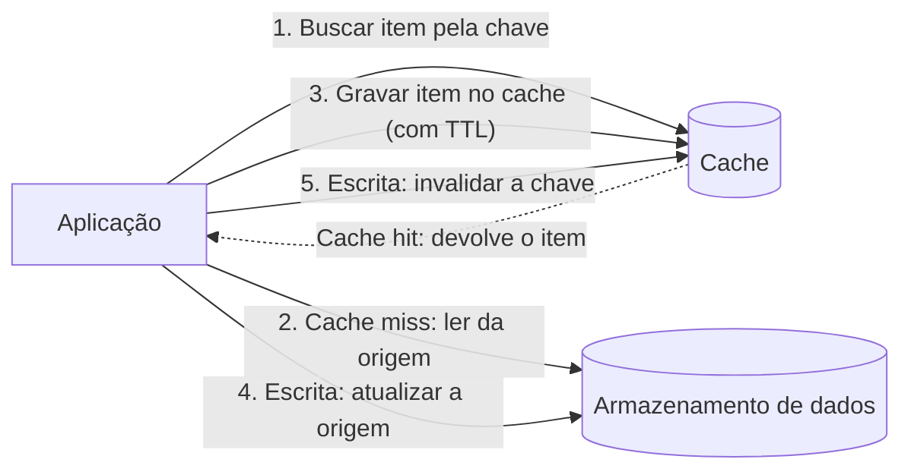

# Cache-Aside

## Descrição

O Cache-Aside carrega dados no cache sob demanda a partir do armazenamento de dados de origem. É a aplicação, e não o cache, que controla o fluxo. Ela consulta o cache primeiro. Se o item estiver lá (*cache hit*), devolve-o na hora. Se não estiver (*cache miss*), busca o item no armazenamento de origem, grava-o no cache e o devolve ao chamador.

Nas escritas, a aplicação atualiza primeiro o armazenamento de origem e depois invalida (remove) a entrada correspondente no cache. Na próxima leitura, o item é recarregado com o valor atualizado. A ordem importa: se o cache for invalidado antes da escrita no armazenamento, outra leitura pode recolocar no cache o valor antigo.

O padrão serve para caches que não oferecem *read-through* ou *write-through* nativos, porque reproduz esse comportamento na própria aplicação. Ele não garante consistência forte entre cache e origem. Por isso, costuma vir acompanhado de políticas de expiração (TTL) que limitam por quanto tempo um dado desatualizado pode ficar no cache.

## Problemas que resolve

- Latência alta e carga repetida sobre o armazenamento de dados quando os mesmos itens são lidos muitas vezes.
- Uso de caches que não carregam nem gravam dados na origem por conta própria.
- Demanda imprevisível, em que não se sabe de antemão quais dados serão necessários e não vale a pena pré-carregar tudo.
- Dados desatualizados no cache após escritas, tratados com invalidação explícita e expiração.
- Disponibilidade limitada de dados muito acessados quando a origem fica indisponível por um curto período.

## Quando usar

- O cache não oferece operações nativas de *read-through* e *write-through*.
- A demanda é imprevisível e os dados devem ser carregados sob demanda.
- A carga é dominada por leituras de dados que mudam pouco e toleram algum atraso de atualização.
- Vários processos ou instâncias da aplicação precisam compartilhar um cache distribuído (por exemplo, Azure Managed Redis).

### Quando evitar

- O conjunto de dados é estático e cabe no cache. Nesse caso, é melhor pré-carregar tudo na inicialização e não expirar os itens.
- A maioria das requisições resultaria em *cache miss*. O custo de consultar e popular o cache supera o ganho.
- Os dados são sensíveis ou relacionados a segurança, principalmente quando o cache é compartilhado entre aplicações ou usuários.
- O objetivo é guardar estado de sessão de uma aplicação web em várias instâncias, o que cria dependência de afinidade entre cliente e servidor.
- Os fluxos exigem ler o próprio dado logo após escrevê-lo (*read-after-write*). Nesses casos, considere *write-through*.

## Trade-offs

| Ganho | Custo / Risco |
| --- | --- |
| Menor latência de leitura para dados acessados com frequência | Possibilidade de ler dados desatualizados entre a escrita e a próxima recarga |
| Menos carga e custo no armazenamento de origem | A lógica de cache fica no código da aplicação, que precisa ler, popular e invalidar o cache |
| Só os dados realmente usados vão para o cache | O primeiro acesso a cada item, e cada acesso após expiração ou remoção, paga o custo de um *miss* |
| Leituras frequentes continuam funcionando, de forma limitada, se a origem cair por pouco tempo | Mais um componente para operar, monitorar e dimensionar |
| Se o cache falhar, é possível recorrer à origem | Se muitas chaves forem perdidas ao mesmo tempo, a origem pode receber um pico de requisições (*cache stampede*) |

- **Expiração:** ajuste o TTL ao padrão de acesso. Um TTL curto demais gera recargas constantes. Um TTL longo demais mantém dados desatualizados.
- **Remoção (eviction):** o cache tem tamanho limitado e costuma remover itens por LRU. Itens caros de obter podem merecer configuração individual.
- **Pré-carga (priming):** é possível aquecer o cache na inicialização. O Cache-Aside continua útil para os itens que expirarem ou forem removidos.
- **Consistência:** processos externos podem alterar a origem sem invalidar o cache. Em ambientes com replicação, manter a consistência é ainda mais difícil.
- **Cache local:** um cache em memória por instância gera cópias divergentes entre instâncias. Use expiração mais curta ou prefira um cache compartilhado ou distribuído.
- **Cache semântico:** em cargas com modelos de linguagem, buscar respostas por similaridade de significado reduz chamadas, mas só é seguro com dados não sensíveis e realmente equivalentes.
- **Observabilidade:** acompanhe a taxa de acerto (*hit ratio*), a latência do cache e da origem e a quantidade de itens removidos.

## Diagrama

Na leitura, a aplicação consulta o cache primeiro e, em caso de *miss*, busca o item na origem e o grava no cache. Na escrita, atualiza a origem antes de invalidar a entrada no cache, para que a próxima leitura traga o valor novo.

## Padrões relacionados

- [Static Content Hosting](/architecture/cloud-design-patterns/deployment-and-topology/static-content-hosting) — também tira carga da aplicação e da origem ao servir conteúdo estático, muitas vezes com CDN e cache.
- [Materialized View](/architecture/cloud-design-patterns/data-management/materialized-view) — pré-computa visões dos dados para leitura, que podem ficar no cache para acelerar consultas.
- [CQRS](/architecture/cloud-design-patterns/data-management/cqrs) — separa leituras e escritas, e o lado de leitura pode usar Cache-Aside para ganhar desempenho.
- [Sharding](/architecture/cloud-design-patterns/data-management/sharding) — particiona dados, e um cache distribuído pode seguir a mesma estratégia de particionamento.
- [Circuit Breaker](/architecture/cloud-design-patterns/resiliency/circuit-breaker) — protege a aplicação quando o cache ou a origem falham e permite recorrer ao outro.

## Referência

- [Documentação no Azure Architecture Center](https://learn.microsoft.com/en-us/azure/architecture/patterns/cache-aside)
