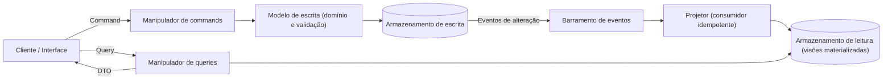

# CQRS

## Descrição

O CQRS (Command Query Responsibility Segregation) separa as operações que alteram dados (*commands*) das operações que leem dados (*queries*), usando modelos distintos para cada lado. Assim, cada modelo pode ser otimizado de forma independente em desempenho, escalabilidade e segurança.

Os *commands* representam tarefas de negócio com intenção clara (por exemplo, "Reservar quarto" em vez de "Definir status como Reservado"). Eles passam por validação e regras de domínio no modelo de escrita, que garante a consistência transacional. As *queries* nunca alteram estado: retornam objetos de transferência de dados (DTOs) ou projeções já no formato que a apresentação precisa, sem lógica de domínio.

A separação pode existir em dois níveis. No mais simples, os dois modelos compartilham o mesmo armazenamento, mas têm lógica distinta. No mais avançado, cada lado tem seu próprio armazenamento, inclusive com tecnologias diferentes (relacional para escrita e banco de documentos para leitura, por exemplo). Nesse caso, o modelo de escrita publica eventos a cada alteração, e o modelo de leitura os consome para atualizar suas visões. Para isso ser confiável, use um mecanismo como o *transactional outbox* e consumidores idempotentes.

Em microsserviços com Database per Service, o CQRS ganha um papel adicional: é a forma de responder a consultas que precisam de dados de vários serviços. Constrói-se um banco de visão (somente leitura), com tipo e esquema escolhidos para a consulta (frequentemente um NoSQL, como armazenamento de documentos ou chave-valor), mantido atualizado pela assinatura dos eventos de domínio publicados pelos serviços donos dos dados. Com Event Sourcing, o CQRS é praticamente obrigatório, pois o log de eventos é difícil de consultar diretamente.

## Problemas que resolve

- Diferença entre a representação dos dados na escrita e na leitura: campos obrigatórios na atualização são irrelevantes na consulta, e vice-versa.
- Contenção de locks quando muitas operações paralelas de leitura e escrita atingem o mesmo conjunto de dados.
- Baixo desempenho por consultas complexas (muitos joins e mapeamentos) e pela carga concentrada em um único armazenamento e camada de acesso a dados.
- Dificuldade de aplicar segurança quando a mesma entidade serve leituras e escritas, o que pode expor dados em contextos indevidos.
- Consultas que precisam de dados de vários serviços quando cada um mantém seu banco privado e o *join* direto não é possível.
- Modelo único que vai ficando complexo demais para atender bem os dois tipos de operação.

## Quando usar

- Ambientes colaborativos, em que vários usuários alteram os mesmos dados ao mesmo tempo e *commands* granulares ajudam a reduzir e resolver conflitos.
- Interfaces orientadas a tarefas e domínios complexos, com agregados e regras de negócio ricas no lado da escrita.
- Cargas com muito mais leituras do que escritas, em que o lado de leitura precisa escalar horizontalmente e o de escrita roda em menos instâncias.
- Equipes separadas: uma cuida da lógica de negócio da escrita e outra das visões de leitura e da interface.
- Sistemas que evoluem com frequência, com novas versões de modelo e mudanças nas regras de negócio.
- Integração com outros subsistemas, sobretudo os que usam Event Sourcing, para que a falha de um componente não derrube o sistema inteiro.

## Quando evitar

- Domínio ou regras de negócio simples.
- Aplicações em que uma interface e um acesso a dados no estilo CRUD bastam.
- Cenários que exigem leitura imediatamente consistente após cada escrita e não toleram dados desatualizados.

## Trade-offs

| Ganho | Custo / Risco |
| --- | --- |
| Escala independente de leitura e escrita | Mais componentes para implantar, monitorar e operar |
| Esquemas otimizados para consulta e para atualização | Sincronização entre os modelos exige código próprio, e ferramentas de scaffolding/O/RM não geram isso automaticamente |
| Consultas simples sobre visões materializadas, sem joins complexos | Consistência eventual: a leitura pode mostrar dados desatualizados |
| Menos contenção de locks e melhor desempenho sob carga | Mensageria traz falhas, duplicidades e reprocessamentos que precisam ser tratados |
| Controle de acesso mais fino sobre quem pode escrever | Complexidade de design maior, especialmente com Event Sourcing |
| Modelos mais limpos e coesos (separação de responsabilidades) | Gerar ou reconstruir projeções pode consumir bastante tempo e recursos |

- **Consistência:** defina como a aplicação detecta e trata ações do usuário baseadas em dados desatualizados (por exemplo, versionamento otimista no *command*).
- **Atomicidade:** como banco e message broker normalmente não participam da mesma transação distribuída, grave a alteração e o evento de forma atômica (*transactional outbox*) e torne os consumidores do lado de leitura idempotentes.
- **Duplicação de código:** em microsserviços, a lógica compartilhada entre as visões e os serviços de origem pode ser duplicada.
- **Alternativa mais simples:** para consultas pequenas, API Composition evita a infraestrutura de eventos e visões, ao custo de *joins* em memória.
- **Latência de propagação:** meça e monitore o atraso entre a escrita e a atualização das projeções.
- **Event Sourcing:** se combinado, o *event store* vira a fonte da verdade e as projeções podem ser reconstruídas reproduzindo os eventos. Use snapshots periódicos para não reprocessar todo o histórico.
- **Processamento assíncrono:** *commands* podem ir para uma fila (por exemplo, Azure Service Bus) e ter prioridades diferentes.

## Diagrama

O cliente envia *commands* para o modelo de escrita, que valida, aplica as regras de domínio e persiste os dados. As alterações viram eventos que atualizam de forma assíncrona as visões do armazenamento de leitura, de onde as *queries* retornam DTOs prontos para exibição.

## Padrões relacionados

- [Event Sourcing](/architecture/cloud-design-patterns/data-management/event-sourcing): costuma ser combinado com CQRS. O *event store* serve de modelo de escrita, e as projeções de leitura são geradas a partir dos eventos.
- [Materialized View](/architecture/cloud-design-patterns/data-management/materialized-view): o modelo de leitura geralmente guarda visões materializadas e desnormalizadas, otimizadas para consulta.
- [Idempotent Consumer](/architecture/cloud-design-patterns/messaging/idempotent-consumer): os consumidores que atualizam o modelo de leitura precisam tolerar eventos duplicados.
- [Publisher-Subscriber](/architecture/cloud-design-patterns/messaging/publisher-subscriber): é a forma usual de propagar eventos do lado de escrita para uma ou mais projeções de leitura.
- [Priority Queue](/architecture/cloud-design-patterns/messaging/priority-queue): ajuda a processar *commands* com prioridades diferentes.
- [Queue-Based Load Leveling](/architecture/cloud-design-patterns/messaging/queue-based-load-leveling): enfileirar *commands* suaviza picos de escrita.
- [Cache-Aside](/architecture/cloud-design-patterns/data-management/cache-aside): é outra forma de acelerar leituras e pode complementar o modelo de leitura.
- [Database per Service](/architecture/microservices/service-collaboration/database-per-service): cria a necessidade de visões que combinam dados de vários serviços.
- [API Composition](/architecture/microservices/service-collaboration/api-composition): alternativa mais simples para consultas entre serviços.
- [Domain Event](/architecture/microservices/service-collaboration/domain-event): eventos que mantêm as visões atualizadas.
- [Command-side Replica](/architecture/microservices/service-collaboration/command-side-replica): estruturalmente idêntico, mas a réplica serve ao lado de comando.

## Referência

- [Documentação no Azure Architecture Center](https://learn.microsoft.com/en-us/azure/architecture/patterns/cqrs)
- [CQRS no microservices.io](https://microservices.io/patterns/data/cqrs.html)
