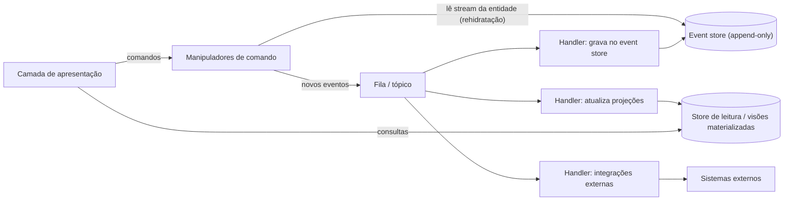

# Event Sourcing

## Descrição

Em vez de guardar apenas o estado atual dos dados e sobrescrevê-lo a cada alteração (modelo CRUD), o Event Sourcing registra toda a sequência de ações aplicadas a uma entidade como eventos imutáveis em um armazenamento somente de acréscimo (*append-only*), o **event store**. Cada evento descreve um fato de negócio, como `ItemAdicionadoAoPedido` ou `PedidoCancelado`, e o event store passa a ser a fonte da verdade (*system of record*).

Cada entidade tem seu próprio fluxo de eventos (*event stream*) ordenado. O estado atual é obtido reproduzindo os eventos desse fluxo, processo chamado de *rehidratação*; snapshots periódicos evitam reprocessar o histórico inteiro. Como reproduzir eventos para cada consulta é caro, o padrão costuma ser combinado com projeções/visões materializadas otimizadas para leitura e com CQRS.

Os eventos também são publicados para manipuladores (*event handlers*) desacoplados, que atualizam modelos de leitura, disparam integrações com sistemas externos ou executam tarefas em segundo plano. Correções nunca alteram eventos já gravados: são feitas com eventos compensatórios (por exemplo, `ReservaCancelada` compensando `AssentosReservados`).

Em microsserviços, o Event Sourcing resolve um problema central: como atualizar o banco e publicar mensagens em um broker de forma atômica, sem two-phase commit. Salvar um único evento é uma operação atômica, e o event store funciona também como broker: os eventos gravados são entregues aos assinantes, na mesma ordem em que ocorreram para cada agregado. Isso viabiliza a publicação confiável de eventos de domínio e sagas coreografadas.

## Problemas que resolve

- Contenção de escrita em sistemas de alta carga, causada por ciclos de leitura-modificação-escrita com bloqueio de linhas sobre a mesma entidade.
- Perda de histórico: o modelo CRUD só guarda o último estado, sem trilha de auditoria nativa.
- Dificuldade de reconstruir o estado em um ponto do passado para depuração, auditoria ou recuperação de desastres.
- Atualizar o banco e publicar mensagens de forma atômica quando 2PC não está disponível ou não é desejável, preservando a ordem dos eventos por agregado.
- Acoplamento entre a operação que altera os dados e as tarefas derivadas (integrações, notificações, atualização de visões).
- Rigidez dos modelos de leitura: novas visões podem ser geradas reprocessando eventos históricos.

## Quando usar

- Quando é importante capturar a intenção ou o motivo das mudanças (por exemplo, "mudou de endereço", "encerrou a conta") e não apenas o estado resultante.
- Quando é preciso minimizar ou evitar atualizações conflitantes dos dados.
- Quando há requisitos de auditoria, histórico completo, reprodução de eventos para restaurar estado ou desfazer alterações.
- Quando a aplicação já trabalha naturalmente com eventos e o custo adicional de adoção é baixo.
- Quando se quer desacoplar a entrada de dados das tarefas que reagem a ela, distribuindo eventos para vários consumidores.
- Quando se usa CQRS e a consistência eventual dos modelos de leitura é aceitável.
- Em partes específicas do sistema que mais se beneficiam, como um livro-razão de pagamentos ou um pipeline de pedidos (a adoção não precisa ser total).

### Quando evitar

- Sistemas CRUD simples, sem necessidade de auditoria, replay ou reconstrução histórica.
- Protótipos, MVPs ou sistemas de vida curta, em que o investimento inicial não se paga.
- Cenários que exigem consistência forte e atualização em tempo real das visões dos dados.
- Dados majoritariamente estáticos ou de referência (catálogos, tabelas de lookup).
- Equipes sem experiência em arquiteturas orientadas a eventos, pelo risco de antipadrões difíceis de reverter.

## Trade-offs

| Ganho | Custo / Risco |
| --- | --- |
| Escritas *append-only* sem bloqueio de linhas, com maior vazão | Consistência eventual entre event store e projeções |
| Trilha de auditoria completa e reconstrução de estado em qualquer ponto do tempo | Consultas exigem projeções; não há consulta ad hoc direta sobre eventos |
| Recuperação de stores de estado e visões a partir do histórico | Rehidratação cara em fluxos longos, exigindo snapshots |
| Desacoplamento entre produtores e consumidores de eventos | Versionamento de esquema de eventos imutáveis é difícil |
| Particionamento natural por ID de entidade, facilitando escala horizontal | Migrar para ou a partir do padrão é caro e restringe decisões futuras |
| Novos modelos de leitura podem ser criados reprocessando eventos | Conflito com requisitos de exclusão de dados pessoais (direito ao esquecimento) |

- **Migração de monólito:** entidades fracamente acopladas que trocam eventos facilitam a migração gradual de um monólito para microsserviços.
- **Alternativa:** quando não se quer adotar o modelo completo, o Transactional Outbox também garante a publicação atômica de eventos.
- **Desenho de eventos:** modele eventos pela intenção de negócio ("2 assentos reservados"), não pelo estado ("restam 42 assentos").
- **Concorrência:** use controle de concorrência otimista por stream (rejeitar o append se a versão mudou) e trate conflitos entre entidades distintas na lógica de negócio.
- **Ordenação:** use números de sequência incrementais por entidade, além de timestamps.
- **Versionamento:** combine desserialização tolerante, versão no envelope do evento e *upcasting*; reescrever eventos no lugar deve ser o último recurso.
- **Idempotência:** a entrega costuma ser *at least once*; os consumidores precisam ignorar duplicatas (por exemplo, rastreando o último número de sequência processado).
- **Loops:** cuidado com eventos que geram eventos e podem levar a ciclos infinitos.
- **Armazenamento:** prefira um event store (dedicado ou tabela append-only em banco relacional/documental); um broker de mensagens, como Apache Kafka, serve para distribuição, mas não substitui o event store.
- **Dados pessoais:** mantenha dados pessoais fora dos eventos (referenciados por ID) ou use *crypto-shredding* com chave por titular.
- **Testes:** o estilo *given-when-then* (eventos passados, comando, eventos esperados) funciona bem, mas ainda são necessários testes de integração para projeções, idempotência e evolução de esquema.

## Diagrama

Os manipuladores de comando reconstroem a entidade a partir do seu stream de eventos, aplicam as regras de negócio e publicam novos eventos. Handlers independentes persistem os eventos, atualizam as visões de leitura consultadas pela UI e integram outros sistemas.

## Padrões relacionados

- [CQRS](/architecture/cloud-design-patterns/data-management/cqrs) — combinação mais comum: o event store atende às escritas e as projeções atendem às leituras, com escala independente.
- [Materialized View](/architecture/cloud-design-patterns/data-management/materialized-view) — projeções otimizadas para consulta geradas a partir dos eventos.
- [Compensating Transaction](/architecture/cloud-design-patterns/distributed-coordination/compensating-transaction) — desfazer alterações por meio de eventos compensatórios, sem modificar o histórico.
- [Idempotent Consumer](/architecture/cloud-design-patterns/messaging/idempotent-consumer) — handlers precisam tolerar a entrega duplicada de eventos.
- [Publisher-Subscriber](/architecture/cloud-design-patterns/messaging/publisher-subscriber) — distribuição dos eventos para múltiplos consumidores desacoplados.
- [Sharding](/architecture/cloud-design-patterns/data-management/sharding) — event stores particionam naturalmente pelo ID da entidade.
- [Saga](/architecture/cloud-design-patterns/distributed-coordination/saga) — coordenação de processos de negócio entre serviços baseada em eventos.
- [Domain Event](/architecture/microservices/service-collaboration/domain-event) — o event store pode ser a fonte de publicação dos eventos de domínio.
- [Transactional Outbox](/architecture/microservices/transactional-messaging/transactional-outbox) — alternativa para publicar eventos de forma atômica sem armazenar o estado como eventos.
- [Audit Logging](/architecture/microservices/observability/audit-logging) — o log de eventos implementa naturalmente uma trilha de auditoria.

## Referência

- [Documentação no Azure Architecture Center](https://learn.microsoft.com/en-us/azure/architecture/patterns/event-sourcing)
- [Event Sourcing no microservices.io](https://microservices.io/patterns/data/event-sourcing.html)
