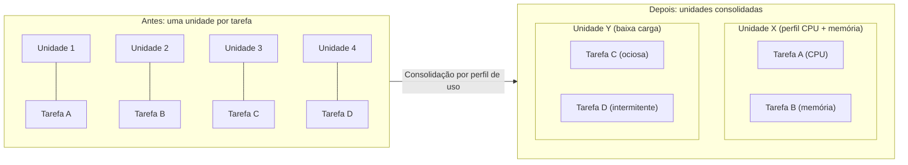

# Compute Resource Consolidation

## Descrição

O padrão Compute Resource Consolidation agrupa várias tarefas ou operações em uma única unidade computacional (uma máquina virtual, um contêiner, um plano de hospedagem ou um pool de nós), em vez de manter cada uma em uma unidade dedicada. O objetivo é aumentar a utilização dos recursos provisionados e reduzir o custo e o esforço de gestão associados a muitas unidades isoladas.

Em aplicações na nuvem é comum começar separando cada função em sua própria unidade de execução, o que simplifica o desenho lógico. Porém, cada unidade consome recursos cobráveis mesmo quando está ociosa ou pouco usada. Ao consolidar, tarefas com requisitos compatíveis passam a compartilhar a mesma capacidade, que fica ocupada por mais tempo.

A escolha do que agrupar é o ponto central: tarefas com escalabilidade, ciclo de vida e cadência de release semelhantes, e com perfis de consumo complementares (por exemplo, uma intensiva em CPU e outra intensiva em memória), são boas candidatas. Tarefas com requisitos de escala conflitantes, que disputam o mesmo recurso ou que exigem isolamento de segurança devem continuar separadas.

## Problemas que resolve

- Custo alto de hospedagem causado por muitas unidades computacionais subutilizadas ou ociosas.
- Capacidade provisionada em excesso (overprovisioning) e recursos caros que passam longos períodos parados.
- Sobrecarga operacional de gerenciar, monitorar, atualizar e automatizar muitas unidades heterogêneas.
- Plataforma de execução fragmentada, com ferramentas e processos operacionais distintos para cada componente.
- Latência de comunicação entre tarefas que poderiam conversar localmente na mesma unidade.

## Quando usar

- Tarefas que não são economicamente viáveis quando executadas em unidades próprias.
- Tarefas que ficam ociosas com frequência ou têm carga baixa e intermitente.
- Tarefas que seriam caras em uma unidade dedicada, mas que podem aproveitar capacidade ociosa de uma unidade compartilhada.
- Tarefas com requisitos semelhantes de escalabilidade, ciclo de vida e cadência de release, que podem escalar como um bloco.
- Sistemas já em produção, com dados de monitoramento (um "mapa de calor" de uso de recursos) que permitem identificar bons candidatos à consolidação.

## Quando evitar

- Tarefas que executam operações críticas com exigência de tolerância a falhas e não podem ser afetadas por vizinhos.
- Tarefas que processam dados altamente sensíveis ou privados e precisam de um contexto de segurança próprio.
- Tarefas que precisam de um ambiente isolado em uma unidade computacional separada (por exigência regulatória, de licenciamento ou de desempenho).
- Tarefas com requisitos de escala conflitantes (por exemplo, uma que recebe picos de tráfego e outra que consome uma fila de baixo volume).
- Tarefas que competem pelo mesmo recurso (duas intensivas em CPU ou duas intensivas em memória).
- Tarefas com ciclos de release muito diferentes, em que implantar uma força a reiniciar todas as outras.

## Trade-offs

| Ganho | Custo / Risco |
| --- | --- |
| Menor custo por melhor utilização da capacidade provisionada | Contenção de recursos entre tarefas que compartilham a unidade (efeito "vizinho barulhento") |
| Plataforma mais homogênea, com gestão e observabilidade simplificadas | Falha ou comportamento anômalo de uma tarefa pode afetar as demais (maior raio de impacto) |
| Menos ferramentas e processos operacionais distintos | Contexto de segurança compartilhado e superfície de ataque maior; cada tarefa fica tão segura quanto a mais vulnerável |
| Comunicação mais rápida entre tarefas colocalizadas | Escala acoplada: todas as tarefas escalam juntas, mesmo que só uma precise |
| Aproveitamento de instâncias maiores (escala vertical) e de capacidade ociosa | Implantar uma tarefa pode exigir parar e reimplantar toda a unidade |

- **Escalabilidade e elasticidade:** não agrupe tarefas com necessidades de escala conflitantes; a política de autoescala vale para a unidade inteira.
- **Ciclo de vida:** a infraestrutura pode reciclar a unidade periodicamente; tarefas longas precisam de checkpointing ou de mecanismos para adiar a reciclagem.
- **Contenção:** combine tarefas com perfis de consumo complementares e defina limites de recursos (CPU, memória) por tarefa quando a plataforma permitir.
- **Complexidade:** várias tarefas na mesma unidade dificultam testes, depuração e manutenção; mantenha a arquitetura lógica estável, de modo que o código de cada tarefa não dependa de onde ela está hospedada.
- **Observabilidade:** monitore o consumo por tarefa, não apenas por unidade, para detectar contenção e reavaliar o agrupamento ao longo do tempo.
- **Alternativas:** consolidação é apenas uma estratégia de redução de custo; modelos serverless com escala a zero ou plataformas de orquestração de contêineres podem oferecer o mesmo benefício com melhor isolamento.

## Diagrama

Antes, cada tarefa ocupa sua própria unidade computacional, muitas vezes ociosa. Depois da consolidação, tarefas com perfis complementares ou carga baixa passam a compartilhar unidades, reduzindo o número de recursos provisionados e aumentando sua utilização.

## Padrões relacionados

- [Sidecar](/architecture/cloud-design-patterns/integration-and-modernization/sidecar) — também colocaliza componentes na mesma unidade de execução, compartilhando recursos e ciclo de vida com a aplicação principal.
- [Bulkhead](/architecture/cloud-design-patterns/resiliency/bulkhead) — caminho oposto: isola recursos para conter falhas; ajuda a decidir quais tarefas não devem ser consolidadas.
- [Deployment Stamp](/architecture/cloud-design-patterns/deployment-and-topology/deployment-stamp) — agrupa componentes e até tenants em unidades de implantação compartilhadas, com trade-offs semelhantes de custo versus isolamento.
- [Competing Consumers](/architecture/cloud-design-patterns/messaging/competing-consumers) — vários consumidores de fila podem rodar em unidades consolidadas e escalar juntos quando têm perfil semelhante.
- [Queue-Based Load Leveling](/architecture/cloud-design-patterns/messaging/queue-based-load-leveling) — suaviza picos de carga, tornando o consumo de recursos mais previsível e facilitando a consolidação.
- [Health Endpoint Monitoring](/architecture/cloud-design-patterns/resiliency/health-endpoint-monitoring) — monitorar a saúde de cada tarefa é essencial quando várias compartilham a mesma unidade.

## Referência

- [Documentação no Azure Architecture Center](https://learn.microsoft.com/en-us/azure/architecture/patterns/compute-resource-consolidation)
