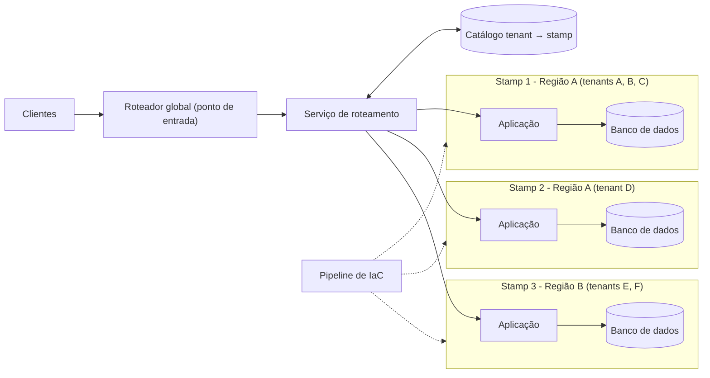

# Deployment Stamps

## Descrição

O padrão Deployment Stamps consiste em implantar várias cópias independentes dos componentes de uma aplicação, incluindo os armazenamentos de dados, como um único grupo de recursos. Cada cópia é chamada de *stamp* (também conhecida como *service unit*, *scale unit* ou *cell*). Em um ambiente multitenant, cada stamp atende a um conjunto predefinido de tenants, e a solução escala de forma quase linear com a adição de novos stamps.

Os stamps funcionam de forma isolada: cada um pode ser implantado, atualizado e monitorado separadamente, e uma mesma região pode conter um ou vários stamps. Como cada stamp guarda apenas os dados dos seus tenants, o padrão faz um particionamento implícito dos dados. Quando há um ponto de entrada único, um serviço de roteamento consulta um mapeamento "tenant → stamp" e encaminha (ou redireciona) cada requisição para o stamp correto.

Como o padrão depende de cópias idênticas da infraestrutura, a infraestrutura como código e pipelines de implantação automatizados são essenciais para manter os stamps previsíveis, repetíveis e livres de divergência de configuração. Ele difere do padrão Geode: em Deployment Stamps cada instância atende somente a um subconjunto de clientes, enquanto em Geode qualquer instância atende qualquer usuário.

## Problemas que resolve

- Limites de escala de uma única instância (conexões, nomes de host, sockets, cotas de serviços)
- Componentes cujo custo ou desempenho não escala linearmente após certo patamar
- Necessidade de isolar dados ou carga de determinados clientes (tenants "barulhentos" ou com requisitos de segurança)
- Convivência de clientes single-tenant (instância dedicada) e multitenant (instância compartilhada)
- Implantação controlada e gradual de atualizações para subconjuntos de clientes (anéis de implantação)
- Clientes com tolerâncias diferentes à frequência de atualizações
- Requisitos de latência ou de soberania de dados que exigem hospedar clientes em regiões específicas

## Quando usar

- A solução tem limites naturais de escalabilidade e alguns componentes não podem ou não devem atender além de certo número de clientes ou requisições
- É preciso separar alguns tenants dos demais, por exemplo por exigências de segurança ou conformidade
- É necessário manter tenants em versões diferentes da solução ao mesmo tempo
- A aplicação é multirregião e o tráfego e os dados de cada tenant precisam ficar em uma região específica
- Deseja-se limitar o raio de impacto (*blast radius*) de falhas e incidentes a um subconjunto de clientes
- O produto é um SaaS que precisa crescer adicionando unidades de escala padronizadas

## Quando evitar

- A solução é simples e não precisa escalar muito
- É possível escalar vertical ou horizontalmente dentro de uma única instância
- Os dados precisam ser replicados em todas as instâncias (considere o padrão Geode)
- Apenas alguns componentes precisam escalar; particionar o armazenamento de dados (Sharding) pode bastar
- A solução tem apenas conteúdo estático; Static Content Hosting com CDN é mais adequado

## Trade-offs

| Ganho | Custo / Risco |
| --- | --- |
| Escala quase linear adicionando novos stamps | Custo maior por duplicar toda a infraestrutura em cada stamp |
| Isolamento de falhas: um stamp com problema não afeta os demais | Stamps não são redundantes entre si por padrão; queda de uma região afeta os tenants hospedados nela |
| Implantações graduais por stamp (anéis, canário) reduzem o risco de mudanças | Exige automação madura (infraestrutura como código, pipelines) para evitar divergência de configuração |
| Isolamento de dados por cliente e residência regional | Mover tenants entre stamps exige lógica de migração específica |
| Flexibilidade para combinar stamps dedicados e compartilhados | Necessidade de um serviço de roteamento altamente disponível e de um catálogo "tenant → stamp" |

- **Operações entre stamps:** relatórios globais (por exemplo, total de clientes) exigem consultar e agregar cada stamp ou centralizar os dados em um data warehouse.
- **Capacidade:** defina a capacidade de um stamp com uma métrica substituta (número de tenants, carga) obtida por testes de carga, monitore o uso e provisione novos stamps de forma proativa.
- **Número mínimo:** implante ao menos dois stamps desde o início para evitar suposições fixas no código ou na configuração.
- **Observabilidade:** centralize métricas, logs, rastreamentos e alertas de todos os stamps para identificar rapidamente stamps não saudáveis.
- **Governança:** trate políticas de segurança, controle de acesso e configurações como código e valide continuamente a divergência entre stamps.
- **Componentes compartilhados:** alguns elementos (como um front-end estático) podem ser compartilhados entre stamps e distribuídos via CDN.

## Diagrama

As requisições chegam por um ponto de entrada global, e o serviço de roteamento consulta o catálogo para descobrir em qual stamp está o tenant. Cada stamp é uma cópia completa e independente da aplicação e dos dados, provisionada de forma idêntica por um pipeline de infraestrutura como código.

## Padrões relacionados

- [Geodes](/architecture/cloud-design-patterns/deployment-and-topology/geodes) — alternativa em que qualquer instância atende qualquer usuário; também pode ser usado para o próprio serviço de roteamento
- [Sharding](/architecture/cloud-design-patterns/data-management/sharding) — stamps particionam os dados implicitamente; sharding pode ser suficiente quando só o armazenamento precisa escalar, ou ser usado dentro de cada stamp
- [Gateway Routing](/architecture/cloud-design-patterns/gateways-and-edge/gateway-routing) — o serviço de roteamento atua como gateway que direciona as requisições ao stamp correto
- [Gateway Offloading](/architecture/cloud-design-patterns/gateways-and-edge/gateway-offloading) — o gateway de roteamento pode concentrar validação de tokens, throttling e autorização
- [Static Content Hosting](/architecture/cloud-design-patterns/deployment-and-topology/static-content-hosting) — alternativa quando a solução é apenas conteúdo estático, ou para componentes compartilhados entre stamps
- [Bulkhead](/architecture/cloud-design-patterns/resiliency/bulkhead) — cada stamp funciona como uma partição isolada que contém o impacto de falhas

## Referência

- [Documentação no Azure Architecture Center](https://learn.microsoft.com/en-us/azure/architecture/patterns/deployment-stamp)
