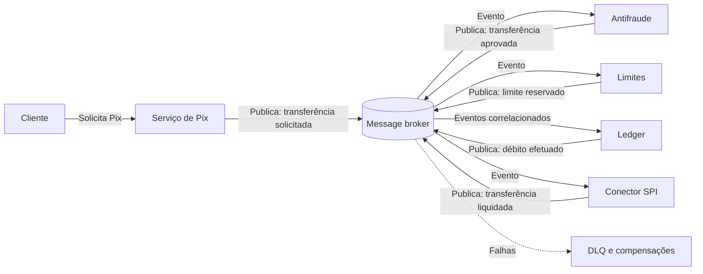

# Choreography

## Descrição

O padrão Choreography distribui a lógica de um fluxo de negócio entre os próprios serviços que participam dele, em vez de concentrá-la em um orquestrador central. Cada serviço decide, com base nas suas regras de negócio, quando e como processar uma operação, e reage a eventos publicados por outros serviços sem conhecer o fluxo completo nem chamar os demais diretamente.

A implementação mais comum usa um message broker em um modelo publish/subscribe. Uma requisição do cliente vira uma mensagem; os serviços interessados consomem essa mensagem, executam sua parte e publicam um novo evento de sucesso ou de falha. Outros serviços reagem a esses eventos para continuar o fluxo ou, em caso de falha, executar ações de compensação.

Com isso, os componentes ficam fracamente acoplados e podem ser adicionados, trocados ou removidos com pouco impacto no restante do sistema. Em contrapartida, ninguém guarda o estado completo de uma transação em andamento. Por isso, observabilidade, idempotência e tratamento de falhas passam a ser responsabilidade de cada participante.

## Problemas que resolve

- Orquestrador central que vira gargalo de desempenho sob carga ou ponto único de falha (SPoF), propagando falhas para todos os serviços dependentes
- Lógica de orquestração complexa e difícil de manter, que precisa ser reescrita sempre que um serviço é adicionado ou removido
- Acoplamento forte entre serviços causado por muitas chamadas ponto a ponto dentro de uma mesma transação de negócio
- Dificuldade de escalar fluxos distribuídos de forma independente por serviço

## Quando usar

- Os componentes executam operações atômicas e independentes no estilo *fire and forget*, sinalizando a conclusão por eventos
- Os componentes são atualizados ou substituídos com frequência e as mudanças precisam causar o mínimo de impacto
- Arquiteturas serverless ou orientadas a eventos com fluxos simples e componentes de vida curta
- Comunicação entre bounded contexts diferentes, que exige baixo acoplamento entre fronteiras de domínio
- O orquestrador central se tornou um gargalo de desempenho

## Quando evitar

- A aplicação é complexa e precisa de um componente central com lógica compartilhada para manter os serviços simples
- A comunicação ponto a ponto entre os componentes é inevitável
- É preciso consolidar, com regras de negócio, o resultado de todas as operações dos serviços (nesse caso, um orquestrador é mais adequado)
- O fluxo é longo e estritamente sequencial, com muitas dependências entre etapas
- Dentro de um único bounded context, onde um orquestrador costuma ser mais simples de entender e operar

## Trade-offs

| Ganho | Custo / Risco |
| --- | --- |
| Elimina o orquestrador como gargalo e ponto único de falha | Nenhum componente tem a visão completa do estado de uma transação em andamento |
| Serviços autônomos e substituíveis, que evoluem com pouco impacto no sistema | Evolução do schema dos eventos pode quebrar consumidores; exige contratos versionados e compatíveis |
| Escalabilidade independente por serviço e processamento paralelo natural | Fluxos sequenciais (esperar vários eventos antes de prosseguir) exigem correlação e ficam complexos |
| Baixo acoplamento entre domínios | Tratamento de falhas distribuído e compensações mais complexas, também sujeitas a falhas |
| Fácil adicionar novos consumidores de um evento sem alterar o produtor | Risco de comportamento emergente, loops de eventos e "event storms" |

- **Observabilidade:** use rastreamento distribuído e IDs de correlação em todas as mensagens para reconstruir o fluxo de ponta a ponta.
- **Idempotência e ordenação:** a entrega "at-least-once" gera duplicatas e mensagens fora de ordem; os consumidores devem ser idempotentes e, quando a ordem importa, usar sessões, números de sequência ou versões.
- **Atomicidade entre estado e evento:** gravar no banco e publicar o evento em operações separadas pode deixar o sistema inconsistente; use Transactional Outbox ou mecanismo equivalente.
- **Resiliência:** sem orquestrador, retries e timeouts ficam a cargo de cada serviço ou de um componente de resiliência dedicado, o que aumenta a comunicação ponto a ponto. Mensagens inválidas devem ir para uma dead-letter queue (DLQ) para evitar retries em cascata.
- **Proteções contra cascatas:** filtragem de eventos, limites de concorrência, throttling e regras explícitas para evitar cadeias circulares.

## Diagrama

Nenhum serviço coordena os demais: cada um reage aos eventos do broker e publica o resultado da sua parte. O antifraude e o serviço de limites reagem em paralelo a "transferência solicitada", o ledger só debita depois de receber os dois eventos ("transferência aprovada" e "limite reservado") e o conector só envia ao SPI depois de "débito efetuado", todos correlacionados pelo `endToEndId` da transferência. A fonte ilustra o padrão com uma entrega por drones.

## Padrões relacionados

- [Publisher-Subscriber](/architecture/cloud-design-patterns/messaging/publisher-subscriber) — mecanismo de mensageria mais usado para implementar a coreografia entre serviços
- [Saga](/architecture/cloud-design-patterns/distributed-coordination/saga) — gerencia a consistência de transações distribuídas e pode ser implementada por coreografia ou orquestração
- [Compensating Transaction](/architecture/cloud-design-patterns/distributed-coordination/compensating-transaction) — desfaz o trabalho já concluído quando uma etapa do fluxo coreografado falha
- [Idempotent Consumer](/architecture/cloud-design-patterns/messaging/idempotent-consumer) — garante que mensagens duplicadas ou reprocessadas não causem efeitos colaterais repetidos
- [Retry](/architecture/cloud-design-patterns/resiliency/retry) — trata falhas transitórias no processamento de mensagens por cada serviço
- [Event Sourcing](/architecture/cloud-design-patterns/data-management/event-sourcing) — registra mudanças de estado como eventos, que podem alimentar o fluxo coreografado
- [Competing Consumers](/architecture/cloud-design-patterns/messaging/competing-consumers) — permite escalar cada serviço participante com várias instâncias consumindo a mesma fila
- [Throttling](/architecture/cloud-design-patterns/resiliency/throttling) — ajuda a conter cascatas de eventos e sobrecarga nos consumidores
- [Ambassador](/architecture/cloud-design-patterns/integration-and-modernization/ambassador) e [Sidecar](/architecture/cloud-design-patterns/integration-and-modernization/sidecar) — podem encapsular preocupações de conectividade e resiliência ao lado de cada serviço

## Referência

- [Documentação no Azure Architecture Center](https://learn.microsoft.com/en-us/azure/architecture/patterns/choreography)
