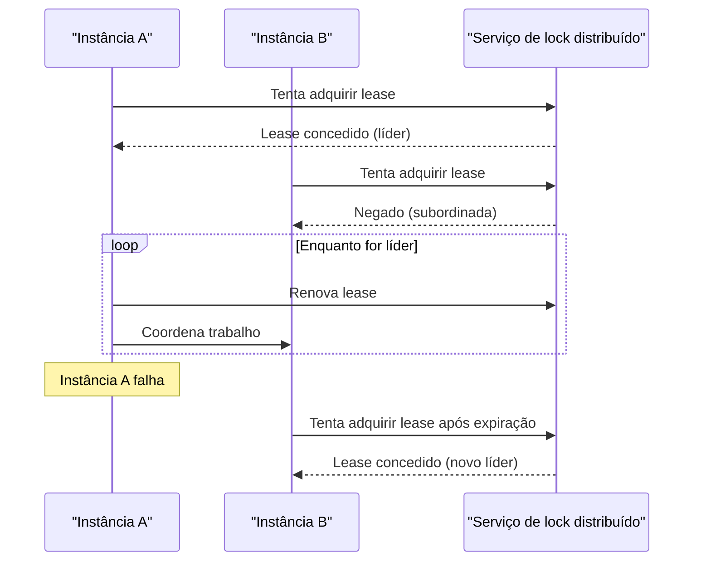

# Leader Election

## Descrição

O padrão Leader Election coordena as ações de um conjunto de instâncias colaborativas de uma aplicação distribuída elegendo uma delas como líder. O líder assume a responsabilidade de coordenar as demais (subordinadas), evitando que entrem em conflito, disputem recursos compartilhados ou interfiram no trabalho umas das outras.

Como todas as instâncias normalmente executam o mesmo código, qualquer uma pode ser líder. Por isso, a eleição precisa ser feita com cuidado para impedir que duas instâncias assumam a liderança ao mesmo tempo. Estratégias comuns incluem disputar um mutex distribuído compartilhado (por exemplo, um lease com tempo de expiração, renovado periodicamente pelo líder) ou usar algoritmos clássicos de eleição e consenso, como Bully, Raft ou Chang e Roberts.

As instâncias subordinadas monitoram o líder por heartbeat, polling ou expiração do lease. Se o líder falhar, ficar inacessível ou não conseguir renovar o lease, uma nova eleição acontece e outra instância assume a coordenação.

## Problemas que resolve

- Várias instâncias idênticas, escaladas horizontalmente, escrevendo em um recurso compartilhado e sobrescrevendo as alterações umas das outras
- Necessidade de agregar os resultados de tarefas executadas em paralelo quando não existe um coordenador natural
- Tarefas que devem ser executadas por uma única instância por vez (jobs agendados, rebalanceamento, limpeza), mesmo com várias réplicas ativas
- Perda de coordenação quando o processo coordenador falha, sem um mecanismo automático de substituição

## Quando usar

- As tarefas de uma aplicação distribuída precisam de coordenação cuidadosa e não existe um líder natural entre instâncias pares
- É preciso garantir que apenas uma instância execute determinada responsabilidade, com failover automático em caso de falha
- O sistema escala horizontalmente e instâncias podem ser criadas ou removidas a qualquer momento

### Quando evitar

- Já existe um líder natural ou um processo singleton dedicado que pode ser reiniciado em caso de falha
- A coordenação pode ser obtida de forma mais leve, por exemplo com bloqueio otimista ou pessimista no acesso a um recurso compartilhado
- Uma solução de terceiros pronta (como Apache ZooKeeper, etcd ou o serviço de coordenação da plataforma) resolve o problema com menos esforço

## Trade-offs

| Ganho | Custo / Risco |
| --- | --- |
| Failover automático da coordenação quando o líder falha | Complexidade para detectar falhas e evitar dois líderes simultâneos (split-brain) |
| Evita conflitos e contenção em recursos compartilhados | O serviço que fornece o mutex distribuído vira dependência crítica e potencial ponto único de falha |
| Qualquer instância pode assumir o papel, sem nó especial | Janela sem líder durante a reeleição pode atrasar operações que dependem da coordenação |
| Ajuste fino possível ao implementar algoritmos de consenso | O líder pode virar gargalo se concentrar trabalho demais |

- **Detecção de falhas:** o tempo de detecção (duração do lease, intervalo de heartbeat) equilibra rapidez de failover e risco de eleições espúrias por falhas transitórias.
- **Líder travado:** um líder que continua renovando o lease mas não progride bloqueia a eleição; verifique a saúde real do líder, não só a renovação.
- **Autoscaling:** a redução de escala pode encerrar justamente a instância líder; o sistema deve tolerar isso.
- **Não determinismo:** não presuma qual instância será eleita.
- **Fencing:** use tokens de época ou versão para que um líder antigo, isolado pela rede, não continue escrevendo após perder a liderança.
- **Observabilidade:** registre eleições, trocas de líder e falhas de renovação para diagnosticar instabilidades.
- **Recurso dedicado:** o objeto usado como lock (por exemplo, um blob com lease no Azure Blob Storage) não deve ser usado para outras finalidades.

## Diagrama

As instâncias disputam um lease em um serviço de lock distribuído; quem o obtém vira líder e o renova periodicamente. Se o líder falhar, o lease expira e outra instância assume a liderança.

## Padrões relacionados

- [Health Endpoint Monitoring](/architecture/cloud-design-patterns/resiliency/health-endpoint-monitoring) — ajuda a verificar se o líder está saudável e progredindo, não apenas renovando o lease
- [Scheduler Agent Supervisor](/architecture/cloud-design-patterns/distributed-coordination/scheduler-agent-supervisor) — o líder pode atuar como scheduler/supervisor que coordena as demais instâncias
- [Competing Consumers](/architecture/cloud-design-patterns/messaging/competing-consumers) — alternativa sem líder para distribuir trabalho entre instâncias pares
- [Retry](/architecture/cloud-design-patterns/resiliency/retry) — trata falhas transitórias ao adquirir ou renovar o lease
- [Compute Resource Consolidation](/architecture/cloud-design-patterns/deployment-and-topology/compute-resource-consolidation) — instâncias que hospedam várias tarefas podem precisar eleger um coordenador entre si

## Referência

- [Documentação no Azure Architecture Center](https://learn.microsoft.com/en-us/azure/architecture/patterns/leader-election)
