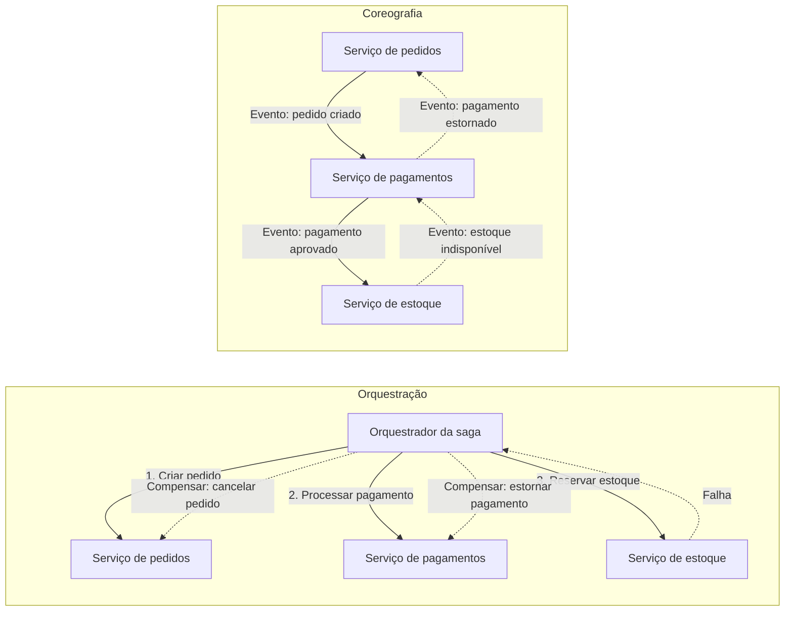

# Saga

## Descrição

O padrão Saga mantém a consistência de dados em sistemas distribuídos ao dividir uma operação de negócio que envolve vários serviços em uma sequência de **transações locais**. Cada serviço executa sua transação de forma atômica no próprio banco de dados e, em seguida, dispara o próximo passo por meio de um evento ou mensagem. Se algum passo falhar, a saga executa **transações de compensação** que desfazem, em ordem inversa, os efeitos dos passos já concluídos.

Os passos de uma saga se classificam em três tipos: **compensáveis** (podem ser revertidos por uma operação de efeito oposto), **pivô** (o ponto sem retorno; depois dele a saga precisa ir até o fim) e **repetíveis** (passos idempotentes posteriores ao pivô, que podem ser reexecutados até ter sucesso e garantem que a saga chegue a um estado final consistente).

Há duas formas comuns de coordenar uma saga. Na **coreografia**, não existe controlador central: cada serviço publica eventos de domínio que acionam a transação local do próximo participante. Na **orquestração**, um componente central (o orquestrador) mantém o estado da saga, envia comandos a cada participante, interpreta as respostas e dispara as compensações em caso de falha.

Em microsserviços, a Saga é a consequência direta do padrão Database per Service: como cada serviço possui seu banco e o two-phase commit não é uma opção, uma regra como "o pedido não pode ultrapassar o limite de crédito do cliente" deixa de caber em uma única transação ACID. Um exemplo clássico é a criação de pedido: na coreografia, o serviço de pedidos cria um pedido pendente e emite um evento, o serviço de clientes tenta reservar crédito e publica o resultado, e o serviço de pedidos aprova ou rejeita o pedido; na orquestração, um orquestrador "Criar Pedido" envia o comando de reservar crédito, recebe a resposta e aprova ou rejeita o pedido.

## Problemas que resolve

- Ausência de transações ACID entre serviços que possuem bancos de dados independentes (um banco por microsserviço).
- Inviabilidade ou alto custo de protocolos de transação distribuída, como o two-phase commit, em ambientes de nuvem e com tecnologias de armazenamento heterogêneas.
- Necessidade de desfazer de forma controlada as alterações parciais quando um passo de um fluxo de negócio distribuído falha.
- Implementar transações de negócio que atravessam serviços sem 2PC quando cada serviço mantém seu banco privado (Database per Service).
- Estados inconsistentes entre serviços após falhas parciais em operações longas (por exemplo, pedido criado, pagamento recusado e estoque já reservado).

## Quando usar

- É preciso garantir consistência de dados em um sistema distribuído sem acoplamento forte entre os serviços.
- O fluxo de negócio atravessa vários serviços, cada um com seu próprio armazenamento de dados.
- É necessário reverter ou compensar operações anteriores quando um passo da sequência falha.
- A consistência eventual é aceitável para o negócio durante a execução do fluxo.
- Operações de longa duração em que manter bloqueios distribuídos seria impraticável.

## Quando evitar

- As transações são fortemente acopladas e exigem isolamento e atomicidade estritos.
- As compensações precisariam ocorrer em participantes anteriores de forma que não é possível definir uma operação de efeito oposto confiável.
- Existem dependências cíclicas entre os participantes.
- Todos os dados estão em um único banco, onde uma transação local resolve o problema com mais simplicidade.

## Trade-offs

| Ganho | Custo / Risco |
| --- | --- |
| Consistência entre serviços sem transações distribuídas nem bloqueios globais | Apenas consistência eventual; estados intermediários ficam visíveis a outros processos |
| Serviços autônomos, com bancos e tecnologias independentes | Cada passo compensável exige projetar e manter uma transação de compensação |
| Falhas parciais tratadas de forma explícita e controlada | Compensações também podem falhar, exigindo retentativas, alertas ou intervenção manual |
| Coreografia: sem ponto único de falha e sem serviço extra de coordenação | Coreografia: fluxo difícil de entender e testar à medida que cresce; risco de dependências cíclicas |
| Orquestração: fluxo explícito, adequado a processos complexos e fácil de evoluir | Orquestração: lógica de coordenação adicional e o orquestrador vira ponto crítico de falha |

- **Isolamento:** sem isolamento entre sagas, podem ocorrer anomalias como atualizações perdidas, leituras sujas e leituras não repetíveis. Contramedidas incluem bloqueio semântico, atualizações comutativas, visão pessimista (reordenar passos para que as atualizações fiquem nos passos repetíveis), releitura de valores antes de atualizar, versionamento dos registros e escolha do mecanismo de concorrência conforme o risco de negócio.
- **Idempotência e falhas transitórias:** mensagens podem ser entregues mais de uma vez, então os participantes precisam ser idempotentes e tratar falhas transitórias com retentativas.
- **Falta de isolamento e de rollback automático:** sem o "I" do ACID, sagas concorrentes podem expor anomalias, e os desenvolvedores devem projetar compensações e escolher contramedidas de isolamento com cuidado.
- **Mudança de estado e mensagem de forma atômica:** o serviço precisa atualizar o banco e publicar a mensagem de forma atômica, o que normalmente exige Transactional Outbox ou Event Sourcing.
- **Resultado para o cliente:** quando a saga é iniciada por uma requisição síncrona, o cliente pode aguardar a conclusão, receber um identificador e consultar o resultado por polling, ou receber uma notificação (WebSocket, webhook) ao final.
- **Passos apenas de consulta:** se um passo da saga só precisa ler dados de outro serviço, o Command-side Replica pode substituí-lo.
- **Observabilidade:** é essencial rastrear cada instância da saga (identificador de correlação, estado atual, passos concluídos e compensados) para depuração e suporte operacional.
- **Complexidade:** a depuração cresce com o número de participantes, e o modelo exige uma mudança de mentalidade no desenho dos fluxos de negócio.
- **Tecnologia:** a orquestração pode ser implementada com um mecanismo de workflow durável (por exemplo, Azure Durable Functions ou Logic Apps), e a coreografia com um barramento de mensagens ou eventos; o padrão em si não depende de nenhuma tecnologia específica.

## Diagrama

Na orquestração, um componente central envia comandos a cada participante e, quando um passo falha, dispara as compensações em ordem inversa. Na coreografia, os próprios serviços reagem aos eventos uns dos outros, e as compensações também se propagam por eventos (linhas tracejadas).

## Padrões relacionados

- [Compensating Transaction](/architecture/cloud-design-patterns/distributed-coordination/compensating-transaction) — descreve como desfazer o trabalho de passos já concluídos, mecanismo central da saga.
- [Choreography](/architecture/cloud-design-patterns/distributed-coordination/choreography) — detalha a coordenação descentralizada por eventos usada na variante coreografada.
- [Scheduler Agent Supervisor](/architecture/cloud-design-patterns/distributed-coordination/scheduler-agent-supervisor) — abordagem de orquestração com supervisão e recuperação de fluxos distribuídos.
- [Idempotent Consumer](/architecture/cloud-design-patterns/messaging/idempotent-consumer) — garante que mensagens reprocessadas não causem efeitos duplicados nos participantes.
- [Retry](/architecture/cloud-design-patterns/resiliency/retry) — trata falhas transitórias, especialmente nos passos repetíveis após o pivô.
- [Circuit Breaker](/architecture/cloud-design-patterns/resiliency/circuit-breaker) — evita insistir em participantes indisponíveis e ajuda a decidir quando compensar.
- [Event Sourcing](/architecture/cloud-design-patterns/data-management/event-sourcing) — registra a sequência de eventos, facilitando o rastreamento do estado da saga.
- [Publisher-Subscriber](/architecture/cloud-design-patterns/messaging/publisher-subscriber) — base de mensageria para a troca de eventos entre participantes.
- [Database per Service](/architecture/microservices/service-collaboration/database-per-service) — cria a necessidade de sagas ao isolar os dados de cada serviço.
- [Domain Event](/architecture/microservices/service-collaboration/domain-event) — eventos que conduzem as sagas coreografadas.
- [Command-side Replica](/architecture/microservices/service-collaboration/command-side-replica) — alternativa para passos de saga que apenas consultam dados.
- [Transactional Outbox](/architecture/microservices/transactional-messaging/transactional-outbox) — publica mensagens da saga de forma atômica com a atualização do banco.

## Referência

- [Documentação no Azure Architecture Center](https://learn.microsoft.com/en-us/azure/architecture/patterns/saga)
- [Saga no microservices.io](https://microservices.io/patterns/data/saga.html)
