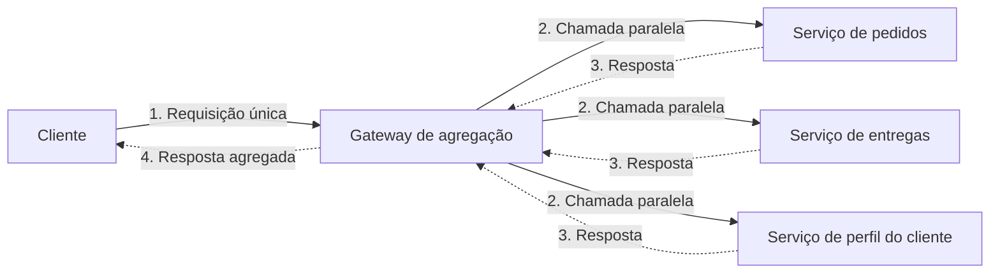

# Gateway Aggregation

## Descrição

O padrão Gateway Aggregation usa um gateway para agregar várias requisições individuais em uma única requisição. Em vez de o cliente chamar diretamente cada serviço de back-end necessário para concluir uma operação, ele envia uma só chamada ao gateway, que a decompõe, despacha as chamadas aos serviços correspondentes (de preferência em paralelo) e combina as respostas em um único payload devolvido ao cliente.

Com isso, a "conversa" (chattiness) entre cliente e back-end diminui drasticamente: o cliente faz uma ida e volta pela rede, enquanto as várias chamadas internas acontecem perto dos serviços, em uma rede de baixa latência. O gateway também concentra o tratamento de falhas transitórias, timeouts e respostas parciais, que antes ficariam espalhados por todos os clientes.

A agregação pode morar no próprio gateway (composição leve, como montar e moldar respostas) ou em um serviço de agregação dedicado atrás dele, quando há lógica de domínio, transformações complexas ou orquestrações mais longas. Como exemplo pontual, um API gateway como o Azure API Management pode compor respostas de vários serviços por meio de políticas.

## Problemas que resolve

- Clientes que precisam fazer muitas chamadas a serviços diferentes para executar uma única tarefa, consumindo recursos e conexões a cada requisição.
- Degradação de desempenho e de escala causada pelo excesso de chamadas entre cliente e back-end, agravada em arquiteturas de microsserviços.
- Ineficiência e perda de conectividade em redes de alta latência (como redes celulares), em que múltiplas requisições aumentam a chance de falha ou de respostas incompletas.
- Necessidade de alterar o cliente sempre que um novo serviço ou funcionalidade passa a fazer parte da operação.
- Superfície de exposição ampla, com muitos serviços acessíveis diretamente pelos clientes.

## Quando usar

- Quando um cliente precisa se comunicar com vários serviços de back-end para realizar uma operação.
- Quando o cliente usa redes com latência significativa, como redes móveis.
- Quando se deseja manter os serviços de back-end isolados da rede dos clientes, expondo apenas um ponto de entrada.
- Quando o back-end precisa evoluir (trocar serviços ou fontes de dados) sem impactar os contratos usados pelos clientes.

## Quando evitar

- Quando o objetivo é reduzir o número de chamadas entre um cliente e um único serviço ao longo de várias operações; nesse caso, uma operação em lote (batch) no próprio serviço tende a ser mais adequada.
- Quando o cliente ou a aplicação fica próximo dos serviços de back-end e a latência não é um fator relevante.
- Quando a agregação exigiria lógica de domínio pesada no gateway, misturando responsabilidades de roteamento, offloading e negócio.

## Trade-offs

| Ganho | Custo / Risco |
| --- | --- |
| Menos idas e voltas entre cliente e back-end, reduzindo latência percebida | O gateway adiciona um salto extra e pode virar gargalo se não escalar com a carga |
| Tratamento de falhas transitórias centralizado em vez de distribuído pelos clientes | O gateway pode se tornar um ponto único de falha (SPoF) se não for projetado para alta disponibilidade |
| Menor superfície pública e menos pontos de autenticação; back-ends isolados da rede | Risco de introduzir acoplamento entre serviços de back-end dentro da lógica de agregação |
| Back-end evolui de forma independente dos clientes | Necessidade de decidir e documentar o comportamento diante de respostas parciais ou falhas |
| Cache na camada de agregação reduz chamadas aos serviços | Mais um componente para operar, testar sob carga e monitorar |

- **Latência:** posicione o gateway perto dos serviços de back-end e use I/O assíncrono e chamadas paralelas para que um serviço lento não trave toda a resposta.
- **Resiliência:** aplique bulkheads, circuit breakers, retries e timeouts por chamada; faça testes de carga para evitar falhas em cascata.
- **Respostas parciais:** defina explicitamente se a operação retorna dados parciais quando um serviço excede o timeout ou se falha por completo quando a consistência é obrigatória.
- **Cache como failover:** considere devolver dados em cache quando um back-end estiver indisponível.
- **Separação de responsabilidades:** prefira um serviço de agregação atrás do gateway quando a agregação tiver requisitos de recursos diferentes das funções de roteamento e offloading.
- **Observabilidade:** use rastreamento distribuído com IDs de correlação para acompanhar cada chamada individual, e monitore métricas de requisição, latência por dependência e tamanho das respostas.

## Diagrama

O cliente envia uma única requisição ao gateway, que dispara chamadas paralelas aos serviços de back-end, combina os resultados e devolve uma só resposta. Os serviços permanecem ocultos do cliente e as múltiplas chamadas ocorrem dentro da rede de baixa latência.

## Padrões relacionados

- [Backends for Frontends](/architecture/cloud-design-patterns/gateways-and-edge/backends-for-frontends) — cada front-end pode ter seu próprio gateway que agrega dados conforme as necessidades específicas do cliente.
- [Gateway Offloading](/architecture/cloud-design-patterns/gateways-and-edge/gateway-offloading) — transfere ao gateway funcionalidades transversais (TLS, autenticação), frequentemente combinado com a agregação.
- [Gateway Routing](/architecture/cloud-design-patterns/gateways-and-edge/gateway-routing) — roteia requisições a vários serviços por um único endpoint; a agregação vai além ao combinar as respostas.
- [Circuit Breaker](/architecture/cloud-design-patterns/resiliency/circuit-breaker) — evita que o gateway continue chamando um serviço com falha e provoque falhas em cascata.
- [Retry](/architecture/cloud-design-patterns/resiliency/retry) — trata falhas transitórias de forma centralizada nas chamadas feitas pelo gateway.
- [Bulkhead](/architecture/cloud-design-patterns/resiliency/bulkhead) — isola recursos por serviço de back-end para que a lentidão de um não esgote o gateway.
- [Cache-Aside](/architecture/cloud-design-patterns/data-management/cache-aside) — permite servir dados em cache na camada de agregação, reduzindo chamadas e servindo como failover.

## Referência

- [Documentação no Azure Architecture Center](https://learn.microsoft.com/en-us/azure/architecture/patterns/gateway-aggregation)
