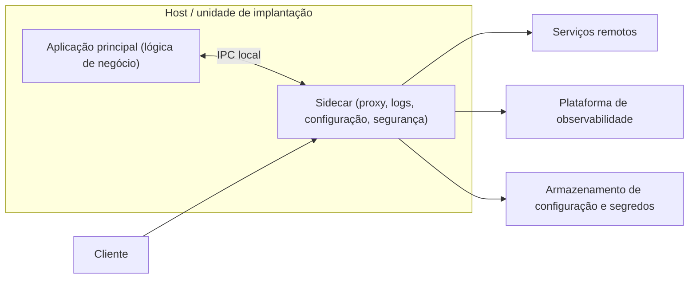

# Sidecar

## Descrição

O padrão Sidecar implanta componentes auxiliares de uma aplicação em um processo ou contêiner separado, executado ao lado da aplicação principal. Assim como o sidecar de uma motocicleta, esse componente fica acoplado à aplicação "pai" e compartilha o seu ciclo de vida: os dois são criados e removidos juntos. O padrão também é conhecido como *Sidekick*.

A aplicação principal cuida da funcionalidade de negócio, enquanto o sidecar assume tarefas periféricas e transversais, como logging, monitoramento, configuração, proxy de rede, criptografia em trânsito e abstração de serviços da plataforma. Cada instância da aplicação recebe sua própria instância de sidecar, que roda no mesmo host e se comunica com ela por um mecanismo local de comunicação entre processos (por exemplo, HTTP ou gRPC em localhost).

Como o sidecar é independente da linguagem e do runtime da aplicação, uma mesma implementação pode atender serviços escritos em tecnologias diferentes, oferecendo uma interface consistente para capacidades da plataforma. A forma mais comum de implementação usa contêineres, mas o conceito vale para qualquer processo coimplantado.

## Problemas que resolve

- Funcionalidades transversais (logging, métricas, configuração, rede) implementadas dentro do processo da aplicação, sem isolamento: uma falha nelas derruba a aplicação inteira.
- Necessidade de reimplementar bibliotecas de plataforma em cada linguagem usada pelos serviços, gerando duplicação e inconsistência.
- Latência e complexidade de implantação ao mover essas funcionalidades para serviços remotos independentes.
- Aplicações legadas ou sem mecanismos nativos de extensão que precisam ganhar novas capacidades (por exemplo, TLS mútuo, coleta de telemetria) sem alteração de código.
- Controles de segurança transversais aplicados de forma desigual entre componentes.

## Quando usar

- A aplicação principal usa linguagens e frameworks diversos e precisa de uma interface uniforme para capacidades comuns.
- Um componente pertence a outra equipe ou a um parceiro externo e deve evoluir de forma independente.
- O componente precisa rodar no mesmo host que a aplicação (por exemplo, para acessar os mesmos recursos locais).
- É necessário um serviço que compartilhe o ciclo de vida da aplicação, mas possa ser atualizado separadamente.
- Deseja-se controle fino de limites de recursos (CPU, memória) para um componente específico, isolado da aplicação.
- É preciso adicionar observabilidade ou controles de segurança sem acoplar dependências ao código da aplicação.

### Quando evitar

- A comunicação entre processos precisa ser altamente otimizada; a sobrecarga do sidecar, especialmente em latência, prejudica interações muito frequentes.
- A aplicação é pequena e o custo de recursos de um sidecar por instância supera os benefícios do isolamento.
- O componente precisa escalar de forma independente da aplicação; nesse caso, prefira um serviço separado.
- A plataforma já oferece nativamente a funcionalidade desejada, tornando o sidecar complexidade desnecessária.
- A malha de serviços disponível oferece um plano de dados sem sidecar (sidecar-less) que atende aos requisitos com menor custo.

## Trade-offs

| Ganho | Custo / Risco |
| --- | --- |
| Isolamento de falhas e de recursos entre aplicação e funcionalidades auxiliares | Consumo extra de CPU e memória em cada instância |
| Independência de linguagem e reutilização da mesma implementação | Latência adicional na comunicação entre processos |
| Superfície de ataque reduzida e controles de segurança uniformes | Mais componentes para implantar, versionar e monitorar |
| Atualização do sidecar independente da aplicação | Necessidade de coordenar ordem de inicialização e encerramento |
| Observabilidade integrada sem alterar o código | Escala sempre acoplada à da aplicação principal |

- **Ciclo de vida:** garanta que o sidecar inicie antes e termine depois da aplicação para evitar condições de corrida; algumas plataformas de orquestração oferecem suporte nativo a isso.
- **Comunicação:** prefira mecanismos de IPC agnósticos de linguagem e framework, salvo quando requisitos de desempenho exigirem algo mais específico.
- **Alternativas:** avalie se a funcionalidade não seria melhor como serviço separado, daemon tradicional ou biblioteca específica da linguagem (integração mais profunda e menos overhead de rede).
- **Empacotamento:** contêineres são o formato mais natural, mas a decisão deve considerar o modelo de implantação da plataforma.
- **Custo e complexidade operacional:** o número de sidecars cresce linearmente com as instâncias, impactando custo e gestão de versões.

## Diagrama

A aplicação principal e o sidecar rodam lado a lado no mesmo host, compartilhando ciclo de vida e recursos. O sidecar intermedeia o tráfego e trata as preocupações transversais, como chamadas a serviços remotos, envio de telemetria e obtenção de configuração, sem que a aplicação precise conhecer esses detalhes.

## Padrões relacionados

- [Ambassador](/architecture/cloud-design-patterns/integration-and-modernization/ambassador) — é uma especialização do Sidecar, atuando como proxy de saída para conectividade com serviços remotos.
- [Gateway Offloading](/architecture/cloud-design-patterns/gateways-and-edge/gateway-offloading) — também descarrega preocupações transversais, porém de forma centralizada em um gateway em vez de por instância.
- [Messaging Bridge](/architecture/cloud-design-patterns/messaging/messaging-bridge) — um sidecar pode atuar como adaptador de protocolo ou ponte entre sistemas de mensageria.
- [Anti-Corruption Layer](/architecture/cloud-design-patterns/integration-and-modernization/anti-corruption-layer) — um sidecar pode isolar a aplicação de interfaces legadas ou incompatíveis.
- [Circuit Breaker](/architecture/cloud-design-patterns/resiliency/circuit-breaker) e [Retry](/architecture/cloud-design-patterns/resiliency/retry) — comumente implementados em sidecars de proxy de rede, sem alterar o código da aplicação.
- [Health Endpoint Monitoring](/architecture/cloud-design-patterns/resiliency/health-endpoint-monitoring) — sidecars podem expor ou executar verificações de saúde em nome da aplicação.
- [External Configuration Store](/architecture/cloud-design-patterns/deployment-and-topology/external-configuration-store) — o sidecar pode obter e entregar a configuração externa à aplicação.

## Referência

- [Documentação no Azure Architecture Center](https://learn.microsoft.com/en-us/azure/architecture/patterns/sidecar)
