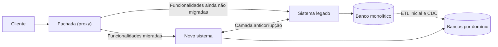

# Strangler Fig

## Descrição

O padrão Strangler Fig migra um sistema legado de forma incremental, substituindo funcionalidades específicas, uma a uma, por novas aplicações e serviços. À medida que as funcionalidades são migradas, o novo sistema passa a abranger tudo o que o antigo fazia, até que o legado possa ser desativado. O nome vem da figueira-estranguladora, que cresce ao redor de uma árvore hospedeira até substituí-la.

O mecanismo central é uma fachada (proxy) colocada entre os clientes e os sistemas. Ela intercepta as requisições e decide, por funcionalidade, se cada uma vai para o legado ou para o novo sistema. Os clientes continuam usando a mesma interface e não percebem que há uma migração em andamento.

A migração ocorre em fases: no início, a fachada encaminha quase tudo ao legado; a cada iteração, mais rotas passam para o novo sistema; quando não restam dependências, o legado é desativado; por fim, a fachada pode ser removida e os clientes passam a falar diretamente com o novo sistema (ou ela pode permanecer como adaptador para clientes antigos).

Na visão do microservices.io (Strangler Application), a pergunta é como migrar um monólito legado para microsserviços. A resposta é construir, ao redor do monólito, uma nova aplicação em arquitetura de microsserviços com dois tipos de serviço: os que assumem funcionalidades antes presentes no monólito e os que adicionam funcionalidades novas. Estes últimos são especialmente valiosos, pois mostram ao negócio o valor dos microsserviços cedo, sem depender de a migração terminar.

## Problemas que resolve

- Sistemas envelhecidos, construídos sobre ferramentas, hospedagem e arquiteturas obsoletas, que ficam cada vez mais difíceis de manter e evoluir.
- O alto risco de reescrever e substituir um sistema complexo inteiro de uma só vez ("big bang").
- A necessidade de os clientes saberem qual versão do sistema atende cada funcionalidade quando duas versões rodam em paralelo.
- Interrupções para os clientes a cada vez que uma funcionalidade muda de lugar durante a modernização.
- Como migrar um monólito legado para uma arquitetura de microsserviços sem parar a entrega de valor ao negócio.
- Bancos de dados monolíticos compartilhados por vários domínios, difíceis de decompor sem uma estratégia gradual.

## Quando usar

- Ao migrar gradualmente um back-end para uma nova arquitetura, especialmente quando substituir sistemas grandes, componentes-chave ou funcionalidades complexas é arriscado.
- Quando o sistema original pode continuar existindo por um período prolongado durante a migração.
- Quando se deseja priorizar substituições de maior retorno (ROI) antes das de menor retorno, aproveitando o investimento já feito no sistema atual.
- Ao decompor um monólito em serviços com fronteiras de domínio bem definidas.

### Quando evitar

- Quando não é possível interceptar as requisições destinadas ao back-end.
- Quando não há acesso ao código-fonte do legado nem a outro ponto de integração modificável (como o banco de dados) para desativar funcionalidades migradas e redirecionar chamadas internas.
- Em sistemas pequenos, cuja substituição completa é simples.
- Quando o sistema original precisa ser desativado rapidamente.

## Trade-offs

| Ganho | Custo / Risco |
| --- | --- |
| Migração incremental reduz o risco em comparação a uma substituição total | Duração maior da migração, com dois sistemas operando em paralelo |
| Clientes não são impactados: mesma interface durante todo o processo | Fachada pode virar ponto único de falha ou gargalo de desempenho |
| Aproveita o investimento existente e permite priorizar por ROI | Custo temporário de infraestrutura da arquitetura de transição |
| Possibilidade de rollback por funcionalidade enquanto o legado existir | Complexidade de gerenciar dados e dependências compartilhados entre os sistemas |
| Melhoria contínua com entregas pequenas e implantações seguras | Fachada precisa ser mantida em sincronia com o andamento da migração |

- **Consistência de dados:** serviços e bancos usados por ambos os sistemas precisam suportar acesso simultâneo; na extração de domínios, use carga inicial (ETL) e captura de alterações (CDC), validando a consistência antes do corte.
- **Dependências cruzadas:** o novo sistema pode precisar chamar partes ainda não migradas e vice-versa; uma camada anticorrupção evita que o novo design herde a semântica do legado.
- **Legado não modificável:** em aplicações centradas no banco de dados, gatilhos ou CDC podem notificar os novos serviços sem alterar o código da aplicação.
- **Novas funcionalidades como serviços:** em vez de acrescentar código ao monólito, implemente-as como microsserviços novos atrás da fachada; isso reduz o crescimento do legado e demonstra o valor da arquitetura cedo.
- **Design futuro:** estruture os novos serviços com fronteiras claras para que eles próprios possam ser substituídos da mesma forma no futuro.
- **Reversibilidade:** trate a remoção de objetos do legado como um passo final deliberado, executado só após a validação do novo sistema.
- **Observabilidade:** monitore a fachada e compare o comportamento entre legado e novo sistema a cada rota migrada.

## Diagrama

O cliente fala apenas com a fachada, que encaminha cada requisição ao legado ou ao novo sistema conforme o estado da migração. Com o tempo, todas as rotas apontam para o novo sistema, os dados são extraídos para bancos por domínio e o legado (e, opcionalmente, a fachada) é desativado.

## Padrões relacionados

- [Database per Service](/architecture/microservices/service-collaboration/database-per-service) — destino dos dados de cada domínio extraído do banco monolítico.
- [Anti-Corruption Layer](/architecture/cloud-design-patterns/integration-and-modernization/anti-corruption-layer) — traduz chamadas entre o novo sistema e o legado durante a coexistência, protegendo o novo design da semântica legada.
- [Gateway Routing](/architecture/cloud-design-patterns/gateways-and-edge/gateway-routing) — a fachada do Strangler Fig é essencialmente um roteamento por gateway para direcionar requisições ao sistema correto.
- [Backends for Frontends](/architecture/cloud-design-patterns/gateways-and-edge/backends-for-frontends) — pode servir como fachada específica por tipo de cliente durante a migração.
- [Materialized View](/architecture/cloud-design-patterns/data-management/materialized-view) — ajuda a expor dados do legado ao novo sistema enquanto os domínios são extraídos.
- [Event Sourcing](/architecture/cloud-design-patterns/data-management/event-sourcing) — eventos de alteração podem alimentar a sincronização de dados entre legado e novo sistema.
- [Circuit Breaker](/architecture/cloud-design-patterns/resiliency/circuit-breaker) — protege a fachada e o novo sistema contra falhas do legado ainda em uso.

## Referência

- [Documentação no Azure Architecture Center](https://learn.microsoft.com/en-us/azure/architecture/patterns/strangler-fig)
- [Strangler Application no microservices.io](https://microservices.io/patterns/refactoring/strangler-application.html)
