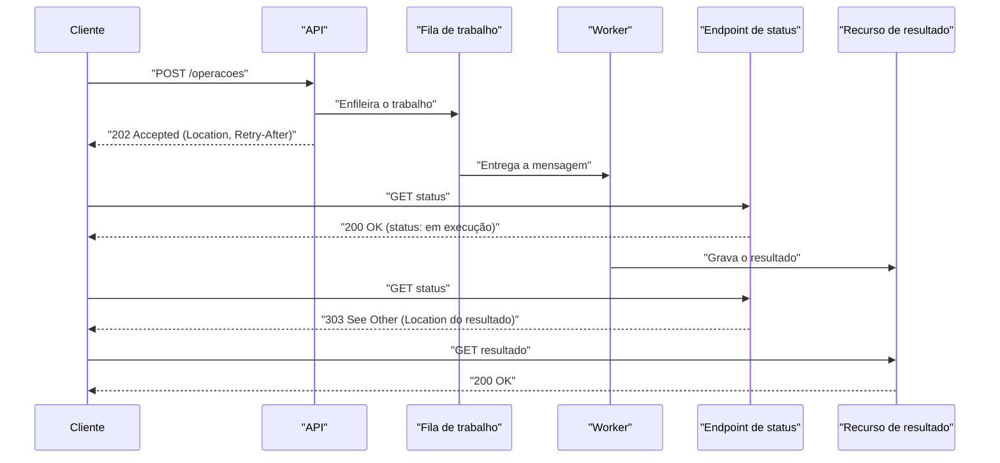

# Asynchronous Request-Reply

## Descrição

O padrão Asynchronous Request-Reply desacopla o processamento no back-end do host de front-end quando o trabalho precisa ser executado de forma assíncrona, mas o cliente ainda precisa de uma resposta clara. Em vez de manter a conexão aberta até o fim de uma operação longa, a API valida a requisição, a encaminha para processamento em segundo plano (por exemplo, por meio de uma fila) e responde imediatamente com HTTP 202 (Accepted).

A resposta 202 traz um cabeçalho `Location` apontando para um endpoint de status e, opcionalmente, um `Retry-After` sugerindo o intervalo de consulta. O cliente faz polling nesse endpoint, que retorna HTTP 200 com o estado atual da operação (pendente, em execução, concluída, com falha, cancelada). Ao terminar, o endpoint de status devolve o resultado ou redireciona com HTTP 303 (See Other) para o recurso final, que o cliente busca com um GET.

O padrão é útil principalmente quando o cliente não consegue receber callbacks (webhooks, WebSockets) e a operação demora segundos, minutos ou mais. Ele funciona tanto entre navegador e servidor quanto entre serviços em uma arquitetura de microsserviços.

## Problemas que resolve

- Operações longas que excedem timeouts de conexão HTTP, de gateways ou de balanceadores de carga
- Clientes bloqueados aguardando respostas demoradas, consumindo conexões e threads no servidor
- Impossibilidade de enviar callbacks ao cliente por restrições de firewall, NAT ou ambiente (por exemplo, código no navegador)
- Acoplamento entre a taxa de requisições recebidas e a capacidade de processamento do back-end
- Falta de visibilidade do cliente sobre o andamento e o resultado de um trabalho em segundo plano

## Quando usar

- Código no lado do cliente, como aplicações de navegador, em que é difícil expor endpoints de callback ou conexões longas adicionam complexidade demais
- Chamadas a serviços que só usam HTTP e não podem enviar callbacks por restrições de rede no cliente
- Integração com workloads que não suportam mecanismos modernos de notificação, como WebSockets ou webhooks
- Operações de longa duração (geração de relatórios, processamento de arquivos, provisionamento de recursos) expostas por uma API REST

## Quando evitar

- Quando há um serviço próprio para notificações assíncronas (por exemplo, um barramento de eventos como o Azure Event Grid)
- Quando as respostas precisam ser transmitidas em tempo real; Server-Sent Events (SSE) oferecem um canal push simples sem polling
- Quando o cliente precisa coletar muitos resultados e a latência deles é importante; um message broker tende a ser mais adequado
- Quando conexões persistentes do lado do servidor (como WebSockets) estão disponíveis para notificar o chamador
- Quando a rede permite abrir portas para receber callbacks ou webhooks
- Quando a operação é rápida o bastante para responder na mesma conexão

## Trade-offs

| Ganho | Custo / Risco |
| --- | --- |
| Resposta imediata e maior responsividade percebida | Cliente precisa implementar polling e tratar estados intermediários |
| Escalabilidade independente entre API e processadores | Mais componentes: fila, workers, armazenamento de status |
| Maior concorrência; o servidor agenda trabalho conforme a capacidade | Polling excessivo gera carga extra se `Retry-After` for ignorado |
| Evita timeouts em operações longas | Latência adicional entre a conclusão e a percepção pelo cliente |
| Visibilidade do progresso via endpoint de status | Necessidade de reter e limpar recursos de status e resultados |

- **Idempotência:** exija uma chave de idempotência (por exemplo, cabeçalho `Idempotency-Key`) para que reenvios do POST retornem o status existente em vez de criar trabalho duplicado.
- **Semântica HTTP:** prefira um endpoint de status dedicado (200 com corpo de status) a fazer polling no recurso final com 404, que é ambíguo. Use 303 em vez de 302 no redirecionamento, para evitar que clientes repitam o método original.
- **Corpo do status:** inclua campos como `status`, `createdAt`, `lastUpdatedAt`, `percentComplete` e um `error` estruturado (por exemplo, RFC 9457).
- **Validação antecipada:** valide a requisição antes de enfileirar e responda 400 (Bad Request) imediatamente se for inválida.
- **Cancelamento:** exponha DELETE no recurso de status para encaminhar o cancelamento ao back-end; avalie rollback parcial ou transação compensatória.
- **Retenção e custo:** defina política de expiração dos recursos de status e resultados (o cabeçalho `Expires` pode comunicá-la).
- **Segurança:** o `Location` pode apontar para uma URL com token de acesso limitado (Valet Key).
- **Clientes legados:** pode ser necessário um façade que esconda o processamento assíncrono de clientes que só fazem chamadas síncronas.
- **Observabilidade:** correlacione o ID da requisição entre API, fila, workers e endpoint de status.

## Diagrama

O cliente recebe 202 assim que a requisição é aceita e enfileirada, consulta o endpoint de status respeitando o `Retry-After` e, após a conclusão, é redirecionado com 303 para buscar o resultado final.

## Padrões relacionados

- [Queue-Based Load Leveling](/architecture/cloud-design-patterns/messaging/queue-based-load-leveling) — a fila entre API e workers desacopla e nivela a carga do processamento assíncrono.
- [Competing Consumers](/architecture/cloud-design-patterns/messaging/competing-consumers) — vários workers podem consumir a fila em paralelo para escalar o processamento.
- [Valet Key](/architecture/cloud-design-patterns/security-and-access/valet-key) — permite que o `Location` aponte para o resultado com acesso restrito e temporário.
- [Idempotent Consumer](/architecture/cloud-design-patterns/messaging/idempotent-consumer) — protege contra processamento duplicado quando o cliente reenvia a requisição.
- [Retry](/architecture/cloud-design-patterns/resiliency/retry) — o cliente deve repetir chamadas com backoff, respeitando o `Retry-After`.
- [Compensating Transaction](/architecture/cloud-design-patterns/distributed-coordination/compensating-transaction) — útil para desfazer trabalho parcial ao cancelar uma operação longa.
- [Claim-Check](/architecture/cloud-design-patterns/messaging/claim-check) — payloads grandes podem ser armazenados à parte e referenciados na mensagem enfileirada.
- [Backends for Frontends](/architecture/cloud-design-patterns/gateways-and-edge/backends-for-frontends) — um BFF pode encapsular o polling ou servir de façade para clientes que esperam respostas síncronas.

## Referência

- [Documentação no Azure Architecture Center](https://learn.microsoft.com/en-us/azure/architecture/patterns/asynchronous-request-reply)
