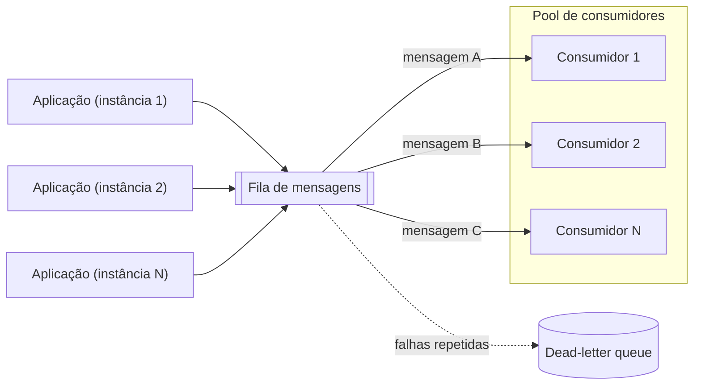

# Competing Consumers

## Descrição

O padrão Competing Consumers permite que várias instâncias consumidoras processem, de forma concorrente, mensagens recebidas pelo mesmo canal de mensageria. Os produtores publicam solicitações como mensagens em uma fila, e um pool de consumidores retira e processa essas mensagens de forma assíncrona, sem que o produtor precise saber qual instância fará o trabalho.

Cada mensagem é entregue a apenas um consumidor: as instâncias "competem" pelas mensagens disponíveis. Isso difere do [Publisher-Subscriber](/architecture/cloud-design-patterns/messaging/publisher-subscriber), em que todos os assinantes recebem todas as mensagens. A fila funciona como buffer e como mecanismo natural de balanceamento de carga: consumidores livres pegam a próxima mensagem, enquanto mensagens demoradas não bloqueiam as demais.

No Enterprise Integration Patterns (Hohpe e Woolf), o padrão é descrito como vários consumidores em um mesmo canal ponto a ponto, em que o sistema de mensageria decide qual deles recebe cada mensagem. Ele só faz sentido em canais ponto a ponto: em um canal publish-subscribe, consumidores adicionais apenas recebem cópias de cada mensagem. O EIP destaca ainda que a concorrência real exige coordenação, o que pode custar desempenho em alto volume, e que a distribuição antecipada de trabalho pode deixar um consumidor ocioso enquanto outro acumula fila. Em sistemas no estilo Kafka, o paralelismo é limitado pelo número de partições (um consumidor por partição dentro do grupo), e as mensagens são atribuídas às partições por um roteador, normalmente baseado na chave da mensagem, o que preserva a ordem de mensagens relacionadas.

Quando o sistema de mensageria oferece leitura transacional ou bloqueio temporário (por exemplo, *peek-lock*), uma mensagem cujo processamento falha volta a ficar visível e pode ser processada por outra instância. Mensagens que falham repetidamente devem ser desviadas para uma fila de mensagens mortas (*dead-letter queue*).

## Problemas que resolve

- Volume de requisições altamente variável e imprevisível, que sobrecarrega uma única instância consumidora em horários de pico.
- Processamento síncrono de requisições que bloqueia a lógica de negócio da aplicação.
- Perda de mensagens ou de trabalho quando um consumidor único falha e o produtor depende dele diretamente.
- Necessidade de coordenar múltiplos consumidores para que cada mensagem seja processada por apenas um deles, com carga distribuída de forma equilibrada.
- Superprovisionamento de capacidade para atender picos que ocorrem só ocasionalmente.

## Quando usar

- A carga de trabalho pode ser dividida em tarefas que rodam de forma assíncrona.
- As tarefas são independentes entre si e podem ser processadas em paralelo.
- O volume de trabalho varia muito e exige uma solução escalável (inclusive escalando até zero quando a fila está vazia).
- A solução precisa de alta disponibilidade e resiliência quando o processamento de uma tarefa falha.

## Quando evitar

- Não é fácil separar a carga em tarefas discretas, ou há forte dependência entre as tarefas.
- As tarefas precisam ser executadas de forma síncrona e a aplicação deve aguardar o término de cada uma antes de prosseguir.
- As tarefas precisam ser executadas em uma sequência específica (a menos que o sistema de mensageria ofereça sessões ou agrupamento que direcionem mensagens relacionadas ao mesmo consumidor).

## Trade-offs

| Ganho | Custo / Risco |
| --- | --- |
| Maior vazão por processamento paralelo | Ordem de processamento não garantida |
| Redundância: a falha de um consumidor não interrompe o processamento | Entrega "pelo menos uma vez" exige consumidores idempotentes |
| Escala elástica com base na profundidade da fila, reduzindo custo em períodos ociosos | Infraestrutura de mensageria adicional para operar e monitorar |
| Desacoplamento entre produtores e consumidores | Retorno de resultados ao produtor exige canal extra (fila de resposta ou armazenamento compartilhado) e correlação |
| Nivelamento de carga em picos | A própria fila pode virar gargalo em alta escala |

- **Ordenação:** projete o sistema para não depender da ordem das mensagens; quando a ordem importa, use sessões ou partições que fixem grupos de mensagens em um único consumidor.
- **Idempotência:** como uma mensagem pode ser processada mais de uma vez (reentregas após falhas ou timeouts), as operações devem ser idempotentes.
- **Mensagens envenenadas:** mensagens malformadas ou que dependem de recursos indisponíveis devem ser movidas para uma *dead-letter queue* após um número máximo de tentativas, em vez de voltarem à fila indefinidamente.
- **Tratamento de resultados:** se o produtor precisar do resultado, armazene-o em local acessível a ambos ou use uma fila de resposta, sinalizando claramente quando o processamento terminou.
- **Escala da mensageria:** em grande volume, particione as filas ou distribua mensagens entre várias filas para evitar que a fila vire gargalo.
- **Confiabilidade da mensageria:** use um sistema de mensagens durável que garanta que nenhuma mensagem enfileirada seja perdida.
- **Custo:** limite o número máximo de consumidores concorrentes para controlar gastos e proteger recursos compartilhados a jusante.
- **Observabilidade:** monitore profundidade da fila, idade da mensagem mais antiga, taxa de falhas e volume da *dead-letter queue*.

- **Visão do EIP:** os limites entre throughput e ordenação, e entre balanceamento e ociosidade, são intrínsecos ao padrão; consumidores que dividem partições não competem de fato, apenas dividem o trabalho de forma estática.

## Diagrama

Várias instâncias da aplicação publicam mensagens em uma única fila; cada mensagem é entregue a apenas um consumidor do pool, que pode escalar conforme a profundidade da fila. Mensagens que falham repetidamente são desviadas para a *dead-letter queue* para análise.

## Padrões relacionados

- [Queue-Based Load Leveling](/architecture/cloud-design-patterns/messaging/queue-based-load-leveling) — a fila entre produtores e consumidores absorve picos e nivela a carga.
- [Publisher-Subscriber](/architecture/cloud-design-patterns/messaging/publisher-subscriber) — contraste: no Pub/Sub todos os assinantes recebem cada mensagem; aqui, apenas um consumidor.
- [Idempotent Consumer](/architecture/cloud-design-patterns/messaging/idempotent-consumer) — garante que reentregas de mensagens não causem efeitos duplicados.
- [Priority Queue](/architecture/cloud-design-patterns/messaging/priority-queue) — permite que consumidores processem primeiro as mensagens mais importantes.
- [Sequential Convoy](/architecture/cloud-design-patterns/messaging/sequential-convoy) — processa em ordem grupos de mensagens relacionadas sem abrir mão da concorrência entre grupos.
- [Asynchronous Request-Reply](/architecture/cloud-design-patterns/messaging/asynchronous-request-reply) — forma de devolver resultados ao produtor quando o processamento é assíncrono.
- [Compute Resource Consolidation](/architecture/cloud-design-patterns/deployment-and-topology/compute-resource-consolidation) — consumidores podem ser consolidados em unidades de computação compartilhadas.
- [Point-to-Point Channel](/architecture/eip/messaging-channels/point-to-point-channel) — o tipo de canal em que os consumidores competem (EIP).
- [Message Dispatcher](/architecture/eip/messaging-endpoints/message-dispatcher) — alternativa em que um único consumidor distribui o trabalho a executores (EIP).
- [Polling Consumer](/architecture/eip/messaging-endpoints/polling-consumer) — modo de consumo possível para cada concorrente (EIP).
- [Event-Driven Consumer](/architecture/eip/messaging-endpoints/event-driven-consumer) — outro modo de consumo possível (EIP).
- [Retry](/architecture/cloud-design-patterns/resiliency/retry) — trata falhas transitórias durante o processamento das mensagens.
- [Throttling](/architecture/cloud-design-patterns/resiliency/throttling) — limita o consumo de recursos quando a escala dos consumidores pressiona serviços a jusante.

## Referência

- [Documentação no Azure Architecture Center](https://learn.microsoft.com/en-us/azure/architecture/patterns/competing-consumers)
- [Página do padrão no Enterprise Integration Patterns](https://www.enterpriseintegrationpatterns.com/CompetingConsumers.html)
