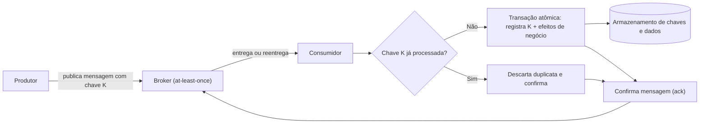

# Idempotent Consumer

## Descrição

O padrão Idempotent Consumer projeta consumidores de mensagens de forma que processar a mesma mensagem mais de uma vez produza exatamente o mesmo efeito que processá-la uma única vez. Como a maioria dos brokers oferece entrega *at-least-once* (pelo menos uma vez), duplicatas são inevitáveis; em vez de tentar eliminá-las na entrega, o consumidor passa a tolerá-las, alcançando processamento *effectively-once*.

No Enterprise Integration Patterns (Hohpe e Woolf), o padrão se chama Idempotent Receiver. O livro o apresenta como a resposta ao fato de uma mensagem poder chegar mais de uma vez, mesmo que o emissor a tenha enviado uma só vez, e descreve duas estratégias: detectar e descartar duplicatas explicitamente ou projetar a semântica das mensagens para que o reprocessamento seja inofensivo (por exemplo, mensagens que carregam o estado absoluto, e não um incremento).

O consumidor extrai de cada mensagem uma chave de deduplicação estável (um identificador atribuído pelo produtor ou uma chave de idempotência de negócio) e consulta um armazenamento persistente de chaves já processadas. Se a chave já existe, a mensagem é confirmada e descartada como duplicata, opcionalmente devolvendo o resultado registrado anteriormente. Caso contrário, a mensagem é processada e a chave é registrada na mesma operação atômica, e só então a mensagem é confirmada.

Há duas formas comuns de guardar os identificadores: em uma tabela dedicada de mensagens processadas (por exemplo, `PROCESSED_MESSAGES`, com chave primária composta por identificador do assinante e da mensagem, de modo que a inserção falha se a mensagem já foi processada) ou nas próprias entidades de negócio que o consumidor cria ou atualiza. Em caso de duplicata, a transação é revertida e a mensagem é ignorada.

No catálogo Patterns of Distributed Systems (Unmesh Joshi), o Idempotent Receiver trata o mesmo problema entre cliente e servidor de um cluster, quando o cliente não sabe se uma requisição sem resposta foi perdida ou processada e a reenvia. A solução é um registro de clientes: o servidor atribui a cada cliente um ID único e cada requisição carrega um número sequencial dentro desse cliente. O servidor guarda a resposta de cada requisição processada, indexada por cliente e número, e, ao receber uma repetição, devolve a resposta guardada sem executar a operação de novo. Em um cluster com Replicated Log, o registro de clientes e as respostas são replicados como qualquer outra entrada, para que um novo líder também reconheça duplicatas. Como o armazenamento não pode crescer sem limite, os registros expiram: respostas de requisições que o cliente já confirmou receber são descartadas, e clientes inativos por um tempo são removidos do registro (e precisam se registrar de novo).

Para que isso funcione sob concorrência, a correção é garantida pelo armazenamento de dados (restrição de unicidade, inserção condicional ou *set-if-absent*) e não por uma verificação seguida de escrita na aplicação. Quando o registro da chave e os efeitos de negócio são gravados na mesma transação, a variante é conhecida como *Inbox*, a contraparte do lado consumidor do *Transactional Outbox*.

## Problemas que resolve

- Reenvios do produtor após timeout ou falha transitória de rede, que geram duas cópias da mesma mensagem no broker.
- Reentrega pelo broker quando a confirmação (*ack*) se perde, o *lock* expira ou o consumidor cai antes de confirmar.
- Consumidor que conclui a escrita no banco mas falha antes do *ack*, fazendo outra instância repetir a operação.
- Efeitos colaterais indesejados de duplicatas: registros duplicados, cobrança em dobro do cliente, notificações repetidas.
- Consumidores concorrentes (*competing consumers*) recebendo cópias da mesma mensagem ao mesmo tempo.
- Em clusters replicados, clientes que reenviam uma requisição após timeout ou troca de líder, sem saber se ela foi aplicada, o que exige registrar clientes e respostas por número de requisição (visão de Joshi).
- Em microsserviços, onde brokers com *at-least-once* são preferidos por confiabilidade, a reentrega é esperada: consumidores não idempotentes (por exemplo, um que subtrai o valor de um evento `AccountDebited` do saldo) calculariam resultados incorretos ao processar um duplicado.

## Quando usar

- O consumidor lê de um broker com entrega *at-least-once*, o padrão da maioria dos brokers.
- Reprocessar uma mensagem pode gerar resultados incorretos, como transações financeiras duplicadas, criação duplicada de recursos ou notificações repetidas.
- Vários consumidores concorrentes processam o mesmo canal, aumentando a chance de duplicatas simultâneas.
- Fora do contexto de mensageria: pipelines ETL que reprocessam dados, processamento de streams retomado a partir de *checkpoint*, jobs agendados que se sobrepõem ou reiniciam, e endpoints de webhook/HTTP que recebem entregas duplicadas.

## Quando evitar

- As operações do consumidor já são naturalmente idempotentes (por exemplo, *upsert* por identificador de negócio, escrita de valor absoluto em vez de incremento, `PUT` em um recurso), tornando a contabilidade de deduplicação um custo sem benefício.
- A carga de trabalho tolera os efeitos de duplicatas ocasionais e o custo de manter um armazenamento de deduplicação supera o impacto de uma duplicata.

## Trade-offs

| Ganho | Custo / Risco |
| --- | --- |
| Permite usar entrega *at-least-once* e retentativas com segurança, sem corromper dados | Exige um armazenamento persistente de chaves processadas, com custo de armazenamento e uma escrita extra por mensagem |
| Duplicatas deixam de ser um risco de correção e passam a ser uma condição tolerada | Implementar corretamente armazenamento, commit atômico e limpeza é propenso a erros |
| Suporta consumidores concorrentes sem processamento em dobro | A escolha errada da chave (identificadores de transporte, timestamps, *correlation ids*) anula a deduplicação |
| Facilita a recuperação após falhas, já que reprocessar é seguro | Efeitos externos que não participam da transação exigem um fluxo em duas fases (*in-progress* / *completed*) e reconciliação de registros pendentes |

Considerações adicionais:

- **Prefira idempotência natural:** projete operações como *upserts* ou use *event-carried state transfer* (a mensagem carrega o estado absoluto resultante) e reserve a deduplicação para o que não puder ser naturalmente idempotente.
- **Atomicidade:** grave o marcador de deduplicação e os efeitos de negócio na mesma transação; gravar em passos separados abre uma janela em que uma queda deixa o efeito aplicado e a chave não registrada.
- **Concorrência:** use restrição de unicidade ou escrita condicional atômica; o padrão "verifica e depois grava" em cache tem condição de corrida.
- **Múltiplos assinantes:** em *publish-subscribe* com armazenamento compartilhado, use chave composta (identidade do consumidor + identidade da mensagem) para que um consumidor não suprima o processamento dos demais.
- **Ciclo de vida dos registros:** defina um TTL maior que a janela máxima de reentrega do broker (tentativas de entrega, *lock*/visibilidade, TTL da mensagem) e considere reenvios manuais a partir de *dead-letter queues*.
- **Deduplicação do broker não substitui o padrão:** recursos como a detecção de duplicatas do Azure Service Bus atuam no envio e dentro de uma janela limitada; ajudam a reduzir volume, mas não evitam reprocessamento após reentrega.
- **Ordenação:** deduplicar não garante ordem; combine com sessões/partições ordenadas ou dados de versão/sequência para rejeitar mensagens obsoletas.
- **Conflito de conteúdo:** se a chave já existe mas o conteúdo difere, envie para *dead-letter* e gere alerta em vez de descartar silenciosamente.
- **Observabilidade:** registre a chave de deduplicação e o identificador de correlação em logs estruturados e acompanhe uma métrica de duplicatas detectadas; um aumento pode indicar problemas no produtor, janela de *ack* subdimensionada ou consumidores instáveis.
- **Propagação:** repasse a chave de idempotência para os serviços chamados a jusante, para que cada camada possa deduplicar seu próprio trabalho.
- **Frameworks:** frameworks de mensageria costumam oferecer essa funcionalidade pronta (deduplicação, retenção e limpeza), reduzindo o risco de implementação manual.

## Diagrama

O consumidor verifica a chave de deduplicação e, se ela for nova, grava a chave e os efeitos de negócio na mesma transação atômica antes de confirmar. Quando a mesma mensagem chega de novo, a chave já existe (garantido por restrição de unicidade no armazenamento) e o consumidor apenas confirma e descarta a duplicata, sem repetir os efeitos.

## Padrões relacionados

- [Guaranteed Delivery](/architecture/eip/messaging-channels/guaranteed-delivery) — a entrega garantida do canal é o que torna as duplicatas possíveis e o receptor idempotente necessário (EIP).
- [Command Message](/architecture/eip/message-construction/command-message) — comandos reentregues são o caso típico em que a idempotência importa (EIP).
- [Competing Consumers](/architecture/cloud-design-patterns/messaging/competing-consumers) — vários consumidores concorrentes aumentam a chance de duplicatas simultâneas, que o Idempotent Consumer trata com segurança.
- [Retry](/architecture/cloud-design-patterns/resiliency/retry) — retentativas de produtores e consumidores são uma das principais origens de duplicatas; consumidores idempotentes tornam as retentativas seguras.
- [Publisher-Subscriber](/architecture/cloud-design-patterns/messaging/publisher-subscriber) — cada assinante recebe sua própria cópia e precisa rastrear o processamento de forma independente.
- [Queue-Based Load Leveling](/architecture/cloud-design-patterns/messaging/queue-based-load-leveling) — filas com entrega *at-least-once* exigem consumidores tolerantes a reentrega.
- [Sequential Convoy](/architecture/cloud-design-patterns/messaging/sequential-convoy) — complementa a deduplicação quando o processamento depende de ordem.
- [Compensating Transaction](/architecture/cloud-design-patterns/distributed-coordination/compensating-transaction) — etapas de compensação também podem ser reexecutadas e devem ser idempotentes.
- [Saga](/architecture/cloud-design-patterns/distributed-coordination/saga) — passos de uma saga coordenados por mensagens dependem de participantes idempotentes.
- [Messaging (microservices)](/architecture/microservices/communication-styles/messaging) — estilo de comunicação assíncrona cujo broker *at-least-once* torna o consumidor idempotente necessário.
- [Transactional Outbox (microservices)](/architecture/microservices/transactional-messaging/transactional-outbox) — contraparte do lado produtor; o *Inbox* é a contraparte do lado consumidor.
- [Replicated Log](/architecture/distributed-systems/data-replication/replicated-log) — o registro de clientes e as respostas guardadas são replicados no log para sobreviver à troca de líder (Patterns of Distributed Systems).
- [Request Waiting List](/architecture/distributed-systems/data-replication/request-waiting-list) — o líder acompanha requisições pendentes enquanto aguarda o commit, e o cliente pode repeti-las (Patterns of Distributed Systems).
- [Event Sourcing](/architecture/cloud-design-patterns/data-management/event-sourcing) — projeções que reprocessam eventos precisam aplicar cada evento uma única vez.

## Referência

- [Documentação no Azure Architecture Center](https://learn.microsoft.com/en-us/azure/architecture/patterns/idempotent-consumer)
- [Idempotent Consumer no microservices.io](https://microservices.io/patterns/communication-style/idempotent-consumer.html)
- [Idempotent Receiver no Enterprise Integration Patterns](https://www.enterpriseintegrationpatterns.com/IdempotentReceiver.html)
- [Idempotent Receiver no catálogo Patterns of Distributed Systems](https://martinfowler.com/articles/patterns-of-distributed-systems/idempotent-receiver.html)
