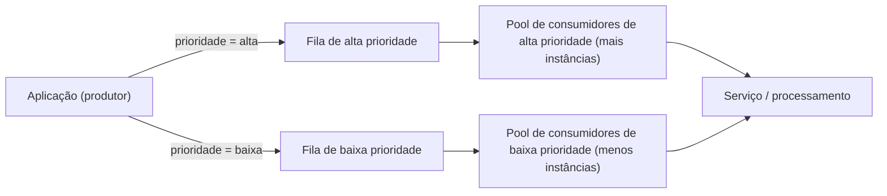

# Priority Queue

## Descrição

O padrão Priority Queue prioriza as requisições enviadas a um serviço para que as de maior prioridade sejam recebidas e processadas antes das de menor prioridade. Em vez de seguir apenas a ordem de chegada (FIFO), o produtor atribui um valor de prioridade a cada mensagem, e os consumidores processam as mensagens de acordo com essa prioridade. Isso é útil quando a aplicação oferece níveis de serviço ou SLAs diferentes para tipos de requisição ou clientes distintos.

Há duas abordagens principais. Na **fila única**, todas as mensagens vão para a mesma fila, que as ordena por prioridade, e os consumidores retiram primeiro as mais prioritárias. Nas **múltiplas filas**, cada nível de prioridade tem sua própria fila e o produtor direciona a mensagem para a fila correspondente.

Com múltiplas filas, os consumidores podem ser organizados de duas formas: um **pool único**, que sempre esvazia primeiro a fila de maior prioridade e só então atende as demais (simples de operar, mas com risco de as mensagens de baixa prioridade nunca serem processadas), ou **pools dedicados** por fila, em que as filas mais prioritárias recebem mais consumidores ou recursos mais potentes, garantindo isolamento de falhas e desempenho independente por nível.

## Problemas que resolve

- Tarefas críticas ficam presas atrás de tarefas menos importantes em uma fila FIFO, atrasando o que é urgente.
- Dificuldade de cumprir SLAs diferenciados (por exemplo, clientes premium versus padrão) com um único fluxo de processamento.
- Picos de demanda degradam igualmente todo o trabalho, inclusive operações essenciais ao negócio.
- Falta de um mecanismo para concentrar recursos de computação e esforços de confiabilidade nos fluxos mais críticos.
- Custos elevados por dimensionar toda a capacidade para o nível de serviço mais exigente.

## Quando usar

- É preciso atender objetivos de latência ou de nível de serviço diferentes para classes distintas de trabalho, como requisições de clientes premium e padrão.
- O trabalho chega em rajadas e as operações críticas precisam ser protegidas, processando primeiro as mensagens de alta prioridade e adiando as demais.
- Algumas tarefas exigem atenção imediata enquanto outras podem esperar ou ser executadas em horários de menor demanda.
- Diferentes tipos de tarefa exigem características de processamento e garantias de desempenho distintas.

### Quando evitar

- Todos os itens de trabalho têm importância de negócio semelhante e o processamento estritamente FIFO é mais importante que a priorização.
- As tarefas têm dependências fortes de ordem entre níveis de prioridade, e reordená-las causaria resultados inconsistentes ou exigiria lógica de coordenação complexa.
- O volume é baixo o suficiente para que todas as mensagens sejam processadas rapidamente, tornando a priorização uma complexidade desnecessária.

## Trade-offs

| Ganho | Custo / Risco |
| --- | --- |
| Trabalho crítico é processado com menor latência | Mensagens de baixa prioridade podem sofrer inanição (starvation) |
| Atendimento de SLAs diferenciados por cliente ou tipo de requisição | Mais filas e pools aumentam a complexidade operacional e de monitoramento |
| Pools dedicados isolam falhas entre níveis de prioridade | Custo extra com filas, consumidores e operações de leitura/consulta cobradas por chamada |
| Recursos podem ser dimensionados de acordo com a importância do trabalho | Perda da ordenação global FIFO entre mensagens de prioridades diferentes |
| Tarefas não urgentes podem ser deslocadas para horários ociosos, reduzindo custos | Necessidade de definir e governar critérios de prioridade claros |

Considerações adicionais:

- **Defina prioridades claramente:** estabeleça níveis distintos e mensuráveis (por exemplo, "alta prioridade = processar em até 10 segundos") e aloque recursos de acordo.
- **Evite inanição:** decida se todo item de alta prioridade precisa ser processado antes de qualquer item de baixa prioridade; se possível, eleve dinamicamente a prioridade de mensagens antigas (aging).
- **Escalabilidade:** ajuste o tamanho de cada pool de consumidores com base na profundidade da fila que ele atende.
- **Observabilidade:** monitore profundidade das filas, latência de processamento, contagem de entregas e vazão por nível de prioridade.
- **Mensagens problemáticas:** use filas de mensagens mortas (dead-letter) após um número configurável de tentativas para que uma mensagem defeituosa não bloqueie o caminho prioritário.
- **Preempção:** com múltiplas filas e pool único, implemente um algoritmo que garanta que as filas de maior prioridade sejam sempre atendidas primeiro.
- **Picos de demanda:** combine com Queue-Based Load Leveling quando a taxa de chegada puder superar a capacidade dos consumidores.

## Diagrama

O produtor atribui uma prioridade a cada mensagem e a envia para a fila correspondente; cada fila é atendida por um pool de consumidores dedicado, e o pool de alta prioridade dispõe de mais capacidade para processar o trabalho crítico com menor latência. Como exemplo pontual, no Azure isso pode ser feito com um tópico do Azure Service Bus com filtros por assinatura e consumidores no Azure Functions.

## Padrões relacionados

- [Queue-Based Load Leveling](/architecture/cloud-design-patterns/messaging/queue-based-load-leveling) — amortece picos de demanda antes do processamento e combina bem com a priorização.
- [Competing Consumers](/architecture/cloud-design-patterns/messaging/competing-consumers) — permite que vários consumidores processem mensagens de cada fila em paralelo, aumentando vazão e disponibilidade.
- [Throttling](/architecture/cloud-design-patterns/resiliency/throttling) — limita o consumo de recursos e pode privilegiar requisições de maior prioridade sob carga.
- [Publisher-Subscriber](/architecture/cloud-design-patterns/messaging/publisher-subscriber) — tópicos e assinaturas com filtros podem rotear mensagens para filas de diferentes prioridades.
- [Bulkhead](/architecture/cloud-design-patterns/resiliency/bulkhead) — pools de consumidores dedicados por prioridade isolam falhas entre níveis.
- [Sequential Convoy](/architecture/cloud-design-patterns/messaging/sequential-convoy) — útil quando a ordem de processamento importa, situação em que a priorização pode ser inadequada.

## Referência

- [Documentação no Azure Architecture Center](https://learn.microsoft.com/en-us/azure/architecture/patterns/priority-queue)
