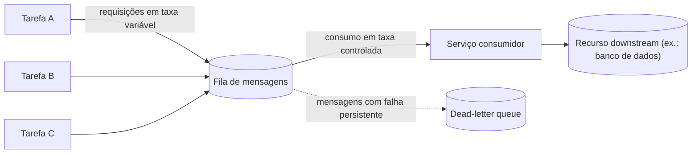

# Queue-Based Load Leveling

## Descrição

O padrão Queue-Based Load Leveling coloca uma fila entre as tarefas que geram trabalho (produtores) e o serviço que executa esse trabalho (consumidor). Em vez de chamar o serviço de forma síncrona, cada tarefa publica uma mensagem com os dados necessários na fila, que funciona como um buffer durável até que o serviço a retire e processe.

Com isso, a taxa de chegada de requisições deixa de estar acoplada à taxa de processamento. Picos intermitentes de demanda se acumulam na fila e são consumidos no ritmo que o serviço consegue sustentar, o que suaviza a carga e protege tanto o serviço quanto as tarefas que dependem dele.

Várias tarefas, gerando requisições em taxas muito variáveis, podem compartilhar a mesma fila. O número de filas e de instâncias consumidoras pode ser ajustado conforme a demanda, permitindo dimensionar o serviço para a carga média em vez da carga de pico.

## Problemas que resolve

- Picos de demanda imprevisíveis que sobrecarregam um serviço e o tornam lento ou indisponível.
- Falhas causadas por contenção quando muitas requisições concorrentes chegam ao mesmo recurso (banco de dados, cache, armazenamento, API de parceiro).
- Timeouts e throttling no chamador quando o serviço não responde a tempo.
- Indisponibilidade temporária do serviço afetando diretamente quem gera o trabalho: com a fila, as tarefas continuam publicando mensagens mesmo que o serviço esteja fora do ar.
- Superprovisionamento de infraestrutura apenas para absorver picos ocasionais.

## Quando usar

- A carga apresenta picos intermitentes que podem sobrecarregar serviços downstream.
- É desejável desacoplar a entrada de requisições da capacidade de processamento para ganhar resiliência e controlar custos.
- O serviço downstream tem limites rígidos de throughput ou aplica throttling ao atingir um limiar.
- O trabalho pode ser processado de forma assíncrona, sem que o chamador precise de resposta imediata.

## Quando evitar

- O chamador exige resposta síncrona e de baixa latência.
- O volume é previsivelmente baixo e estável, de modo que a complexidade da fila traz pouco benefício.
- A taxa média de produção supera de forma sustentada a capacidade de consumo: a fila só adia o problema, crescendo indefinidamente.

## Trade-offs

| Ganho | Custo / Risco |
| --- | --- |
| Resiliência a picos e a falhas temporárias do serviço | Latência maior entre a submissão e o processamento |
| Dimensionamento para a carga média, reduzindo custo | Mais um componente para operar, monitorar e proteger |
| Escala independente de produtores e consumidores | Comunicação de mão única; respostas exigem mecanismo adicional |
| Isolamento de falhas do processamento em relação à entrada | Entrega pelo menos uma vez exige consumidores idempotentes |
| Throughput controlado e previsível no recurso downstream | Ordem de processamento não garantida com consumidores paralelos |

Considerações adicionais:

- **Controle de taxa:** limite a taxa agregada dos consumidores. Autoescalar consumidores sem esse limite apenas transfere a sobrecarga para as dependências downstream. Teste sob carga e ajuste o número de filas e de instâncias.
- **Profundidade da fila:** monitore o tamanho e a idade das mensagens; escale consumidores dentro de limites seguros ou descarte/rejeite trabalho no produtor quando necessário.
- **Durabilidade:** escolha uma fila que persista mensagens em armazenamento durável ou replicado e conheça suas cotas de tamanho e retenção; avalie recuperação geográfica se necessário.
- **Idempotência:** como a maioria das filas entrega mensagens pelo menos uma vez, o processamento repetido deve produzir o mesmo resultado (sem registros duplicados ou cobranças repetidas).
- **Mensagens problemáticas:** direcione mensagens que falham de forma persistente para uma dead-letter queue e monitore-a para investigação e reenvio.
- **Ordenação:** se for obrigatória, use recursos como sessões ou partições ordenadas (por exemplo, message sessions no Azure Service Bus); caso contrário, projete consumidores para tratar mensagens em qualquer ordem.
- **Respostas:** se o produtor precisar de retorno, combine com uma fila de resposta ou com o padrão Asynchronous Request-Reply.

## Diagrama

Várias tarefas publicam mensagens em ritmos irregulares na mesma fila, que absorve os picos; o serviço consome as mensagens no próprio ritmo e protege o recurso downstream, enquanto mensagens que não podem ser processadas são isoladas em uma dead-letter queue.

## Padrões relacionados

- [Competing Consumers](/architecture/cloud-design-patterns/messaging/competing-consumers) — várias instâncias consomem da mesma fila para aumentar o throughput do processamento.
- [Throttling](/architecture/cloud-design-patterns/resiliency/throttling) — limita o consumo de recursos; o load leveling evita que a demanda atinja o limiar de throttling.
- [Rate Limiting](/architecture/cloud-design-patterns/resiliency/rate-limiting-pattern) — controla a taxa com que os consumidores acessam o recurso downstream.
- [Priority Queue](/architecture/cloud-design-patterns/messaging/priority-queue) — permite processar mensagens mais importantes antes das demais.
- [Asynchronous Request-Reply](/architecture/cloud-design-patterns/messaging/asynchronous-request-reply) — oferece um meio de devolver respostas ao chamador em fluxos assíncronos.
- [Idempotent Consumer](/architecture/cloud-design-patterns/messaging/idempotent-consumer) — garante que mensagens entregues mais de uma vez não causem efeitos duplicados.
- [Claim Check](/architecture/cloud-design-patterns/messaging/claim-check) — reduz o tamanho das mensagens enfileiradas armazenando o payload fora da fila.
- [Retry](/architecture/cloud-design-patterns/resiliency/retry) — trata falhas transitórias ao publicar ou processar mensagens.

## Referência

- [Documentação no Azure Architecture Center](https://learn.microsoft.com/en-us/azure/architecture/patterns/queue-based-load-leveling)
